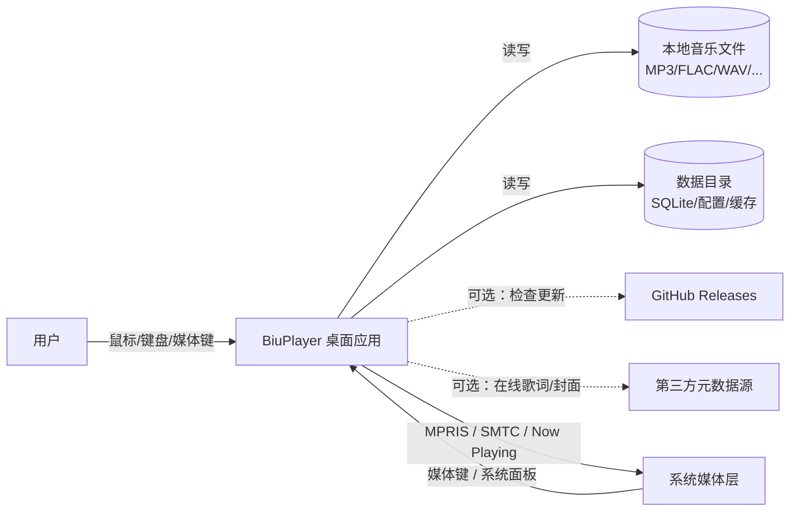
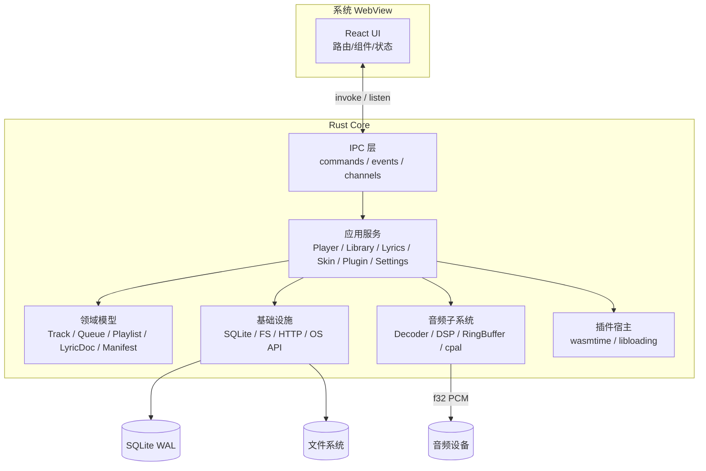
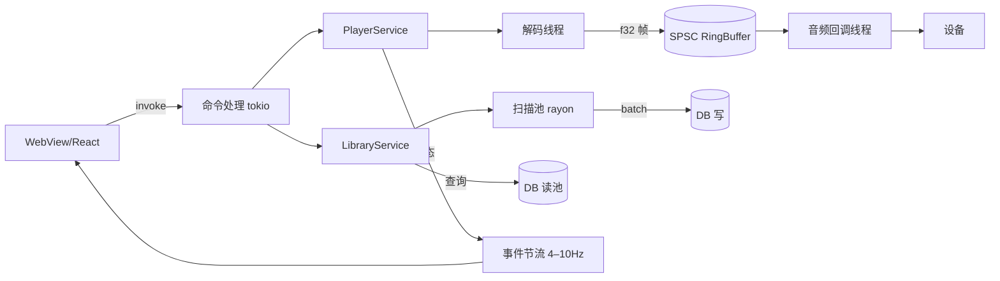
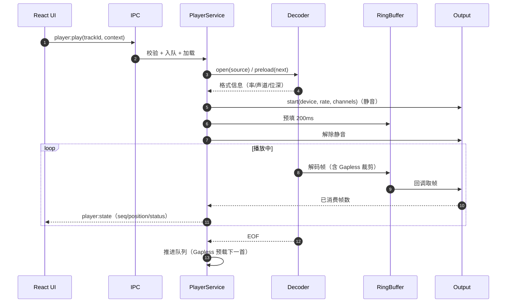
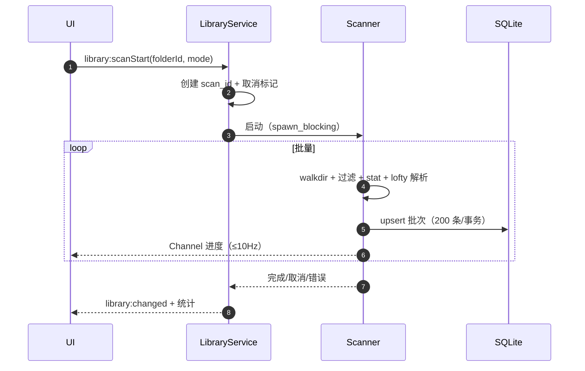
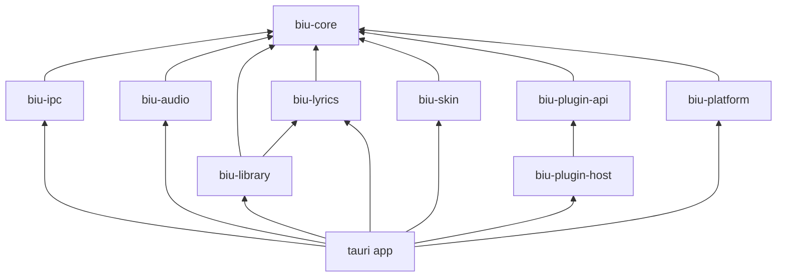
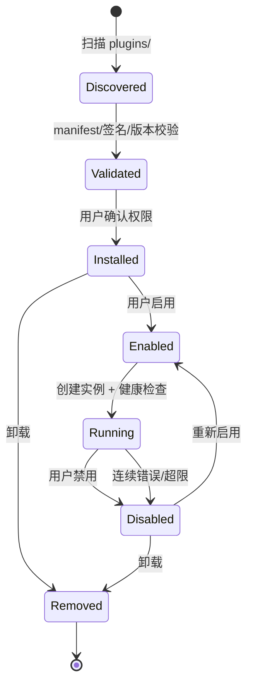
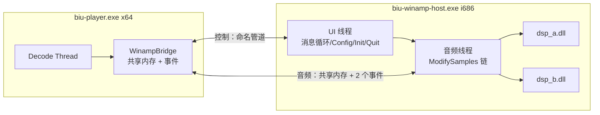
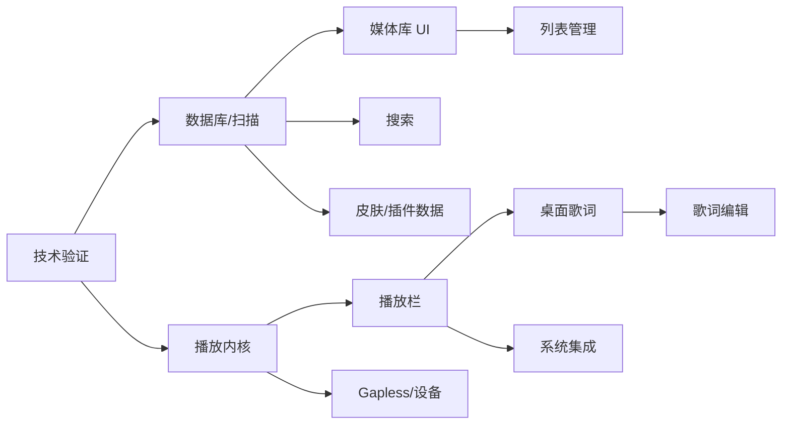

# BiuPlayer 技术架构文档

| 项 | 内容 |
|---|---|
| 文档版本 | v0.1（评审稿） |
| 日期 | 2026-11-23 |
| 状态 | 待评审 |
| 关联文档 | [docs/Idea.md](Idea.md)、[docs/FeatureList.md](FeatureList.md)、[docs/Prd.md](Prd.md) |
| 适用范围 | BiuPlayer 0.x – 1.0 |
| 读者 | 核心开发、贡献者、插件与皮肤开发者、打包维护者 |

**修订记录**

| 版本 | 日期 | 变更 |
|---|---|---|
| v0.1 | 2026-11-23 | 首版：选型、总体架构、模块设计、IPC、数据模型、安全、构建与测试 |

---

## 0. 阅读指南

- **PRD 回答“做什么”**，本文回答“怎么做、为什么这样做、边界在哪”。
- 功能编号与 [docs/FeatureList.md](FeatureList.md) 的 `F-<模块>-NN`、[docs/Prd.md](Prd.md) 的 `FR-<模块>-NN` 保持一致。
- 关键取舍以 **ADR** 记录（见 §20），正文只给结论与理由。
- 约定：**必须**（Must）为发布门槛；**应该**（Should）为默认做法，偏离需在 PR 说明；**可以**（May）为可选。
- 图中的 `WebView` 统一指 Windows WebView2、macOS WKWebView、Linux WebKitGTK。

---

## 1. 架构目标与约束

### 1.1 目标分解

| 产品目标（PRD G1–G5） | 架构手段 | 验证方式 |
|---|---|---|
| G1 本地优先、离线完整 | 零网络依赖的核心路径；网络仅用于用户显式触发的更新检查/在线歌词 | 断网全流程测试；抓包 |
| G2 原生音质与稳定播放 | Rust 解码/输出，独立实时音频线程，Gapless，位深/采样率透明 | 金样 PCM 对比、长时间播放 |
| G3 大库流畅 | SQLite + FTS5、增量扫描、虚拟列表、游标分页 | 10 万曲库基准 |
| G4 好看可换肤 | CSS 变量令牌 + `.biuskin` 包 + 布局描述 | 皮肤安装/回退测试 |
| G5 可扩展 | WASM 插件沙箱 + 版本化 API + 原生插件受控逃生口 | 示例插件、崩溃隔离测试 |
| 跨平台一致 | Tauri 2 + 平台适配层；WebView 能力基线 | 三平台矩阵 |

### 1.2 质量属性场景

| ID | 场景 | 响应度量 |
|---|---|---|
| QA-1 | 用户冷启动，库内 10 万曲 | 主窗口可交互 ≤ 3s；库列表首屏 ≤ 1s |
| QA-2 | 播放中滚动 10 万条列表 | 滚动 ≥ 55fps；播放不断音 |
| QA-3 | 扫描 1 万文件时用户切歌 | 切歌响应 ≤ 200ms；扫描可取消 |
| QA-4 | 第三方插件 panic | 主程序不崩溃；插件自动禁用并记录 |
| QA-5 | 皮肤包缺资源/非法 CSS | 回退内置皮肤；用户可见提示 |
| QA-6 | 播放中拔掉输出设备 | 自动暂停并提示；换回设备可恢复 |
| QA-7 | 数据库迁移失败 | 回滚到备份；应用仍可启动 |
| QA-8 | 断网 30 天 | 全部本地功能可用；无错误弹窗 |
| QA-9 | 恶意标签含 HTML/超长文本 | 不执行脚本；列表不崩、不卡死 |

### 1.3 硬约束

| ID | 约束 | 影响 |
|---|---|---|
| C1 | Tauri 2 依赖系统 WebView；Linux 需 WebKitGTK **4.1** | Ubuntu 22.04+ 为基线；20.04（4.0）需专项验证，见 Q1 |
| C2 | 不做代码签名/公证，预算为零 | 无法依赖系统级静默更新信任链；以 SHA256 + 构建溯源 + 文档指引替代 |
| C3 | 无账号、无遥测、默认零出站 | 诊断依赖本地日志与用户主动导出 |
| C4 | 目标低配：4 核 / 8GB / 机械硬盘可用 | 扫描与解码需限流；避免全量驻留内存 |
| C5 | 三平台：Windows x64、macOS x64/arm64、Linux x64 | 平台差异收敛到 `biu-platform` |
| C6 | 小团队维护 | 优先成熟 crate；不自研解码器/数据库/运行时 |
| C7 | Windows 安装包 ≤ 25MB（不含 WebView2） | 不随包捆绑大运行时；FFmpeg 作为可选组件 |
| C8 | 皮肤与插件是不可信输入 | 沙箱、权限、路径与资源限制 |
| C9 | 合规 | 不内置 `.ski` 解析、商业解码器、受版权保护的字体/图标；FFmpeg 可选且遵循 LGPL |

> **许可证**：代码采用 `MIT`；第三方依赖经 `cargo-deny` 审查；可选 FFmpeg 组件单独分发并附许可说明。

### 1.4 关键决策一览

| ADR | 决策 | 一句话理由 |
|---|---|---|
| ADR-001 | Tauri 2 而非 Electron | 包体/内存低一个量级，Rust 侧可承载音频 |
| ADR-002 | 音频引擎自研（cpal + symphonia） | 需要 Gapless、DSP 链与实时控制，rodio 抽象不足 |
| ADR-003 | SQLite + FTS5 | 单文件、可备份、事务与全文检索成熟 |
| ADR-004 | 前端状态二分：Zustand + TanStack Query | UI 瞬时状态与服务端式缓存职责分离 |
| ADR-005 | WASM（wasmtime）插件沙箱 | 跨平台、可限额、崩溃隔离 |
| ADR-006 | 自研 `.biuskin` 皮肤格式 | 规避 `.ski` 兼容与授权风险 |
| ADR-007 | tauri-specta 生成类型化 IPC | 编译期发现契约漂移 |
| ADR-008 | 封面走 asset 协议而非 IPC 字节 | 避免大 payload 与 base64 开销 |
| ADR-009 | rusqlite 同步 + 连接池/阻塞线程 | 编译快、SQL 可控，桌面场景足够 |
| ADR-010 | 实时音频路径无锁、无分配 | 避免爆音与优先级反转 |
| ADR-011 | Hash 路由 | 自定义协议下无 SPA fallback 依赖 |
| ADR-012 | 不启用遥测与云同步 | 隐私承诺与成本约束 |

---

## 2. 技术选型

### 2.1 选型总表

| 层 | 选型 | 版本基线 | 理由 |
|---|---|---|---|
| 应用壳 | Tauri | 2.x | 系统 WebView、Rust 后端、打包矩阵完善 |
| 前端框架 | React | 19.x | 生态、并发特性、团队熟悉度 |
| 语言 | TypeScript | 5.8+ strict | 类型安全 |
| 构建 | Vite | 7.x | 快速 HMR、Tauri 官方集成 |
| 样式 | Tailwind CSS | 4.x | 令牌化、与 shadcn 契合、产物小 |
| 组件 | shadcn/ui（Radix 原语） | 最新 | 源码可控、可主题化、无障碍基础好 |
| 路由 | React Router | 7.x（HashRouter） | 稳定、约定简单 |
| 客户端状态 | Zustand | 5.x | 轻量、选择器订阅、无 Provider 嵌套 |
| 数据缓存 | TanStack Query | 5.x | 失效/重取/游标分页模型贴合 IPC |
| 虚拟列表 | TanStack Virtual | 3.x | 固定/动态行高、10 万行可用 |
| 表单 | react-hook-form + zod | 7.x / 4.x | 性能与运行时校验 |
| i18n | i18next + react-i18next | 24.x | 命名空间、插值、运行时切换 |
| 图标/提示 | lucide-react / sonner | 最新 | 轻量、风格统一 |
| IPC 类型 | tauri-specta | 2.x | Rust → TS 类型与事件绑定生成 |
| 异步运行时 | tokio | 1.x | Tauri 默认、生态成熟 |
| 音频输出 | cpal（共享） | 0.15+ | 默认共享模式；独占由平台后端实现 |
| 解码 | symphonia | 0.5.4+ | 纯 Rust、多格式、无 GPL；AIFF 需 `aiff` feature |
| Opus | `opus` 解码 + symphonia 解 Ogg 容器 | — | 版权干净；无内置解码器 |
| 重采样 | rubato | 0.16+ | 高质量 sinc、可配置延迟 |
| 标签 | lofty | 0.22+ | 读写覆盖主流格式 |
| 数据库 | rusqlite（bundled SQLite） | 0.32+ | 无系统依赖、FTS5 可用 |
| 迁移 | rusqlite_migration | 1.x | 嵌入式、事务化 |
| 中文分词 | jieba-rs | 0.7+ | 写入/查询一致的分词 |
| 日志 | tracing + tracing-appender | 0.1 / 0.2 | 结构化、滚动、低开销 |
| HTTP | reqwest（rustls） | 0.12+ | 无 OpenSSL 依赖、易交叉编译 |
| 插件运行时 | wasmtime | 2x | 成熟、燃料/内存/中断控制 |
| Winamp2 DSP 兼容 | 独立 32 位宿主 + 共享内存桥 | — | Windows x64；i686 宿主，16bit ABI；崩溃隔离 |
| 原生插件 | libloading（C ABI） | 0.8+ | 受控逃生口 |
| 系统媒体控制 | souvlaki | 0.8+ | SMTC / MPRIS / Now Playing 一体 |
| 单实例/快捷键/通知/自启 | tauri-plugin-* | 2.x | 官方维护 |
| 测试 | cargo test / vitest / Testing Library / tauri-driver | — | 分层覆盖 |
| 质量 | ESLint 9 + Prettier 3 + rustfmt + clippy + cargo-deny | — | CI 强制 |
| CI/CD | GitHub Actions | — | 免费额度满足开源 |

### 2.2 关键取舍

**Tauri vs Electron**：Electron 自带 Chromium，体积 80MB+、内存高；Tauri 复用系统 WebView，包体可控制在 25MB 内，且 Rust 侧适合做实时音频。代价是 WebView 版本差异（尤其 Linux）与调试复杂度，通过能力基线与视觉回归缓解。

**cpal + symphonia vs rodio**：rodio 提供便捷播放器抽象，但难以精确控制预解码、Gapless 裁剪、DSP 链插入点与设备切换。自研管线换来控制力，代价是需要自己处理重采样、声道映射与错误恢复。

**rusqlite vs sqlx**：sqlx 的编译期 SQL 校验与异步友好是优点，但编译时间长、SQLite 驱动仍需阻塞线程。桌面单用户场景用 rusqlite + 连接池 + `spawn_blocking` 更简单直接。所有 SQL 参数化，禁止字符串拼接。

**wasmtime vs QuickJS**：WASM 有明确的沙箱边界、内存上限与燃料计量，适合不可信插件；QuickJS 更易做 JS 插件但隔离与限额需额外工作。1.0 以 WASM 为主，原生插件仅作为受控逃生口。

**Tailwind 4**：使用 CSS 变量与 `@theme`，构建产物小；要求 WebKitGTK ≥ 2.40（Ubuntu 22.04 为 2.44，满足）。若实测旧 WebView 出现样式缺失，回退 Tailwind 3.4 的成本被限制在样式层。

### 2.3 运行环境基线

| 项 | 基线 |
|---|---|
| Windows | 10 1809+ / 11，x64；WebView2 Evergreen |
| macOS | 11+，Intel 与 Apple Silicon |
| Linux | Ubuntu 22.04/24.04，WebKitGTK 2.44+，X11 与 Wayland |
| Node / pnpm | Node 22 LTS / pnpm 10 |
| Rust | stable，MSRV 跟随 Tauri 2（CI 固定 toolchain） |

---

## 3. 总体架构

### 3.1 系统上下文



核心路径（扫描、播放、歌词、列表）**不依赖网络**；虚线连接必须由用户显式开启，且失败不影响本地功能。

### 3.2 容器视图



### 3.3 分层职责

| 层 | 职责 | 禁止 |
|---|---|---|
| 表现层（React） | 渲染、交互、乐观更新、i18n、可访问性 | 直接读文件、拼 SQL、持有权威播放状态 |
| IPC 层 | 参数校验、权限检查、DTO 映射、错误规范化 | 业务规则 |
| 应用服务 | 用例编排、事务边界、并发控制、事件发布 | 平台细节 |
| 领域层 | 纯函数与实体规则（队列推进、LRC 解析、CUE 切分、标签归一） | 依赖 Tauri/IO，便于单测 |
| 基础设施 | SQLite、文件、解码、输出、HTTP、OS 集成 | 向上泄漏实现类型 |

依赖方向只能由外向内；`biu-core` 不依赖 `tauri`，保证可在纯 Rust 测试中复用。

### 3.4 进程与线程模型

主进程多线程 + 可选的 32 位 Winamp2 宿主进程。**实时音频线程与 UI/IO 完全隔离**是硬性设计。

| 执行体 | 数量 | 职责 | 约束 |
|---|---|---|---|
| 主线程（Tauri event loop） | 1 | 窗口、托盘、菜单、系统事件 | 不做阻塞 IO、不解码、不查询大库 |
| tokio worker | 2–4 | 命令处理、文件 IO、网络、事件分发 | 不触碰音频回调数据 |
| 音频回调线程 | 每设备 1 | 从环形缓冲取样本、写设备 | **无分配、无锁、无日志、无系统调用** |
| 解码线程 | 每播放器 1 | 解码 → 重采样 → DSP → 写环形缓冲 | 不直接操作 UI/DB |
| DB 写 | 串行（Mutex<Connection>） | 事务、批量 upsert、迁移 | 不长事务；批量 ≤ 500 行/批 |
| DB 读池 | 3 | 查询、搜索、聚合 | `spawn_blocking`，WAL 并发读 |
| 扫描池 | 2–4（rayon） | 遍历、stat、标签解析 | 不写 DB，结果交写通道 |
| 插件线程 | 每插件 1 | wasmtime 实例与调用 | 燃料/内存/时间限额 |
| Winamp2 宿主 | 0–1 进程（UI 线程 + 音频线程各 1） | 32 位 DLL 的 Config/Init/ModifySamples/Quit | 独立进程；崩溃不波及主程序；仅 Windows |



### 3.5 播放数据流



- 前端不参与音频数据传输；封面等二进制经 `asset://` 读取。
- `player:state` 4Hz 推送，前端用 `position + timestamp` 在 rAF 中插值，避免高频 IPC。

### 3.6 扫描数据流



### 3.7 启动时序

1. Tauri `setup`：解析路径 → 初始化日志 → 加载 `settings.json`（校验、坏文件备份）→ 打开数据库（迁移前备份）。
2. 启动服务：PlayerService（不打开设备）、LibraryService、PluginHost（懒加载）、SkinService（应用皮肤）。
3. 创建主窗口（若启用“启动到托盘”则仅托盘），前端挂载。
4. 前端 `app:ready` 后拉取首屏（最近播放/当前列表/库统计），恢复队列但不自动播放（可配置）。
5. 延迟任务（30s 后）：封面缓存清理、更新检查（若开启）、缺失文件检测。

目标：主窗口可交互 ≤ 2s，库首屏 ≤ 1s；扫描/索引在后台进行。

### 3.8 关闭与异常

- 正常退出：停止播放（淡出 50ms）→ 保存队列/位置/窗口状态（原子写）→ 停插件 → `PRAGMA wal_checkpoint(TRUNCATE)` → 退出。
- 强制退出/崩溃：启动时检测 `running.lock` 与 `clean_exit` 标记；异常退出提供“恢复队列/安全模式（禁用插件与第三方皮肤）/导出诊断”。
- 数据库损坏：`PRAGMA integrity_check` 失败 → 备份原文件 → 尝试 `VACUUM INTO` 抢救 → 失败则新建空库。

## 4. Rust 工程结构

### 4.1 Workspace 划分

```
src-tauri/
├── Cargo.toml                # [workspace] members = ["crates/*"]
├── build.rs
├── tauri.conf.json
├── capabilities/
│   ├── main.json
│   └── lyrics.json
├── crates/
│   ├── biu-core/             # 错误、ID、配置、路径、时间/单位、通用校验
│   ├── biu-audio/            # 解码、重采样、DSP、环形缓冲、输出、CUE、Gapless
│   ├── biu-library/          # 数据库、迁移、扫描、标签、搜索、封面、统计
│   ├── biu-lyrics/           # LRC 解析/序列化、编码检测、同步模型
│   ├── biu-skin/             # .biuskin 校验、解包、令牌、回退
│   ├── biu-plugin-api/       # 插件 ABI、manifest、权限、宿主 trait（无运行时）
│   ├── biu-plugin-host/      # wasmtime 宿主、原生加载、生命周期、限额
│   ├── biu-platform/         # 媒体控制、快捷键、电源、单实例、平台路径
│   ├── biu-ipc/              # DTO、错误码、事件名、specta 类型导出
│   └── biu-winamp-proto/     # Winamp2 宿主协议、共享内存布局（无平台依赖）
├── winamp-host/              # 独立 i686 Windows 二进制，不参与默认 workspace 构建
└── src/
    ├── main.rs               # 入口
    ├── lib.rs                # Builder 装配、setup、invoke_handler
    ├── state.rs              # AppState（Arc<Services>）
    ├── commands/             # 按域拆分的 #[tauri::command]
    │   ├── player.rs
    │   ├── library.rs
    │   ├── playlist.rs
    │   ├── lyrics.rs
    │   ├── skin.rs
    │   ├── plugin.rs
    │   ├── settings.rs
    │   └── system.rs
    └── events.rs             # 事件节流与广播
```

### 4.2 依赖规则



- `biu-core` 不依赖 `tauri`、`cpal`、`rusqlite`，只含纯类型与规则。
- `biu-audio` 不知道数据库与 UI；音源通过 `MediaSource` 抽象注入。
- `biu-library` 不依赖音频解码；标签读取用 `lofty`，时长/格式以文件头为准。
- 插件 ABI（`biu-plugin-api`）与宿主（`biu-plugin-host`）分离，便于第三方仅依赖 ABI crate。
- `winamp-host/` 是**独立 Cargo 工程**，不加入主 workspace：它必须以 `i686-pc-windows-msvc` 构建，出错进入 64 位构建会静默加载失败。CI 单独构建并作为资源打入 Windows 包。
- `biu-winamp-proto` 只含 `repr(C)` 共享内存布局、控制消息与错误码，不依赖 `windows`/`tauri`，由 32 位宿主与主程序共同依赖。

### 4.3 关键 trait（示意）

```rust
pub trait Decoder: Send {
    fn format(&self) -> AudioFormat;
    fn duration(&self) -> Option<Duration>;
    fn next(&mut self, out: &mut [f32]) -> Result<usize, DecodeError>;
    fn seek(&mut self, to: Duration) -> Result<(), DecodeError>;
    fn gapless(&self) -> GaplessInfo; // delay/padding，样本数
}

pub trait DspStage: Send {
    fn prepare(&mut self, rate: u32, channels: usize);
    fn process(&mut self, buf: &mut [f32]);
    fn reset(&mut self);
}

pub trait AudioOutput: Send {
    fn start(&mut self, cfg: OutputConfig, rx: AudioConsumer) -> Result<(), OutputError>;
    fn pause(&mut self);
    fn resume(&mut self);
    fn stop(&mut self);
    fn latency(&self) -> Duration;
}
```

约束：`DspStage::process` 与音频回调路径**不得分配、不得加锁、不得 IO**；所有可能失败的初始化在 `prepare` 完成。

### 4.4 Feature flags

| flag | 作用 | 默认 |
|---|---|---|
| `ffmpeg-sidecar` | 启用扩展格式的可选解码组件 | off |
| `native-plugins` | 允许加载原生动态库 | off（实验） |
| `wasm-plugins` | 启用 wasmtime 宿主 | on |
| `profiling` | tracing span + 帧统计 | off |
| `devtools` | 允许打开 WebView 调试器 | dev only |
| `winamp-dsp` | Winamp2 32 位 DSP 兼容宿主（仅 Windows x64） | on（Windows） |

---

## 5. 前端架构

### 5.1 目录结构

```
src/
├── app/
│   ├── main.tsx
│   ├── router.tsx
│   ├── providers.tsx
│   └── layouts/AppShell.tsx
├── features/
│   ├── player/          # 播放栏、队列、正在播放
│   ├── library/         # 曲目/专辑/艺人/流派、扫描入口
│   ├── playlists/
│   ├── lyrics/          # 歌词视图、编辑器、桌面歌词设置
│   ├── equalizer/
│   ├── skins/
│   ├── plugins/
│   ├── settings/
│   └── tools/
├── components/
│   ├── ui/              # shadcn 生成物，禁止手改
│   └── common/          # EmptyState/ErrorState/LoadingRows/CoverImage
├── lib/
│   ├── ipc/             # client.ts / bindings.ts / events.ts / errors.ts
│   ├── query/           # queryKeys、失效策略
│   ├── i18n/
│   ├── format.ts
│   └── cn.ts
├── stores/              # player.ts / ui.ts / selection.ts
├── styles/              # globals.css / tokens.css
└── types/
```

### 5.2 路由与页面

使用 `createHashRouter`（ADR-011），路由即页面编号：

| 路由 | 页面 | 加载方式 |
|---|---|---|
| `/` | P-01 正在播放 | 首屏 |
| `/library` | P-02 曲目 | 首屏（虚拟列表） |
| `/library/albums`、`/albums/:id` | P-03/P-04 | 懒加载 |
| `/library/artists`、`/artists/:id` | P-05 | 懒加载 |
| `/library/genres` | P-06 | 懒加载 |
| `/playlists`、`/playlists/:id` | P-07 | 懒加载 |
| `/search` | P-08 搜索 | 懒加载 |
| `/lyrics/:trackId` | P-09 歌词编辑 | 懒加载（编辑器较重） |
| `/equalizer` | P-10 均衡器 | 懒加载 |
| `/skins` | P-11 皮肤 | 懒加载 |
| `/plugins` | P-12 插件 | 懒加载 |
| `/settings/:section` | P-13 设置 | 懒加载 |
| `/tools` | P-14 音频工具 | 懒加载 |

> `/settings` 为重定向到 `/settings/general`；未知路由回 `/`。

### 5.3 状态管理

**权威状态在 Rust**，前端只做投影与瞬时 UI 状态。

| 状态类型 | 归属 | 工具 | 示例 |
|---|---|---|---|
| 播放状态 | Rust → 事件投影 | Zustand | 当前曲目、位置、音量、模式、队列摘要 |
| 服务端式数据 | IPC 查询 | TanStack Query | 曲目分页、专辑、歌词、插件列表 |
| 瞬时 UI | 前端 | Zustand | 选中项、侧栏折叠、弹窗、拖拽中 |
| 表单 | 组件 | react-hook-form | 标签编辑、设置项 |
| URL 状态 | 路由 | React Router | 当前视图、筛选条件（可分享/可恢复） |

**事件应用规则**：`player:state` 带单调递增 `seq`；若 `seq <= lastSeq` 丢弃。前端乐观切换（播放/暂停）进入 `pending`，收到新状态或 2s 超时后以服务端为准。

### 5.4 IPC 客户端

```ts
// lib/ipc/client.ts
export class AppError extends Error {
  constructor(readonly code: ErrorCode, message: string, readonly details?: unknown) {
    super(message);
  }
}

export async function call<T>(cmd: CommandName, args?: Record<string, unknown>): Promise<T> {
  try {
    return await invoke<T>(cmd, args);
  } catch (e) {
    throw normalizeError(e); // { code, message, details }
  }
}
```

- **命令**：请求/响应，统一 `domain:action` 命名，DTO `camelCase`。
- **事件**：`listen` 单例封装，按事件名引用计数，组件卸载自动解绑；事件在 Rust 侧节流。
- **Channel**：扫描进度、批量导入等流式结果使用 `tauri::ipc::Channel`，天然按请求隔离、可背压。
- **取消**：长任务返回 `taskId`，提供 `system:cancelTask(taskId)`；扫描另带 `scanId`。
- **超时**：仅对网络类命令设置（15s）；本地查询不设盲超时，避免大库误判。
- **大对象**：封面/音频波形不走 IPC，使用 `convertFileSrc` + `asset://`。

### 5.5 查询键与失效

| 键 | 内容 | staleTime | 失效触发 |
|---|---|---|---|
| `['tracks', filter, sort]` | 曲目分页（游标） | 30s | `library:changed`、标签更新 |
| `['albums', filter]` | 专辑列表 | 60s | `library:changed` |
| `['album', id]` | 专辑详情 | 60s | 标签更新 |
| `['artists']` / `['artist', id]` | 艺人 | 60s | `library:changed` |
| `['playlists']` / `['playlist', id]` | 列表 | 30s | `playlist:changed` |
| `['lyrics', trackId]` | 歌词 | ∞ | `lyrics:changed` |
| `['plugins']` / `['skins']` | 插件/皮肤 | 30s | 安装/卸载/启用 |
| `['winamp']` | Winamp2 插件列表/宿主状态 | 10s | `winamp:state`、添加/删除 |
| `['settings']` | 设置 | ∞ | 保存成功 |

`library:changed` 采用 300ms 防抖合并，避免扫描末尾风暴式刷新。

### 5.6 列表与渲染性能

- TanStack Virtual 固定行高（40/32px），只渲染可视区 + 10 行 overscan。
- 行组件 `memo`，props 仅传 `id` 与少量标量；选中态用 `Set<number>` + 选择器订阅，避免整表重渲染。
- 封面 ``，按显示尺寸取 128/512 缓存；无封面用确定性渐变占位。
- 拖拽使用指针事件 + `transform`，不做逐帧 React 状态更新；跨列表拖拽用 HTML5 DnD 或 pointer 方案二选一，1.0 用 pointer 以保证触控板体验。
- 大数据导入/删除使用批量命令 + 进度 Channel，不在前端循环调用单条命令。

### 5.7 主题与皮肤接入

- 语义令牌定义在 `styles/tokens.css`，Tailwind 通过 `@theme inline` 映射为工具类。
- 内置 `light`/`dark` 两套令牌；`data-theme` 控制，`prefers-color-scheme` 跟随系统。
- 第三方皮肤写入 `data-skin="<id>"` 并注入令牌 CSS 变量；布局差异由 `layout.json` 描述（区域显隐/顺序/尺寸），不执行任意 JS。
- 首屏防闪烁：`index.html` 内联极小脚本，从 `localStorage` 读取主题与皮肤标识并在首帧前设置属性。
- 禁止皮肤引用远程资源；`url()` 仅允许包内相对路径，加载前做路径归一化校验。

### 5.8 i18n 与可访问性

- 命名空间：`common`、`player`、`library`、`settings`、`errors`、`plugins`。
- 禁止拼接句子；复数用 i18next `_one/_other`；日期/数字用 `Intl`。
- CI 校验：所有 `t('key')` 在 zh-CN/en-US 存在；缺失回退英文并记录。
- 路由切换后焦点移到主标题；切歌通过 `aria-live="polite"` 播报；快捷键在输入框聚焦时禁用。

---

## 6. 音频引擎

### 6.1 管线


**缓冲策略**：环形缓冲 500ms；启动预填 200ms；欠载时输出静音并记录，连续 3 次欠载降级（增大缓冲）并提示。

**Winamp2 链路位置**：位于 Gapless Trim 之后、重采样之前，让插件看到源采样率（与 Winamp 行为一致）；链内强制立体声 i16（单声道复制、>2 声道下混），输出再交给重采样。未启用时该级直通，不增加延迟。启用后位完美/DoP 自动关闭（§6.4）。

### 6.2 格式支持矩阵

| 格式 | 解码 | 优先级 | 备注 |
|---|---|---|---|
| MP3 | symphonia | P0 | 解析 Xing/LAME 头做 Gapless |
| FLAC | symphonia | P0 | 24bit/192kHz 直通 |
| WAV | symphonia | P0 | PCM/IEEE float |
| AAC / M4A | symphonia | P0 | 解析 iTunSMPB/编辑列表 |
| ALAC | symphonia | P0 | — |
| OGG Vorbis | symphonia | P0 | — |
| AIFF | symphonia（feature `aiff`） | P0 | — |
| Opus | `opus` 绑定（symphonia 只解容器） | P1 | 无内置解码器；48kHz 内部重采样 |
| APE / WavPack / TTA / TAK | 可选组件 | P1 | ffmpeg sidecar 或原生库 |
| WMA | 可选组件 | P1 | 仅 Windows 原生或 ffmpeg |
| DSD（DSF/DFF） | 自研解析 + 抽取/DoP | P1/P2 | 先 PCM，DoP 需设备支持 |
| 网络流（HTTP） | reqwest + 增量解码 | P2 | 支持 Range/seek |

Cargo features 需显式开启：`mp3,aac,alac,aiff,isomp4,ogg,vorbis,flac,wav,pcm`（AAC/MP3/ALAC/AIFF 在 0.5.x 默认不启用）。Opus 解码需静态链接 libopus（BSD），在 CI 预编译三平台库。

探测顺序：扩展名 → 文件头魔数 → 解码器 `probe`；不信任扩展名。损坏文件在扫描阶段标记 `decode_error`，播放时跳过。

### 6.3 Gapless 与切轨

- **MP3**：读取 Xing/Info 帧的 LAME 扩展，取 encoder delay（通常 576/529）与 padding，解码后裁剪首尾样本。
- **AAC**：优先 iTunSMPB，其次 MP4 edit list；缺失时按 1024 样本粒度近似。
- **FLAC/ALAC/WAV/AIFF**：通常无编码延迟，直接按样本衔接。
- **预载**：剩余时长 < 5s 时打开下一首并预解码到独立缓冲；当前曲结束样本后立即拼接，输出设备不关闭、不 drain。
- **交叉淡入淡出**：独立 DSP 阶段，重叠区等功率曲线；开启时禁用严格 Gapless。淡入淡出时长 0–12s 可配。
- **验证**：构造 3 张连续专辑，校验总样本数 = 各曲样本数之和（容差 0）。

### 6.4 输出与设备

| 项 | 策略 |
|---|---|
| 采样格式 | 设备支持则 f32，否则 s16/i32 转换（带抖动） |
| 采样率 | 跟随设备默认；源不同则 rubato 重采样（SincFixedIn，质量可配） |
| 位完美 | P1：仅当源率=设备率、音量=1.0、DSP 全旁路且 Winamp2 链关闭时启用，否则提示并回退重采样 |
| 声道 | 单声道→双声道复制；5.1→双声道按 ITU 系数下混 |
| 设备切换 | 每 2s 轮询默认设备；变化时暂停→重开→恢复位置 |
| 独占模式 | P1：WASAPI Exclusive / CoreAudio Hog Mode / ALSA `hw:`；失败回退共享 |
| 延迟 | 默认 15ms 缓冲；“低延迟”8ms、“省电”30ms |
| 欠载 | 静音填充 + 计数；持续欠载自动增大缓冲 |

**独占后端**：cpal 只覆盖共享模式；P1 的独占/位完美通过 `AudioOutput` 的平台实现完成（Windows `wasapi` crate、macOS `coreaudio` Hog Mode、Linux `alsa` 直连 `hw:`），不满足条件时回退 cpal 共享并明示链路。该路径必须进真机矩阵（不同声卡/驱动差异大）。

**Winamp2 链约束**：任何启用的 Winamp2 DSP 插件都会把信号转成 16bit 整数并可能改变长度，因此位完美、DoP、原生 DSD 直通在其启用期间不可用；UI 在播放栏显示“DSP 链（16bit）”徽标，设置页说明原因。

### 6.5 DSP 链

固定顺序：**输入增益 → 10 段 EQ → 平衡 → 单声道/声道交换 → ReplayGain → 限幅 → 淡入淡出**。

- EQ：ISO 中心频率 31.5/63/125/250/500/1k/2k/4k/8k/16k，peaking biquad，增益 ±12dB，Q 可调；预置可保存/导入。
- ReplayGain：优先 album gain，回退 track gain；`peak` 用于限幅；无标签时可选“按 -18 LUFS 估算”（P2）。
- 限幅：前视 5ms 的软限幅，防止削波。
- 淡变：播放/暂停/切歌/seek 应用 5–50ms 斜坡，消除爆音。
- 速度/变调：rubato + 相位声码器，P2。
- 频谱：解码侧 FFT（1024 点，Hann），仅可视化可见时以 30Hz 推送 32 个频段能量，避免常驻开销。
- Winamp2 链：不在上述内置顺序内，位于重采样之前（§6.1）；链内顺序由用户在插件页调整，逐个可旁路。它运行在解码线程，允许最多 30ms 的跨进程等待，但**仍不得在音频回调中调用**。

**实时安全**：DSP 参数通过无锁命令队列传递，在音频回调的块边界应用；禁止在回调中分配或打印日志。Winamp2 桥是唯一允许在解码线程阻塞的环节，超时策略见 §10.9。

### 6.6 CUE 支持

- 解析 `FILE/TRACK/INDEX/TITLE/PERFORMER/REM DATE/GENRE`；支持单文件多轨与多文件。
- 虚拟轨：`start_sample/end_sample`，时长由样本差计算；seek 映射到物理文件偏移。
- 标签继承：专辑级字段 + 轨道级覆盖；`track_no` 使用 CUE 编号。
- 显示：专辑视图合并为一张专辑；曲目列表标注 CUE 来源；不支持编辑 CUE 内的标签（只读）。
- 边界：INDEX 00/01 的 pregap 归入前一首尾部或独立静音，默认归入前一首。

### 6.7 DSD

- DSF/DFF 解析元数据与 1bit 数据；DSD64/128/256。
- 默认转换为 PCM 176.4kHz（抽取滤波），UI 标注“DSD→PCM”。
- DoP：封装为 176.4/352.8 PCM 帧，需设备与驱动支持；不支持时自动回退。
- 不支持 DSD 时给出明确提示，不静默播放噪声。

### 6.8 错误与恢复

| 错误 | 行为 |
|---|---|
| 文件不存在 | 标记 missing，跳到下一首 |
| 解码失败 | 记录格式/位置，跳下一首；连续 3 次暂停并提示 |
| 设备丢失 | 暂停，保留位置；设备恢复后可一键继续 |
| 不支持格式 | 提示安装可选组件或转换格式 |
| 缓冲欠载 | 静音填充，自动增大缓冲 |
| 插件 DSP 异常 | 旁路该插件并禁用，主链路继续 |
| Winamp2 宿主崩溃/超时 | 3 次 30ms 超时即杀掉宿主；按 `current_slot` 归因并禁用问题插件，重启宿主加载其余插件，播放不断流（最多 1 个块静音） |

### 6.9 测试

- **金样测试**：固定 10s 片段解码为 f32，与基准哈希/逐样本容差比较（重采样路径允许 1e-4）。
- **Gapless 测试**：两张无缝专辑，断言样本总数与拼接点波形连续。
- **EQ 测试**：白噪声扫频，比较各中心频率增益误差 ≤ 0.5dB。
- **设备测试**：模拟 44.1k/48k/96k、单/双声道、欠载注入。
- **Winamp2 测试**：i686 测试插件（增益、反相、崩溃、变长）验证链顺序、旁路、归因与恢复；详见 §18。
- **长稳**：24h 循环播放 + 随机 seek，监控内存与 xrun 计数。

---

## 7. 媒体库与扫描

### 7.1 不变量

- `tracks.path` 全局唯一（规范化绝对路径）；同一文件不重复入库。
- 曲目必须属于一个 `folders` 记录；移除目录默认仅移除索引，不删文件。
- CUE 虚拟轨以 `(cue_sheet_id, cue_track_no)` 唯一，不与物理文件路径冲突。
- 标签缓存与文件真实标签可能漂移，以“最后扫描/最后写入”时间为准，UI 显示 `updated_at`。

### 7.2 扫描流程

1. **准备**：校验目录可读；写入/更新 `folders`；生成 `scan_id` 与取消标记。
2. **遍历**：`walkdir`（不跟随符号链接，跳过隐藏目录与用户排除项）；按扩展名初筛。
3. **探测**：`stat` 取 size/mtime；`lofty` 读标签与音频属性；失败则用 symphonia probe 兜底。
4. **批量入库**：每 200 条或 500ms 提交一个事务；`INSERT ... ON CONFLICT(path) DO UPDATE`。
5. **进度**：Channel 推送 `{scanId, phase, processed, total, currentPath, errors}`，≤10Hz。
6. **收尾**：标记本次未见到的曲目为 `missing`（可选“清理缺失”）；更新统计；发 `library:changed`。

**模式**：快速（mtime+size 未变则跳过标签读取）、完整（重读全部标签）、重建（清空后全量）。

**并发**：rayon 2–4 线程；DB 写串行；解析大图时限制单文件封面 ≤ 20MB，避免内存峰值。

### 7.3 增量与重命名

- 增量键：`(size, mtime_ns)`；未变则跳过。
- 重命名检测：`(size, quick_hash)`，`quick_hash` 取文件首 64KB 的 BLAKE3；Unix 额外用 inode 辅助。
- 移动目录：按 quick_hash 匹配后更新 path，保留播放次数/评分/列表引用。
- 文件监听（P1）：`notify` 监听已添加目录，2s 防抖，忽略临时文件与扫描期间的自身写入。

### 7.4 搜索

- 写入时由 Rust 生成 `search_text`：`title`、`artist`、`album` 原文，加上每段的全拼、空格分隔音节与首字母连写（如“晴天”生成 `qing tian`、`q t`、`qt`、`qingtian`）。
- FTS5 外部内容表 `tracks_fts(title, search_text, path, content='tracks', content_rowid='id')`，触发器同步。
- 查询：按空白拆词，每个词加 `*` 前缀，用 `AND` 连接后 `MATCH`，按 `bm25()` 排序；MVP 不做字段前缀与 `LIKE` 回退（P1）。
- 拼音基于 `pinyin` crate 的 `ToPinyin`，不引 jieba；中文多音字按词典默认读音。
- 目标：10 万曲目 ≤ 100ms；输入 150ms 防抖。

### 7.5 封面缓存

- 键：图片字节 BLAKE3；路径 `cache/covers/<前2位>/<hash>_<size>.webp`。
- 尺寸：128（列表）、512（详情/播放栏）；原图不落地，除非用户导出。
- 清理：LRU，上限 500MB；启动后延迟清理；正在使用的封面加引用计数。
- 内嵌封面读取加缓存（`moka` 或自研 LRU），避免重复解析大文件。

### 7.6 缺失与重复

- 缺失：播放失败或扫描未见时标记；提供“重新定位”（按文件名+大小在同目录/父目录查找）与“移除记录”。
- 重复（P1）：按 `(size, quick_hash)` 分组；展示时长/码率/路径，支持保留最优（无损 > 高码率）。
- 指纹（P2）：chromaprint，用于跨编码重复识别。

### 7.7 性能要点

| 手段 | 效果 |
|---|---|
| 游标分页 `(sort_key, id)` | 避免 OFFSET 深翻页退化 |
| 覆盖索引 | 列表页不回表 |
| 批量事务 | 1 万文件写入从分钟级降到十秒级 |
| 标签解析并行 | 多核利用 |
| 封面懒加载 | 首屏不等封面 |
| WAL + `synchronous=NORMAL` | 写入吞吐与安全平衡 |

---

## 8. 标签与元数据

### 8.1 读写能力

| 格式 | 读 | 写 | 封面 | 备注 |
|---|---|---|---|---|
| MP3（ID3v2.3/2.4） | ✅ | ✅ | ✅ | 兼容 ID3v1 回退 |
| FLAC（Vorbis Comment） | ✅ | ✅ | ✅ | 多值字段 |
| M4A/ALAC（MP4 atoms） | ✅ | ✅ | ✅ | `©nam/©ART/aART` |
| OGG/Opus | ✅ | ✅ | ✅ | — |
| WAV/AIFF | ✅ | ⚠️ | ⚠️ | 写 ID3 chunk 兼容性有限，默认只读 |
| APE/WavPack | ✅ | ⚠️ | ✅ | 写入需可选组件，默认只读 |
| WMA | ⚠️ | ❌ | ⚠️ | 仅读取基础字段 |
| DSD | ✅ | ❌ | ✅ | ID3 只读 |

### 8.2 规则

- **编码检测**：ID3v1/latin1 字段用 `chardetng` + GBK 回退；写入统一 UTF-8/UTF-16（按格式要求）。
- **多值**：艺人、流派支持多值；主艺人取第一个，`artists` 关联表保留全部。
- **归一化**：去除首尾空白、全角转半角（数字/字母）、合并连续空格；保留原始值用于显示。
- **排序字段**：`sort_title/sort_artist/sort_album` 缺省时按“去除冠词/标点”规则生成（中英文分别处理）。
- **写入策略**：仅写用户修改的字段；同目录临时文件 + 原子替换；写入前记录原文件大小/mtime，失败回滚临时文件。
- **批量编辑**：逐文件独立结果，汇总成功/失败；不做跨文件事务（无法原子）。
- **锁**：标签写入与扫描同一文件的解析互斥（按 path 的异步锁）。
- **只读格式**：UI 明确禁用编辑并说明原因，不静默失败。
- **安全**：标签内容一律按纯文本渲染；超长字段截断显示（如 4KB），不进入 DOM 的 `innerHTML`。

### 8.3 ReplayGain / 音量

- 读取 `REPLAYGAIN_TRACK_GAIN/ALBUM_GAIN/PEAK`；缺失时可后台分析（P1，需解码全曲，低优先级线程）。
- 应用顺序：RG → 用户音量 → 限幅；避免二次削波。

---

## 9. 歌词

### 9.1 来源与优先级

1. 用户编辑的同名 `.lrc`（sidecar）。
2. 内嵌歌词（ID3 USLT、FLAC LYRICS、MP4 `©lyr`）。
3. 数据库缓存（扫描时提取的内嵌副本）。
4. 在线歌词（默认关闭，P2）。

### 9.2 解析

- 支持 `[mm:ss.xx]`、`[mm:ss.xxx]`、一行多时间戳、`[offset:±ms]`、`[ti/ar/al/by]` 元数据。
- 增强格式 `<mm:ss.xx>` 逐字时间（P2）；解析失败降级为纯文本。
- 编码：UTF-8（含 BOM）、UTF-16 LE/BE、GBK/GB18030 自动检测。
- 输出 `LyricDoc { lines: Vec<LyricLine { at_ms, text, words? }>, offset_ms }`，按时间稳定排序。

### 9.3 同步与渲染

- 时钟源为播放器 `position_ms`（音频时钟），不是墙钟；暂停/seek 立即反映。
- 高亮用二分查找当前行；rAF 更新，避免 setInterval 漂移。
- 桌面歌词独立窗口：透明、置顶、可锁定点击穿透、按显示器记忆位置；通过事件接收状态，不申请文件能力。
- 长歌词自动滚动到中间；用户手动滚动后 3s 内不自动跟随。

### 9.4 编辑器

- 打轴：播放中按快捷键记录当前行时间；自动前进；支持撤销/重做。
- 微调：`±10ms/±100ms`；批量平移 offset；拖动行调整顺序。
- 保存：原子写 sidecar（UTF-8 无 BOM），保留原文件备份 `.lrc.bak`；检测 mtime 冲突，提示覆盖/另存。
- 内嵌写入：仅对支持写的格式开放；失败回退 sidecar。
- 校验：时间单调、空行、重复时间戳提示。

### 9.5 测试

- 解析器表驱动用例（含异常/多时间戳/编码）。
- 同步测试：给定位置序列，断言高亮行。
- 编辑器：打轴→保存→重载一致性。

## 10. 插件宿主

### 10.1 插件包与 manifest

```
com.example.spectrum/
├── manifest.json
├── plugin.wasm
├── ui/                  # 可选：界面插件
│   └── index.html
└── assets/
```

```json
{
  "id": "com.example.spectrum",
  "name": "Spectrum Plus",
  "version": "1.2.0",
  "apiVersion": 1,
  "minAppVersion": "0.5.0",
  "kind": "visualizer",
  "entry": "plugin.wasm",
  "permissions": ["player:read", "storage"],
  "author": "Example",
  "homepage": "https://example.com",
  "license": "MIT"
}
```

校验：`id` 反向域名、版本 SemVer、`apiVersion` 必须为宿主支持的整数、`entry` 必须位于包内且为相对路径、权限必须在白名单内、包体 ≤ 20MB、解压后总大小 ≤ 100MB（防 zip bomb）。

### 10.2 扩展点

| kind | 运行位置 | 能力 | 1.0 |
|---|---|---|---|
| `decoder` | 解码线程 | 注册新格式/容器 | P1（原生/受控） |
| `output` | 输出线程 | 自定义设备后端 | P2（原生） |
| `dsp` | 解码线程（写入环形缓冲前） | 处理 f32 帧 | P1 |
| `visualizer` | 插件线程 | 读取频谱/波形，输出 UI 数据 | P1 |
| `ui-panel` | 独立 WebView 窗口 | 展示自定义面板 | P1 |
| `lyrics-source` | tokio | 按曲目信息取歌词 | P2 |
| `metadata-source` | tokio | 补充封面/标签 | P2 |
| `import-export` | tokio | 导入导出列表/统计 | P2 |

> **DSP 插件不进实时回调**：在解码线程按 1024 帧块处理，单块预算 5ms；超预算累计 3 次自动旁路并提示。这样即使插件慢，也只影响预解码余量，不直接造成 xrun。

### 10.3 WASM ABI（v1）

为降低第三方门槛，1.0 采用**核心模块 + JSON 消息**，而非组件模型（ADR-013）：

- Guest 导出：`biu_alloc(len: i32) -> i32`、`biu_free(ptr: i32, len: i32)`、`biu_handle(op: i32, ptr: i32, len: i32) -> i64`（高 32 位指针、低 32 位长度）。
- Host 导入：`biu_log(level, ptr, len)`、`biu_kv_get(key_ptr, key_len, out_ptr) -> i32`、`biu_kv_set(...)`、`biu_track_meta(...)`、`biu_emit(event_id, ptr, len)`。
- 消息为 UTF-8 JSON，含 `apiVersion`；未知字段忽略，未知 `op` 返回 `E_UNSUPPORTED`。
- 每个插件独立 `Store` 与线性内存；**不启用 WASI**（无文件/网络/时钟），需要的能力由 host 函数代理并检查权限。

### 10.4 资源限额

| 项 | 限额 | 超限行为 |
|---|---|---|
| 线性内存 | 64MB | 实例终止 |
| 单次调用燃料 | 10M | trap，记错误 |
| 单次调用墙钟 | 50ms（UI）/ 5ms（DSP 块） | epoch 中断 |
| KV 存储 | 10MB / 插件 | 写入失败 |
| 日志 | 环形 2000 行 | 覆盖最旧 |
| 连续错误 | 3 次 | 自动禁用，通知用户 |

### 10.5 生命周期



### 10.6 原生插件（受控逃生口）

- C ABI + `libloading`；导出 `biu_plugin_init/handle/shutdown`，结构体版本化。
- 默认编译关闭（`native-plugins`），设置中需开启“允许原生插件”并二次确认。
- 加载前校验：同目录、扩展名白名单、可选 SHA256 白名单；加载后无法保证崩溃隔离，文档明确风险。
- 2.0 评估独立进程 + IPC 隔离；在此之前，原生插件仅推荐给可信开发者。

### 10.7 权限模型

| 权限 | 含义 | 敏感度 |
|---|---|---|
| `player:read` | 读取播放状态与当前曲目 | 低 |
| `player:control` | 播放/暂停/切歌/seek | 中 |
| `library:read` | 查询曲目/专辑（只读） | 中 |
| `lyrics:read` | 读取当前歌词 | 低 |
| `storage` | 插件私有 KV | 低 |
| `network` | 通过宿主发起 HTTPS 请求（域名白名单） | 高 |
| `dsp:audio` | 处理音频帧 | 高 |
| `ui:panel` | 创建面板窗口 | 中 |
| `filesystem:plugin-dir` | 读写自身目录 | 中 |

安装时逐项展示，默认全不勾选；`network` 需输入允许域名。

### 10.8 UI 插件隔离

- 独立 `WebviewWindow`，加载自定义协议 `plugin://<id>/ui/index.html`，与主界面**不同源**。
- 独立 capability 文件，仅允许事件与 `plugin_bridge:*` 命令；bridge 命令校验调用窗口 label 与插件 id 一致。
- 插件页面 CSP 禁止远程脚本；`postMessage` 仅用于窗口内 iframe（若插件自带 iframe）。
- 关闭窗口即销毁实例；不随主窗口隐藏而保留。

### 10.9 Winamp2 DSP 兼容宿主（Windows）

#### 10.9.1 约束与方案选择

Winamp2 音效插件是 **32 位 PE DLL**，导出 `winampDSPGetHeader2`；64 位进程无法用 `LoadLibrary` 加载 32 位模块，WOW64 也不提供“把 32 位 DLL 映射进 64 位地址空间”的受支持接口（[Winamp DSP.H](https://git.pikami.org/random-mirrors/winamp/src/commit/fd8ef2942fbd7cf32a1762e6e3fba29fc635e779/Src/Winamp/DSP.H)、[千千静听兼容说明](https://www.doit.com.cn/p/69909.html)）。

| 方案 | 结论 |
|---|---|
| 64 位主进程直接加载 | 不可行 |
| Windows 版整体编译为 32 位 | 否决：4GB 地址空间、依赖链与 WebView2 约束、插件崩溃直接拖垮播放器 |
| 独立 32 位宿主 + 进程间音频桥 | **采用**：主程序保持 x64，插件崩溃可隔离，可单独重启 |
| Wine / 指令转译 | 不支持；macOS/Linux 不提供该能力 |

宿主 `biu-winamp-host.exe` 以 `i686-pc-windows-msvc` 构建，随 Windows x64 包分发，在 WOW64 下运行。Windows ARM64 依赖 x86 仿真，标为实验性；macOS/Linux 隐藏入口。

#### 10.9.2 进程与线程模型



- 主程序 `biu-audio::winamp` 在解码线程调用 `process(&mut [i16])`；等待上限 30ms，失败按 §10.9.6 处理。**不在 cpal 回调中调用**。
- 宿主 UI 线程负责窗口消息、`Config`、`Init`、`Quit`；音频线程只跑 `ModifySamples` 链，单线程顺序调用，避免插件不可重入问题。
- 宿主由主程序通过 Job Object（`JOB_OBJECT_LIMIT_KILL_ON_JOB_CLOSE` + 进程内存上限 512MB）托管；主程序退出/崩溃时宿主随之终止。
- 端口命名带 128 位随机 token：`\\.\pipe\biu-winamp-<token>`、`Local\biu-winamp-shm-<token>`、`Local\biu-winamp-in-<token>`、`Local\biu-winamp-out-<token>`；管道 ACL 仅当前用户。

#### 10.9.3 ABI 与调用契约

```c
typedef struct winampDSPModule {
  char *description;
  HWND hwndParent;                 // 由宿主填写：每个插件槽一个隐藏父窗口
  HINSTANCE hDllInstance;          // 由宿主填写
  void (__cdecl *Config)(struct winampDSPModule *);          // 可空
  int  (__cdecl *Init)(struct winampDSPModule *);            // 0 = 成功
  int  (__cdecl *ModifySamples)(struct winampDSPModule *,
        short int *samples, int numsamples, int bps, int nch, int srate);
  void (__cdecl *Quit)(struct winampDSPModule *);            // 可空
  void *userData;
} winampDSPModule;

typedef struct winampDSPHeader {
  int version;                     // 0x20 / 0x21 / 0x22
  char *description;
  winampDSPModule *(__cdecl *getModule)(int index);
} winampDSPHeader;
```

- 导出函数按 `extern "C" fn(HWND) -> *mut winampDSPHeader` 调用：0x20 插件忽略多余参数，0x22 插件可拿到宿主窗口；`cdecl` 由调用方清栈。
- 校验：`version >= 0x20`、`getModule(0) != null`、`Init` 返回 0；`Config`/`Quit` 为空则跳过。`description` 只读，超长截断。
- `numsamples` 是**每声道帧数**（MP3 常见 576）；缓冲区按 2× 帧分配，返回值允许 0.5×–2×。`bps=16`、`nch=2`（强制立体声）、`srate` 为源采样率；样本为交错 `i16`。
- 插件通过 `hwndParent` 收到的 `WM_WA_IPC` 由宿主窗口过程应答最小集合（版本、播放位置/列表位置返回 0，标题返回空串）；不转发给主程序，避免跨进程指针与重入。
- 不支持：依赖 `winamp.exe` 模块/注册表/完整 IPC 的插件；此类插件在日志中标记 `winamp_ipc_unsupported`。

#### 10.9.4 多插件链

- 链上限 8 个，顺序由用户拖拽；每个槽可独立启用/旁路/配置。宿主按顺序把上一级输出作为下一级输入，等价于千千静听的多插件链。
- **等长插件**（返回帧数 = 输入）完全支持，可任意组合。
- **变长插件**（返回 0.5×–2×，如变速/时间伸缩）只允许放在链尾；启用时进入“变速模式”：关闭 Gapless、时间轴按输出帧计数、seek 允许近似。链中非末位返回变长时，宿主截断/补静音到输入长度并报 `E_WINAMP`（`details.reason = "varlen"`），UI 标记“建议置于链尾”。
- 单块 1024 帧；共享缓冲容量 2048 帧/声道。任一级输出超过容量即截断并报错，防止 2^N 膨胀。
- 切歌不重置插件（与 Winamp 一致）；seek 默认只清空桥缓冲，可在插件兼容选项里开启“seek 时重置插件状态”。

#### 10.9.5 共享内存与事件

```rust
#[repr(C)]
pub struct WinampShm {
    magic: u32,          // b"BIUW"
    abi: u32,            // 1
    seq: u32,            // 每次请求 +1
    status: u32,         // 0 idle / 1 request / 2 done / 3 error
    frames_in: u32,
    frames_out: u32,
    channels: u32,       // 固定 2
    sample_rate: u32,
    bank: u32,           // 0/1 双缓冲
    current_plugin: i32, // 崩溃归因：正在调用的槽
    error: i32,          // WinampError
    capacity_frames: u32,// 2048
}
```

- 数据区：`in[2][2048 * 2]` 与 `out[2][2048 * 2]`（`i16`），按 `bank` 选择；主程序写入后 `SetEvent(in)`，宿主处理完 `SetEvent(out)`。
- 控制管道：长度前缀 JSON；请求带 `id`，响应/事件带同一 `id`。命令：`hello`、`load`、`unload`、`set_chain`、`set_format`、`open_config`、`reset`、`shutdown`；事件：`loaded`、`error`、`config_closed`、`bye`。
- 超时：`WaitForSingleObject(out, 30ms)`；连续 3 次超时或管道 EOF，判定宿主失效。

#### 10.9.6 故障归因与恢复

1. 宿主在每次调用 `ModifySamples` 前把 `current_plugin` 写入共享头。
2. 主程序检测到进程退出/超时，读取 `current_plugin`，把该槽标记为 `crashed` 并禁用。
3. 杀掉宿主（Job Object 兜底），重新启动并只加载剩余插件；当前块以静音补齐，播放不中断。
4. 同一插件再次崩溃则永久禁用，提示查看日志；连续 2 次宿主启动失败进入“Winamp2 兼容不可用”状态，不影响普通播放。
5. 崩溃信息写入本地日志与 `winamp-host.log`；诊断包附带宿主版本、插件路径与 SHA256，不包含音频数据。

#### 10.9.7 UI 与数据

- 设置 → 插件 → “Winamp 音效”标签：添加 DLL（多选）、列表（名称/版本/位数/状态）、拖拽排序、启用/旁路、配置、移除、重新加载宿主。
- 添加时读取 PE 头：`IMAGE_FILE_MACHINE_I386` 才接受；`AMD64`/`ARM64` 明确提示“不是 32 位 Winamp2 插件”。计算 SHA256，记录路径与添加时间。
- 配置窗口由宿主创建并显示为独立顶层窗口（标题 `<插件名> 配置`），不嵌入 Tauri 窗口，避免跨进程 `SetParent` 的 DPI/输入问题；关闭后回到设置页。
- 数据库表 `winamp_dsp` 保存路径/哈希/顺序/启用状态/最后错误；插件自己的 INI/注册表配置不代管、不备份。

#### 10.9.8 安全与许可

- 加载即执行任意原生代码，**不是安全沙箱**；首次添加需二次确认，文案明确“仅安装你信任的插件”。
- 只用绝对路径 + `LoadLibraryExW(..., LOAD_LIBRARY_SEARCH_DLL_LOAD_DIR | LOAD_LIBRARY_SEARCH_SYSTEM32)`；先 `SetDefaultDllDirectories` 限制搜索路径，降低 DLL 劫持。
- 不自动扫描 Winamp 插件目录、不从网络位置加载、不随包分发任何第三方 DLL；插件许可与稳定性由用户负责。
- 宿主不以管理员权限运行；Job Object 限制内存与子进程（如可行），但不承诺阻断插件的外部行为。

#### 10.9.9 构建、打包与测试

- `src-tauri/winamp-host/` 是独立 Cargo 工程，`rustup target add i686-pc-windows-msvc` 后构建；静态 CRT（`+crt-static`），产物目标 < 3MB。
- CI 新增 `build-winamp-host`（windows-latest），产物作为 Tauri `bundle.resources` 打入 NSIS 与 zip；主程序通过 `resource_dir()/winamp-host/biu-winamp-host.exe` 定位。
- 测试夹具：i686 的 `dsp_gain.dll`、`dsp_invert.dll`、`dsp_crash.dll`、`dsp_varlen.dll`；`biu-winamp-host --selftest` 在 CI 跑链顺序、旁路、变长、崩溃归因。
- 手工矩阵：Win10 1809/22H2、Win11 x64；ARM64 仅记录结果，不作为发布门槛。

---

## 11. 皮肤引擎

### 11.1 包结构

```
com.example.dark/
├── manifest.json
├── tokens.json
├── layout.json
└── assets/
    ├── cover-fallback.webp
    └── noise.png
```

```json
{
  "id": "com.example.dark",
  "name": "Midnight",
  "version": "1.0.0",
  "schemaVersion": 1,
  "author": "Example",
  "dark": true,
  "tokens": "tokens.json",
  "layout": "layout.json"
}
```

### 11.2 令牌

`tokens.json` 只允许白名单键，值为受限格式：

```json
{
  "color": {
    "bg": "#0b0d12",
    "surface": "#141821",
    "text": "#e8ecf4",
    "muted": "#98a2b3",
    "primary": "#5b8cff",
    "border": "rgba(255,255,255,0.08)"
  },
  "radius": { "sm": "6px", "md": "10px", "lg": "16px" },
  "font": { "ui": "system-ui", "lyrics": "system-ui" },
  "player": { "barHeight": "72px", "coverSize": "48px" }
}
```

校验：颜色仅 `#rgb/#rrggbb/#rrggbbaa/rgb()/rgba()/hsl()`；长度仅 `px/rem/%`；字体仅本地字体族，禁止 `url()`；未知键忽略并警告。

### 11.3 布局

`layout.json` 描述区域显隐、顺序与尺寸，不执行代码：

```json
{
  "regions": ["sidebar", "main", "playerBar"],
  "sidebar": { "visible": true, "width": "220px", "position": "left" },
  "playerBar": { "visible": true, "height": "72px" },
  "main": { "padding": "16px" }
}
```

非法布局（缺主区域、尺寸越界）回退默认布局并提示。

### 11.4 应用与回退

1. 解压到临时目录 → 校验 manifest/schema → 原子移动到 `skins/<id>/<version>/`。
2. 读取令牌 → 生成 `:root[data-skin="<id>"] { --biu-*: ... }` 样式表 → 注入。
3. 应用布局 → 广播 `skin:changed` 给所有窗口（含桌面歌词）。
4. 任一阶段失败：保留当前皮肤，标记该皮肤不可用，提示原因。
5. 删除当前皮肤：先切换到内置皮肤，再删除目录。

### 11.5 安全

- 包内资源仅通过自定义协议按相对路径读取，路径规范化后必须仍在包目录内。
- 禁止 `@import`、远程 `url()`、`expression()`、`javascript:`。
- 样式注入使用构造的 CSSStyleSheet，不拼接用户字符串到 `<style>` 文本（防提前闭合）。
- 包体 ≤ 20MB；图片单张 ≤ 8MB；仅允许 png/webp/jpg/svg（SVG 作为 `` 加载，不内联）。

---

## 12. 数据层

### 12.1 路径

| 平台 | 数据目录 | 缓存目录 |
|---|---|---|
| Windows | `%APPDATA%\BiuPlayer` | `%LOCALAPPDATA%\BiuPlayer\cache` |
| macOS | `~/Library/Application Support/BiuPlayer` | `~/Library/Caches/BiuPlayer` |
| Linux | `$XDG_DATA_HOME/biuplayer` 或 `~/.local/share/biuplayer` | `$XDG_CACHE_HOME/biuplayer` |
| 便携模式 | `<程序目录>/data`（检测 `portable.flag`） | `<程序目录>/data/cache` |

目录结构：

```
data/
├── settings.json
├── library.db
├── library.db-wal / -shm
├── backups/
├── lyrics/            # 用户编辑的 sidecar 副本（可选）
├── skins/
├── plugins/
├── logs/
└── cache/
    ├── covers/
    └── waveform/
```

### 12.2 配置

- `settings.json`：UTF-8、带 `schemaVersion`、原子写（临时文件 + rename）、保留 `.bak`。
- 读取失败：解析错误 → 备份坏文件为 `settings.corrupt.<ts>.json` → 使用默认值 → 提示。
- 写入节流：高频设置（音量、窗口尺寸）200ms 防抖；退出前强制落盘。
- 未知字段保留（向前兼容），未知版本拒绝降级并提示。

```json
{
  "schemaVersion": 1,
  "general": { "language": "zh-CN", "theme": "system", "skin": "builtin.dark", "startMinimized": false },
  "playback": { "mode": "sequential", "crossfadeMs": 0, "gapless": true, "resumeOnStart": true },
  "audio": { "deviceId": "default", "bufferMs": 15, "bitPerfect": false, "replayGain": "album" },
  "dsp": { "eqEnabled": false, "eqPreset": "flat", "preampDb": 0, "mono": false },
  "lyrics": { "desktop": false, "fontSize": 32, "offsetMs": 0, "source": "local" },
  "library": { "watch": true, "excludeGlobs": ["**/@eaDir/**"], "cleanMissing": false },
  "ui": { "sidebarWidth": 220, "listDensity": "comfortable", "reduceMotion": false }
}
```

### 12.3 SQLite 设置

```sql
PRAGMA journal_mode = WAL;
PRAGMA synchronous = NORMAL;
PRAGMA foreign_keys = ON;
PRAGMA busy_timeout = 5000;
PRAGMA temp_store = MEMORY;
PRAGMA cache_size = -65536;   -- 64MB
PRAGMA mmap_size = 268435456; -- 256MB
```

写连接唯一，读连接 3 个；读使用 `spawn_blocking`。批量写每 200 行或 500ms 提交。

### 12.4 核心表

```sql
CREATE TABLE schema_migrations (
  version    INTEGER PRIMARY KEY,
  applied_at INTEGER NOT NULL
);

CREATE TABLE folders (
  id           INTEGER PRIMARY KEY,
  path         TEXT NOT NULL UNIQUE,
  name         TEXT NOT NULL,
  enabled      INTEGER NOT NULL DEFAULT 1,
  added_at     INTEGER NOT NULL,
  last_scan_at INTEGER,
  track_count  INTEGER NOT NULL DEFAULT 0
);

CREATE TABLE artists (
  id        INTEGER PRIMARY KEY,
  name      TEXT NOT NULL,
  sort_name TEXT NOT NULL,
  name_key  TEXT NOT NULL UNIQUE
);

CREATE TABLE albums (
  id              INTEGER PRIMARY KEY,
  title           TEXT NOT NULL,
  sort_title      TEXT NOT NULL,
  album_artist_id INTEGER REFERENCES artists(id),
  year            INTEGER,
  cover_hash      TEXT,
  track_count     INTEGER NOT NULL DEFAULT 0,
  duration_ms     INTEGER NOT NULL DEFAULT 0,
  UNIQUE(title, album_artist_id)
);

CREATE TABLE cue_sheets (
  id          INTEGER PRIMARY KEY,
  path        TEXT NOT NULL UNIQUE,
  album_title TEXT,
  performer   TEXT,
  genre       TEXT,
  date        TEXT,
  mtime_ns    INTEGER NOT NULL,
  updated_at  INTEGER NOT NULL
);

CREATE TABLE tracks (
  id            INTEGER PRIMARY KEY,
  path          TEXT NOT NULL UNIQUE,
  folder_id     INTEGER NOT NULL REFERENCES folders(id) ON DELETE CASCADE,
  file_name     TEXT NOT NULL,
  ext           TEXT NOT NULL,
  size          INTEGER NOT NULL,
  mtime_ns      INTEGER NOT NULL,
  quick_hash    TEXT,
  duration_ms   INTEGER NOT NULL,
  sample_rate   INTEGER,
  channels      INTEGER,
  bit_depth     INTEGER,
  bitrate_kbps  INTEGER,
  codec         TEXT,
  lossless      INTEGER NOT NULL DEFAULT 0,
  title         TEXT NOT NULL DEFAULT '',
  sort_title    TEXT NOT NULL DEFAULT '',
  artist_display TEXT NOT NULL DEFAULT '',
  album_display  TEXT NOT NULL DEFAULT '',
  album_artist_display TEXT NOT NULL DEFAULT '',
  album_id      INTEGER REFERENCES albums(id),
  artist_id     INTEGER REFERENCES artists(id),
  genre         TEXT,
  year          INTEGER,
  track_no      INTEGER,
  disc_no       INTEGER,
  composer      TEXT,
  comment       TEXT,
  replaygain_track REAL,
  replaygain_album REAL,
  peak          REAL,
  has_cover     INTEGER NOT NULL DEFAULT 0,
  cover_hash    TEXT,
  lyrics_embedded INTEGER NOT NULL DEFAULT 0,
  cue_sheet_id  INTEGER REFERENCES cue_sheets(id),
  cue_track_no  INTEGER,
  search_text   TEXT NOT NULL DEFAULT '',
  initials      TEXT NOT NULL DEFAULT '',
  decode_error  TEXT,
  missing       INTEGER NOT NULL DEFAULT 0,
  added_at      INTEGER NOT NULL,
  updated_at    INTEGER NOT NULL
);

CREATE TABLE track_stats (
  track_id      INTEGER PRIMARY KEY REFERENCES tracks(id) ON DELETE CASCADE,
  play_count    INTEGER NOT NULL DEFAULT 0,
  skip_count    INTEGER NOT NULL DEFAULT 0,
  last_played_at INTEGER,
  rating        INTEGER NOT NULL DEFAULT 0,   -- 0..5
  favorite      INTEGER NOT NULL DEFAULT 0
);

CREATE TABLE track_artists (
  track_id  INTEGER NOT NULL REFERENCES tracks(id) ON DELETE CASCADE,
  artist_id INTEGER NOT NULL REFERENCES artists(id) ON DELETE CASCADE,
  role      TEXT NOT NULL DEFAULT 'main',
  position  INTEGER NOT NULL DEFAULT 0,
  PRIMARY KEY (track_id, artist_id, role)
);

CREATE TABLE playlists (
  id          INTEGER PRIMARY KEY,
  name        TEXT NOT NULL,
  kind        TEXT NOT NULL DEFAULT 'static', -- static | smart
  rules_json  TEXT,
  sort_order  INTEGER NOT NULL DEFAULT 0,
  created_at  INTEGER NOT NULL,
  updated_at  INTEGER NOT NULL
);

CREATE TABLE playlist_items (
  playlist_id INTEGER NOT NULL REFERENCES playlists(id) ON DELETE CASCADE,
  track_id    INTEGER NOT NULL REFERENCES tracks(id) ON DELETE CASCADE,
  position    INTEGER NOT NULL,               -- 间隔 1000，重排时重编号
  added_at    INTEGER NOT NULL,
  PRIMARY KEY (playlist_id, position)
);

CREATE TABLE lyrics (
  track_id   INTEGER PRIMARY KEY REFERENCES tracks(id) ON DELETE CASCADE,
  source     TEXT NOT NULL,                   -- sidecar | embedded | online | user
  content    TEXT NOT NULL,
  offset_ms  INTEGER NOT NULL DEFAULT 0,
  updated_at INTEGER NOT NULL
);

CREATE TABLE play_history (
  id         INTEGER PRIMARY KEY,
  track_id   INTEGER NOT NULL REFERENCES tracks(id) ON DELETE CASCADE,
  started_at INTEGER NOT NULL,
  played_ms  INTEGER NOT NULL,
  completed  INTEGER NOT NULL DEFAULT 0
);

CREATE TABLE plugins (
  id           TEXT PRIMARY KEY,
  name         TEXT NOT NULL,
  version      TEXT NOT NULL,
  api_version  INTEGER NOT NULL,
  kind         TEXT NOT NULL,
  path         TEXT NOT NULL,
  enabled      INTEGER NOT NULL DEFAULT 0,
  permissions  TEXT NOT NULL DEFAULT '[]',
  installed_at INTEGER NOT NULL,
  updated_at   INTEGER NOT NULL
);

CREATE TABLE plugin_kv (
  plugin_id TEXT NOT NULL,
  key       TEXT NOT NULL,
  value     BLOB NOT NULL,
  PRIMARY KEY (plugin_id, key)
);

CREATE TABLE winamp_dsp (
  id          INTEGER PRIMARY KEY,
  path        TEXT NOT NULL UNIQUE,
  name        TEXT NOT NULL,
  sha256      TEXT NOT NULL,
  enabled     INTEGER NOT NULL DEFAULT 1,
  sort_order  INTEGER NOT NULL DEFAULT 0,
  last_error  TEXT,
  added_at    INTEGER NOT NULL
);

CREATE TABLE skins (
  id           TEXT PRIMARY KEY,
  name         TEXT NOT NULL,
  version      TEXT NOT NULL,
  path         TEXT NOT NULL,
  active       INTEGER NOT NULL DEFAULT 0,
  installed_at INTEGER NOT NULL
);

CREATE TABLE eq_presets (
  id         INTEGER PRIMARY KEY,
  name       TEXT NOT NULL UNIQUE,
  gains_json TEXT NOT NULL,
  preamp_db  REAL NOT NULL DEFAULT 0,
  builtin    INTEGER NOT NULL DEFAULT 0
);
```

> `track_stats` 独立的原因：播放计数高频更新，若放在 `tracks` 会触发 FTS/索引重写并放大 WAL。评分与收藏放这里，列表查询通过 `LEFT JOIN` + 覆盖索引完成。

### 12.5 索引

```sql
CREATE INDEX idx_tracks_folder      ON tracks(folder_id);
CREATE INDEX idx_tracks_album       ON tracks(album_id, disc_no, track_no);
CREATE INDEX idx_tracks_artist      ON tracks(artist_id);
CREATE INDEX idx_tracks_sort_title  ON tracks(sort_title, id);
CREATE INDEX idx_tracks_added       ON tracks(added_at DESC, id DESC);
CREATE INDEX idx_tracks_missing     ON tracks(missing) WHERE missing = 1;
CREATE INDEX idx_stats_last_played  ON track_stats(last_played_at DESC);
CREATE INDEX idx_history_track      ON play_history(track_id, started_at DESC);
CREATE INDEX idx_items_track        ON playlist_items(track_id);
CREATE INDEX idx_winamp_order       ON winamp_dsp(sort_order, id);
```

### 12.6 全文检索

```sql
CREATE VIRTUAL TABLE tracks_fts USING fts5(
  title, search_text, path,
  content = 'tracks',
  content_rowid = 'id',
  tokenize = 'unicode61'
);

CREATE TRIGGER tracks_ai AFTER INSERT ON tracks BEGIN
  INSERT INTO tracks_fts(rowid, title, search_text, path)
  VALUES (new.id, new.title, new.search_text, new.path);
END;

CREATE TRIGGER tracks_ad AFTER DELETE ON tracks BEGIN
  INSERT INTO tracks_fts(tracks_fts, rowid, title, search_text, path)
  VALUES ('delete', old.id, old.title, old.search_text, old.path);
END;

CREATE TRIGGER tracks_au AFTER UPDATE ON tracks BEGIN
  INSERT INTO tracks_fts(tracks_fts, rowid, title, search_text, path)
  VALUES ('delete', old.id, old.title, old.search_text, old.path);
  INSERT INTO tracks_fts(rowid, title, search_text, path)
  VALUES (new.id, new.title, new.search_text, new.path);
END;
```

`search_text` 由 Rust 侧生成：`title`、`artist`、`album` 原文 + 全拼 `qing tian` + 首字母 `q t` / `qt` + 连写 `qingtian`；避免在查询时做中文分词。

### 12.7 迁移与备份

- 迁移脚本编译进二进制，版本单调递增，每个版本一个事务；`schema_migrations(version, applied_at)` 记录已应用版本。
- 启动时：`PRAGMA integrity_check` → 若 `schemaVersion < 最新` 先复制为 `library.db.bak` → 逐版本迁移 → 提交。
- 失败：关闭连接 → 用备份替换 → 记录日志 → 提示用户（保留备份文件）。
- 当前版本 2：v1 建 9 表与 FTS5，v2 增加 `tracks.search_text` 并重建 `tracks_fts`；旧库升级前自动备份。
- 用户备份：整库复制 + 设置/皮肤/插件清单；恢复需重启应用。

### 12.8 容量估算

| 数据 | 10 万曲目估算 |
|---|---|
| tracks | ~120MB（含文本与索引） |
| FTS | ~40MB |
| stats/history | ~20MB |
| 封面缓存 | 0.5–2GB（可清理） |
| 合计（不含封面） | ~200MB |

---

## 13. IPC 契约

### 13.1 约定

- 命令名 `domain:action`，参数与返回值 `camelCase`；时间为毫秒整数；路径为绝对路径字符串。
- 错误统一序列化为 `{ code, message, details?, retryable? }`；`message` 为英文开发者信息，UI 用 `code` 映射 i18n。
- 所有命令参数经 serde 校验；路径在 Rust 侧规范化并检查允许根目录。
- 版本：`app:getBootInfo` 返回 `ipcVersion`；新增字段向后兼容，删除/改语义需升版本。

### 13.2 错误码

| code | 含义 | 前端处理 |
|---|---|---|
| `E_INVALID_ARG` | 参数非法 | 表单错误 |
| `E_NOT_FOUND` | 曲目/文件/记录不存在 | 提示 + 刷新 |
| `E_PERMISSION` | 路径/能力不允许 | 提示选择目录 |
| `E_IO` | 文件读写失败 | 提示路径/权限 |
| `E_DECODE` | 解码失败 | 标记不可播 |
| `E_UNSUPPORTED` | 格式/能力不支持 | 引导安装组件 |
| `E_BUSY` | 资源忙（扫描/写标签） | 稍后重试 |
| `E_DB` | 数据库错误 | 提示导出诊断 |
| `E_PLUGIN` | 插件错误 | 展示插件日志 |
| `E_WINAMP` | Winamp2 宿主/插件错误（`details.reason`） | 展示宿主日志并禁用问题插件 |
| `E_CANCELLED` | 用户取消 | 静默 |
| `E_INTERNAL` | 未预期 | 上报本地日志 |

### 13.3 命令（按域）

| 域 | 关键命令 | 说明 |
|---|---|---|
| `app` | `app:getBootInfo`、`app:quit`、`app:checkUpdate`、`app:openExternal` | 启动信息、退出、更新、外链（白名单） |
| `player` | `player:getState`、`player:play`、`player:pause`、`player:toggle`、`player:stop`、`player:next`、`player:prev`、`player:seek`、`player:setVolume`、`player:setMode`、`player:loadQueue`、`player:enqueue`、`player:removeFromQueue`、`player:moveInQueue`、`player:clearQueue`、`player:jumpTo`、`player:getDevices`、`player:setDevice`、`player:setSpectrumEnabled` | 播放控制与队列；`play` 接受 `trackIds` + `context` |
| `library` | `library:addFolder`、`library:removeFolder`、`library:listFolders`、`library:scanStart`、`library:scanCancel`、`library:scanStatus`、`library:queryTracks`、`library:getTrack`、`library:updateTags`、`library:queryAlbums`、`library:getAlbum`、`library:queryArtists`、`library:getArtist`、`library:queryGenres`、`library:search`、`library:getStats`、`library:locateMissing`、`library:removeMissing` | 查询用游标分页；`scanStart` 返回 `scanId` |
| `playlist` | `playlist:list`、`playlist:create`、`playlist:rename`、`playlist:delete`、`playlist:addItems`、`playlist:removeItems`、`playlist:reorder`、`playlist:import`、`playlist:export` | 导入支持 m3u/m3u8/pls |
| `lyrics` | `lyrics:get`、`lyrics:save`、`lyrics:searchLocal`、`lyrics:embed`、`lyrics:clear`、`lyrics:setOffset` | 保存返回冲突标记 |
| `skin` | `skin:list`、`skin:install`、`skin:uninstall`、`skin:activate`、`skin:getActive` | 安装返回校验结果 |
| `plugin` | `plugin:list`、`plugin:install`、`plugin:uninstall`、`plugin:enable`、`plugin:disable`、`plugin:getLogs`、`plugin:bridgeCall` | `bridgeCall` 仅限插件窗口 |
| `winamp` | `winamp:list`、`winamp:add`、`winamp:remove`、`winamp:setEnabled`、`winamp:reorder`、`winamp:configure`、`winamp:restartHost`、`winamp:status` | 仅 Windows x64；添加时校验 PE/导出/哈希 |
| `settings` | `settings:get`、`settings:patch`、`settings:reset`、`settings:export`、`settings:import` | `patch` 为部分更新 |
| `system` | `system:chooseFolder`、`system:chooseFiles`、`system:revealInFolder`、`system:openPath`、`system:getPlatformInfo`、`system:setAutostart`、`system:getAutostart`、`system:setSleepTimer`、`system:cancelTask`、`system:exportDiagnostics` | 文件选择走对话框插件，路径回传后由 Rust 校验 |

**游标分页**：请求 `{ cursor?, limit, sort, filter }`；响应 `{ items, nextCursor }`。`cursor` 为 base64 编码的 `(sortKey, id)`，服务端解析为 `WHERE (sort_key, id) > (?, ?)`，禁止客户端传 OFFSET。

### 13.4 事件

| 事件 | 载荷 | 频率 | 订阅方 |
|---|---|---|---|
| `app:ready` | `{ ipcVersion, version }` | 一次 | 主窗口 |
| `player:state` | `{ seq, status, trackId, positionMs, durationMs, volume, mode, queueIndex, queueLen }` | 4Hz + 状态变化 | 主窗口、桌面歌词 |
| `player:track-changed` | `{ trackId, track }` | 切歌 | 主窗口、歌词窗、托盘 |
| `player:spectrum` | `{ bands: number[32] }` | 30Hz（仅显式开启） | 可视化组件 |
| `library:changed` | `{ kinds: string[], ids?: number[] }` | 扫描结束/标签更新（防抖） | 主窗口 |
| `playlist:changed` | `{ playlistId }` | 变更 | 主窗口 |
| `lyrics:changed` | `{ trackId }` | 保存/外部修改 | 主窗口、歌词窗 |
| `skin:changed` | `{ skinId }` | 切换 | 所有窗口 |
| `plugin:state` | `{ pluginId, state, error? }` | 状态变化 | 插件页 |
| `winamp:state` | `{ host, plugins: [{ id, state, error? }], bitPerfectDisabled }` | 状态变化 | 插件页、播放栏 |
| `settings:changed` | `{ keys: string[] }` | 保存后 | 所有窗口 |
| `app:error` | `{ code, message, taskId? }` | 异常 | 主窗口 |

> 扫描进度不走全局事件，使用 `Channel` 绑定到 `scanStart` 调用，避免多窗口串扰与丢失。

### 13.5 契约生成

- `biu-ipc` 用 `specta` 标注 DTO 与命令；构建时生成 `src/lib/ipc/bindings.ts`（提交入库，CI 校验无 diff）。
- 事件载荷同样生成类型；前端 `subscribe('player:state', ...)` 得到强类型回调。
- CI 检查：Rust 侧命令增删改必须同步生成文件，否则红灯。

## 14. 安全设计

### 14.1 威胁模型

| 资产 | 威胁 | 控制 |
|---|---|---|
| 用户音乐与数据 | 路径穿越读取任意文件 | 规范化 + 允许根目录校验；插件仅能访问自身目录 |
| 主界面 | 标签/歌词注入 HTML/脚本 | 纯文本渲染；CSP；禁止 `dangerouslySetInnerHTML` |
| 系统 | 恶意插件外联/读写 | WASM 无 WASI；权限白名单；网络经宿主代理 |
| 系统 | Winamp2 32 位 DLL 执行任意原生代码 | 用户显式确认 + SHA256 + 独立宿主进程 + Job 限额；明确不构成沙箱 |
| 用户 | 恶意皮肤包（zip bomb/超长资源） | 大小限额、解压上限、资源白名单 |
| 更新链路 | 中间人篡改下载 | HTTPS + 仅打开浏览器下载页；SHA256 校验文件 |
| 构建链 | 依赖投毒 | 锁文件、`cargo-deny`、`pnpm audit`、Action 固定 SHA |
| 本地数据 | 同机其他用户读取 | 依赖 OS 用户目录权限；文档说明数据库未加密 |

### 14.2 CSP

生产环境（示意，Tauri 会注入 nonce/hash）：

```
default-src 'self';
script-src 'self';
style-src 'self' 'unsafe-inline';
img-src 'self' asset: http://asset.localhost data: blob:;
media-src 'self' asset: http://asset.localhost;
font-src 'self' data:;
connect-src ipc: http://ipc.localhost;
object-src 'none';
base-uri 'none';
frame-ancestors 'none';
```

- `unsafe-inline` 仅用于样式（皮肤变量注入需要）；脚本不允许内联。
- 开发模式单独放宽 `connect-src ws://localhost:1420`，生产配置不得包含。
- 不使用 `eval`/`new Function`；第三方库如需要，替换实现。

### 14.3 能力（capabilities）

```json
{
  "$schema": "../gen/schemas/desktop-schema.json",
  "identifier": "main",
  "description": "主窗口最小权限",
  "windows": ["main"],
  "permissions": [
    "core:default",
    "dialog:allow-open",
    "opener:allow-open-url",
    "notification:default",
    "global-shortcut:allow-register",
    "global-shortcut:allow-unregister"
  ]
}
```

- 主窗口**不开放** `fs` 插件能力：所有文件操作在 Rust 命令内完成并校验。
- 桌面歌词窗口独立 capability：仅 `core:event` 与只读播放状态，无文件、无对话框。
- 插件窗口独立 capability：仅 `plugin_bridge:*` 与事件。
- `opener` 仅允许 `https://` 且域名白名单（GitHub、项目主页、歌词源）。

### 14.4 路径校验

```rust
pub fn ensure_within(root: &Path, candidate: &Path) -> Result<PathBuf, AppError> {
    let root = root.canonicalize().map_err(AppError::io)?;
    let path = candidate.canonicalize().map_err(AppError::io)?;
    if !path.starts_with(&root) {
        return Err(AppError::permission("path outside allowed root"));
    }
    Ok(path)
}
```

- 用户选择的目录加入允许根集合（内存 + 设置持久化）；移除目录后立即失效。
- 符号链接：`canonicalize` 解析后校验，防止逃逸；扫描默认不跟随符号链接。
- TOCTOU：写文件前再次 `symlink_metadata` 检查类型；不追求对抗本地恶意竞争（威胁模型内不包含本机提权攻击）。

### 14.5 数据与注入

- SQL 一律参数绑定；动态排序字段用枚举映射到固定 SQL 片段，不拼用户输入。
- 标签/歌词/文件名输出到 UI 前转义；日志中不打印完整标签内容（避免日志注入）。
- 导入 m3u/pls/json 时限制条目数（10 万）与字段长度。
- 反序列化使用 `serde` 严格模式；未知字段按兼容策略忽略，但大小受限。

### 14.6 网络

- 仅 `reqwest` + rustls；禁用系统代理自动信任？保留系统代理但校验 TLS。
- 域名白名单：`api.github.com`、`github.com`、用户配置的歌词源。
- 在线请求带明确 UA、超时 15s、重试 2 次（指数退避）、响应体上限 5MB。
- 不加载远程图片到主界面（封面仅本地缓存）；在线封面下载后落缓存再显示。

### 14.7 Winamp2 原生插件边界

- Winamp2 DSP 是**用户自担风险的原生扩展**：与原生插件同级，不进入 WASM 权限模型，也不承诺拦截其文件/网络/注册表访问。
- 准入：仅在 Windows x64 显示；添加时校验 PE `i386`、导出 `winampDSPGetHeader2`、读取版本与描述、计算 SHA256；用户勾选“我信任此插件”后才写入 `winamp_dsp`。
- 运行：独立 i686 宿主 + Job Object（内存 512MB、随主程序退出）；插件失败只影响宿主，主程序重启宿主并禁用问题项。
- 供应链：不内置、不推荐来源、不自动更新插件；设置页展示路径/哈希，便于用户核对。

### 14.8 供应链

- `Cargo.lock`、`pnpm-lock.yaml` 入库；CI 使用 `--locked` / `--frozen-lockfile`。
- `cargo-deny` 检查许可证、漏洞（RUSTSEC）、重复依赖；`pnpm audit --prod`。
- GitHub Actions 固定到 commit SHA；发布 job 使用最小权限 `permissions: contents: write`。
- 依赖升级由 Dependabot/Renovate 提 PR，必须过全量 CI。

---

## 15. 性能设计

### 15.1 预算与手段

| 指标 | 预算 | 主要手段 |
|---|---|---|
| 冷启动 | ≤ 2s（空库）/ ≤ 3s（10 万） | 延迟初始化、首屏查询走覆盖索引、封面懒加载 |
| 空闲内存 | ≤ 200MB | WebView 之外仅保留必要缓存；封面 LRU 上限 64MB |
| 播放内存 | ≤ 300MB | 解码缓冲按需；预载最多 2 首 |
| 10 万库内存 | ≤ 500MB | 不整表驻留；分页 + 虚拟列表 |
| 播放 CPU | ≤ 3% | 解码线程独立；可视化默认关闭 |
| 列表滚动 | ≥ 55fps | 虚拟列表、行 memo、避免布局抖动 |
| 搜索 | ≤ 100ms | FTS5 + 分词 + 覆盖索引 |
| 扫描 1 万 | ≤ 60s（SSD） | rayon 并行 + 批量事务 |
| IPC 延迟 | p95 ≤ 50ms | 轻量 DTO、避免大 payload、节流事件 |
| Winamp2 DSP | 宿主周转 p95 ≤ 5ms；链路附加延迟 ≤ 30ms；2 插件 CPU ≤ 2% | 1024 帧块、共享内存、单宿主；超时旁路 |

### 15.2 启动

- 前端首包拆分：主界面 + 播放栏首屏；编辑器/均衡器/设置懒加载。
- 首屏只查“最近播放 50 条 + 当前列表”，不查全库计数（计数异步补）。
- 数据库打开后仅执行 `PRAGMA` 与版本检查，不自动全量扫描；增量扫描延迟到首屏可交互后。
- 封面与波形缓存清理延迟 30s，低优先级线程。
- WebView 首帧前内联主题脚本，避免闪烁导致的重复布局。

### 15.3 内存

- 曲目列表只保留当前页（≤ 200 条）+ 可视区；滚动触底预取下一页。
- 封面解码为显示尺寸（128/512），不保留原图；LRU 按字节计。
- 频谱仅可视化可见时计算；关闭后释放 FFT 缓冲。
- 扫描器逐文件流式解析，封面读取限 20MB，批次间释放。
- Rust 侧字符串对高频字段（codec/genre）可 intern；先用基准验证再优化。

### 15.4 数据库

- 列表查询使用覆盖索引，避免回表；`EXPLAIN QUERY PLAN` 纳入评审。
- 深分页用游标；禁止 `OFFSET 90000`。
- 统计聚合走 `track_stats` 与预聚合表（P2 年度报告可离线计算）。
- 大批量删除（移除目录）分事务进行，避免长 WAL 与 UI 卡顿。
- WAL 定期 checkpoint；退出时 TRUNCATE。

### 15.5 音频

- 实时回调零分配；环形缓冲预分配；DSP 参数通过无锁队列在块边界生效。
- 解码线程优先级略高于普通线程（平台允许时），但不实时。
- 预载下一首仅在剩余 < 5s 时进行，避免无谓 IO。
- 重采样仅在采样率不匹配时启用；匹配时直通。
- Winamp2 桥按 1024 帧块同步处理，不复制多余数据；宿主空闲 5 分钟且无配置窗口时退出，下次启用再冷启动。

### 15.6 度量与回归

- `criterion` 基准：搜索、分页、扫描解析、解码吞吐、EQ 处理。
- CI 基准在固定 runner 上跑，比较相对基线，回归 > 10% 失败（允许噪声阈值）。
- 前端用 Performance API 打点（本地 console/诊断，不上传）：首屏、路由切换、列表滚动帧率。
- 长稳任务每周跑一次 24h，记录 RSS、xrun、错误数。

---

## 16. 可观测性与诊断

### 16.1 日志

- `tracing` + `tracing-appender`，按天滚动，单文件 10MB × 5；默认 `info`，模块可单独调级。
- 字段：`ts`、`level`、`target`、`session_id`、`msg`、结构化字段；时间 UTC + 本地时区偏移。
- 敏感信息：不记录完整文件内容、不记录歌词正文；路径可按设置脱敏（仅保留文件名）。
- 前端错误经 `window.onerror`/`unhandledrejection` 转发到 Rust 日志（限流 10 条/分钟）。

### 16.2 崩溃

- `std::panic::set_hook` 写入 `crash-<ts>.log`（含 backtrace，`RUST_BACKTRACE=1` 构建）。
- 启动检测上次未正常退出：提示“恢复队列 / 安全模式 / 导出诊断”。
- 安全模式：禁用第三方皮肤与全部插件，使用默认输出设备。
- WebView 进程崩溃：Tauri 事件触发重建窗口，提示并记录。

### 16.3 诊断包

`system:exportDiagnostics` 生成 zip：

```
diagnostics/
├── info.json          # 版本、OS、WebView 版本、CPU/内存、locale
├── settings.redacted.json
├── logs/              # 最近 3 个日志文件
├── db-check.txt       # integrity_check / 表行数
├── plugins.json       # 已安装插件与状态（不含 KV）
└── crashes/           # 最近崩溃日志
```

导出前展示内容清单，由用户确认；不自动上传。

### 16.4 开发调试

- `devtools` feature 下允许打开 WebView 调试器；生产构建关闭。
- Rust 侧 `--features profiling` 输出 span 耗时与音频 xrun 统计。
- 提供 `BIU_LOG`、`BIU_DATA_DIR` 环境变量便于测试隔离。

---

## 17. 构建、打包与发布

### 17.1 工具链

| 项 | 版本 |
|---|---|
| Node | 22 LTS |
| pnpm | 10 |
| Rust | stable（CI 固定日期） |
| Tauri CLI | 2.x |
| 平台依赖 | 见 17.4 |

### 17.2 脚本

| 命令 | 作用 |
|---|---|
| `pnpm dev` | 仅前端（浏览器调试，IPC 需 mock） |
| `pnpm tauri dev` | 完整应用开发 |
| `pnpm build` | `tsc --noEmit && vite build` |
| `pnpm tauri build` | 生成当前平台安装包 |
| `pnpm test` / `pnpm test:watch` | vitest |
| `pnpm lint` / `pnpm typecheck` | ESLint / TS |
| `cargo test --workspace` | Rust 测试 |
| `cargo clippy -- -D warnings` | 静态检查 |
| `pnpm gen:ipc` | 生成 `src/lib/ipc/bindings.ts` |
| `pnpm e2e` | tauri-driver + WebdriverIO |

### 17.3 tauri.conf 关键配置（示意）

```json
{
  "productName": "BiuPlayer",
  "identifier": "com.tagecode.biuplayer",
  "app": {
    "windows": [
      {
        "label": "main",
        "title": "博音音乐播放器",
        "width": 1200,
        "height": 800,
        "minWidth": 960,
        "minHeight": 640,
        "center": true
      }
    ],
    "security": {
      "csp": "default-src 'self'; script-src 'self'; style-src 'self' 'unsafe-inline'; img-src 'self' asset: http://asset.localhost data: blob:; media-src 'self' asset: http://asset.localhost; connect-src ipc: http://ipc.localhost; object-src 'none'; base-uri 'none'"
    }
  },
  "bundle": {
    "active": true,
    "targets": ["nsis", "dmg", "appimage", "deb", "rpm"],
    "icon": ["icons/32x32.png", "icons/128x128.png", "icons/icon.icns", "icons/icon.ico"],
    "windows": {
      "nsis": { "installMode": "currentUser", "languages": ["SimpChinese", "English"] },
      "webviewInstallMode": { "type": "downloadBootstrapper" }
    },
    "macOS": { "minimumSystemVersion": "11.0" }
  }
}
```

### 17.4 平台要点

**Windows**
- 产物：NSIS 安装版（当前用户，免管理员）+ 绿色版 zip（exe + 必要资源）。
- WebView2：使用 `downloadBootstrapper` 控制体积；绿色版启动时检测运行时，缺失则提示下载（不静默安装）。
- 绿色版数据默认仍写 `%APPDATA%`，放入 `portable.flag` 后改为程序目录。
- MSVC 运行库：目标机器通常自带；文档列出 VC++ 2015-2022 运行库要求。
- Winamp2：随包附带 `winamp-host/biu-winamp-host.exe`（i686，静态 CRT）；主程序按需启动。插件需用户自备，部分老插件依赖 x86 VC++ 运行库，README 给出说明。

**macOS**
- 产物：`aarch64` 与 `x86_64` 分别 dmg（可选 universal，体积翻倍）。
- 未签名/未公证：首次打开需右键打开或 `xattr -dr com.apple.quarantine`；README 与下载页给出图文指引。
- 最低系统 11.0；`LSMinimumSystemVersion` 与构建 target 一致。
- 媒体键与 Now Playing 使用 `souvlaki`；沙箱未启用（非 App Store 分发）。

**Linux**
- 产物：AppImage、deb、rpm；在 Ubuntu 22.04 容器/runner 构建，保证 glibc 2.35 兼容。
- 构建依赖：`libwebkit2gtk-4.1-dev`、`libgtk-3-dev`、`librsvg2-dev`、`patchelf`、`libayatana-appindicator3-dev`。
- 运行依赖：`libwebkit2gtk-4.1-0`、GTK3；deb/rpm 声明依赖，AppImage 依赖系统 WebKitGTK（不打包，避免体积与冲突）。
- Wayland：默认自动；如遇光标/缩放问题提供 `WEBKIT_DISABLE_COMPOSITING_MODE=1` 兜底说明。
- Ubuntu 20.04：WebKitGTK 4.0 不满足 Tauri 2，单独 job 探测并记录结论（Q1）。

### 17.5 CI 矩阵

| Job | Runner | Target | 产物 |
|---|---|---|---|
| `test` | ubuntu-22.04 | host | 单测/集成/lint/typecheck |
| `build-windows` | windows-latest | `x86_64-pc-windows-msvc` | NSIS + zip（含 Winamp2 宿主） |
| `build-winamp-host` | windows-latest | `i686-pc-windows-msvc` | `biu-winamp-host.exe` + 自检 |
| `build-macos-intel` | macos-13 | `x86_64-apple-darwin` | dmg |
| `build-macos-arm` | macos-14 | `aarch64-apple-darwin` | dmg |
| `build-linux` | ubuntu-22.04 | `x86_64-unknown-linux-gnu` | AppImage + deb + rpm |
| `probe-ubuntu2004` | ubuntu-20.04 | host | 兼容性报告（允许失败） |
| `e2e` | ubuntu-22.04 | host | WebDriver 报告 |

- 缓存：pnpm store、`~/.cargo/registry`、`target`（按 target 分键）；可选 sccache。
- 触发：PR 跑 test + 构建冒烟；`v*` tag 跑全矩阵并创建 draft release。
- 产物命名：`BiuPlayer_<version>_<os>_<arch>.<ext>`；同时生成 `SHA256SUMS`。
- Release notes 由 `CHANGELOG.md` 提取；附安装说明与已知问题。

### 17.6 更新策略

- 不做静默自动更新（无签名信任链）。启动后（可关闭）请求 GitHub Releases API，比较 SemVer，提示“有新版本”并打开下载页。
- 下载页提供 SHA256 与构建来源（GitHub Actions run 链接）。
- 预留 `tauri-plugin-updater` 接口，待未来具备签名条件再启用。

---

## 18. 测试策略

### 18.1 分层

| 层 | 范围 | 工具 | 目标 |
|---|---|---|---|
| Rust 单元 | 领域规则、LRC、CUE、路径、配置 | `cargo test` | 核心 crate ≥ 70% |
| Rust 集成 | 扫描→入库→查询、迁移、标签写读 | 临时目录 + 内存/临时库 | 关键路径全覆盖 |
| 音频金样 | 解码、Gapless、EQ、重采样 | 固定样本 + 哈希/容差 | 回归即失败 |
| 前端单元 | 工具、store、格式化 | vitest | 逻辑分支覆盖 |
| 组件 | 列表、播放栏、设置表单 | Testing Library + IPC mock | 交互与空/错状态 |
| E2E | 首次启动、播放、扫描、换肤、插件 | tauri-driver + WebdriverIO | Linux/Windows |
| 手工 | macOS、Wayland、高 DPI、设备切换 | 检查表 | 每版本 |

### 18.2 测试数据

- `fixtures/audio/`：每种格式 3–10s 片段（含中文/英文标签、多值、内嵌封面、无标签）。
- `fixtures/lyrics/`：标准/多时间戳/偏移/GBK/损坏。
- `fixtures/cue/`：单文件多轨、多文件、带 pregap。
- 大库生成器：`cargo run -p biu-library --example gen_library -- 100000`（仅路径与元数据，不生成真实音频）。

### 18.3 E2E 场景

1. 首次启动向导 → 添加目录 → 扫描完成 → 播放。
2. 播放/暂停/切歌/seek/音量/模式；重启恢复队列。
3. 创建列表、拖拽排序、导入 m3u。
4. 编辑标签 → 列表即时更新。
5. 安装皮肤 → 切换 → 删除回退。
6. 安装示例插件 → 启用 → 面板显示 → 禁用。
7. 睡眠定时到点停止。
8. 损坏文件跳过与提示。
9. 添加两个 Winamp2 DSP 测试插件 → 同时启用 → 调整顺序 → 配置窗口 → 崩溃恢复。

### 18.4 质量门

- PR：fmt、clippy `-D warnings`、单测、typecheck、lint、IPC 生成无 diff。
- 合并前：至少 1 名 reviewer；新增逻辑带测试；UI 变更有截图。

### 18.5 Winamp2 兼容测试

- **夹具**：`fixtures/winamp/` 下 i686 测试 DLL：`dsp_gain.dll`（×0.5）、`dsp_invert.dll`（反相）、`dsp_crash.dll`（首次调用崩溃）、`dsp_varlen.dll`（返回 2×）。
- **协议测试**：共享内存 seq/bank 正确、超时、管道断开、宿主重启；`--selftest` 在 CI 跑。
- **链测试**：增益→反相 与 反相→增益 输出符号相反但幅度一致；旁路后逐样本等于输入。
- **故障测试**：崩溃后 `current_plugin` 归因正确、该槽禁用、其余插件恢复、播放无中断。
- **变长测试**：链尾变长输出被接受；非链尾返回 2× 时截断并报 `E_WINAMP`。
- **手工**：至少 5 个真实常见插件（EQ/环绕/音量/限幅类）在 Win10/11 上验证；记录不兼容清单。
- 发布前：全矩阵构建、E2E 绿、24h 长稳（1.0 前）、安装/卸载/升级手工验证。
- 覆盖率：`biu-core`/`biu-library` ≥ 70%，`biu-audio` ≥ 60%，前端 ≥ 50%（行覆盖，仅趋势参考）。

### 18.6 手工矩阵

| 维度 | 取值 |
|---|---|
| OS | Win10 22H2、Win11、macOS 11/14、Ubuntu 22.04/24.04 |
| 架构 | x64、arm64（mac） |
| 显示 | 100%/150%/200%，多屏 |
| 会话 | X11、Wayland |
| 音频 | 板载、USB DAC、蓝牙（延迟/切换） |
| 库规模 | 空、1k、10 万 |
| 网络 | 离线、限速、代理 |

---

## 19. 仓库结构与工程规范

### 19.1 仓库树

```
biu-player/
├── .github/
│   ├── workflows/{ci.yml,release.yml}
│   └── ISSUE_TEMPLATE/
├── docs/{Idea.md,FeatureList.md,Prd.md,Arch.md}
├── public/
├── src/                      # React（见 §5.1）
├── src-tauri/                # Rust（见 §4.1）
├── scripts/{gen-icons.sh,check-i18n.ts,bench.sh}
├── tests/e2e/
├── package.json
├── pnpm-lock.yaml
├── vite.config.ts
├── tsconfig.json
├── eslint.config.js
├── CHANGELOG.md
├── CONTRIBUTING.md
├── LICENSE
└── README.md
```

### 19.2 约定

- **提交**：Conventional Commits（`feat:`、`fix:`、`refactor:`、`docs:`、`chore:`），scope 用模块名（`audio`、`library`、`ui`）。
- **分支**：`main` 受保护；功能分支 `feat/<topic>`；发布 tag `v<semver>`。
- **Rust**：`rustfmt` 默认风格；错误用 `thiserror` 定义领域错误，命令层转 `AppError`；禁止 `unwrap()` 处理可恢复错误（测试除外）。
- **TS**：`strict`；禁止 `any`（必要时 `unknown` + 收窄）；ESLint 规则含 `react-hooks`、`import/order`、`no-floating-promises`。
- **组件**：`components/ui` 由 shadcn CLI 生成，不手改；业务组件放 `features/*`；样式只用 Tailwind 类与令牌，禁止散落十六进制色值。
- **文档**：架构变更需新增/修订 ADR；用户可见行为变更更新 PRD 与 CHANGELOG。
- **国际化**：新增文案必须同时提供 zh-CN/en-US（繁中可回退简中并标记 TODO）。
- **性能**：涉及列表/查询/解码的 PR 需说明复杂度与基准影响。

## 20. 架构决策记录（ADR）

> 状态：Accepted（已采纳）/ Proposed（待定）。修订决策需新增 ADR 并在 PR 中链接。

| ID | 决策 | 替代方案 | 后果 | 状态 |
|---|---|---|---|---|
| ADR-001 | 采用 Tauri 2 作为应用壳 | Electron、Qt、Flutter | 包体小、内存低；受系统 WebView 差异约束，Linux 基线抬到 22.04 | Accepted |
| ADR-002 | Rust 自研音频管线（symphonia + cpal） | rodio、GStreamer、Web Audio | 掌控 Gapless/DSP/设备；需自行处理重采样、错误恢复与平台差异 | Accepted |
| ADR-003 | SQLite（WAL）+ FTS5 作为唯一库存储 | JSON 文件、DuckDB、嵌入式 KV | 事务/检索/备份成熟；写入需串行化，全文检索需自行分词 | Accepted |
| ADR-004 | Zustand 管 UI 状态，TanStack Query 管 IPC 数据 | Redux、Jotai、全部塞进一个 store | 职责清晰、重渲染可控；需约定查询键与失效策略 | Accepted |
| ADR-005 | 插件以 WASM（wasmtime）沙箱为主 | JS 运行时、Lua、原生动态库 | 隔离与限额明确；ABI 需自维护，DSP 性能有限 | Accepted |
| ADR-006 | 自定义 `.biuskin` 皮肤格式 | 兼容千千 `.ski`、纯 CSS 主题 | 规避授权与解析风险；无法直接复用旧皮肤，需迁移工具（P2） | Accepted |
| ADR-007 | tauri-specta 生成 IPC 类型 | 手写 TS 类型、OpenAPI | 契约漂移在 CI 暴露；引入生成步骤与版本耦合 | Accepted |
| ADR-008 | 封面/波形走 asset 协议 | IPC 传 base64、HTTP 本地服务 | 避免大 payload 与内存复制；需配置 asset scope 与 CSP | Accepted |
| ADR-009 | rusqlite + 连接池 + `spawn_blocking` | sqlx、SeaORM | 编译快、SQL 可控；异步桥接需谨慎，避免阻塞 tokio worker | Accepted |
| ADR-010 | 实时音频路径无锁、无分配 | 回调中加 Mutex/分配 | 避免 xrun 与优先级反转；参数传递需无锁队列，代码约束更强 | Accepted |
| ADR-011 | Hash 路由 | Browser 路由 | 自定义协议下无 SPA fallback 依赖；URL 不美观但桌面无感 | Accepted |
| ADR-012 | 不启用遥测/云同步 | 自建统计、Sentry | 隐私与成本优势；问题发现依赖用户主动反馈 | Accepted |
| ADR-013 | 插件 ABI 用核心模块 + JSON（v1） | 组件模型（WIT） | 第三方门槛低、工具链简单；序列化开销与类型弱约束，2.0 再评估 | Proposed |
| ADR-014 | 不做静默自动更新 | tauri-plugin-updater | 规避未签名信任链风险；用户需手动下载，更新率可能低 | Accepted |
| ADR-015 | 扩展格式用可选解码组件 | 全量内置 FFmpeg | 包体可控、许可清晰；用户需额外安装，格式覆盖分层 | Accepted |
| ADR-016 | Winamp2 DSP 用独立 32 位宿主进程 | 整体 32 位、64 位直载、Wine | 主程序保持 x64；崩溃隔离；代价是 sidecar、30ms 级延迟与仅 Windows x64 支持 | Accepted |

**ADR 模板**：标题 / 状态 / 背景 / 决策 / 替代方案 / 后果（正面、负面、风险）/ 关联 PR。

---

## 21. 风险与技术债

| 风险 | 概率 | 影响 | 缓解 | 触发信号 |
|---|---|---|---|---|
| WebKitGTK 版本差异导致样式/API 缺失 | 中 | 高 | 能力基线、视觉回归、避免 Chromium 专属 API | Linux 截图 diff |
| cpal 设备热插拔/独占行为不一致 | 中 | 中 | 轮询 + 恢复流程；真机矩阵 | 设备切换失败率 |
| Gapless 在部分编码器上不精确 | 中 | 中 | LAME/iTunSMPB 解析 + 金样测试；失败时退化为淡入淡出 | 样本数偏差 |
| WASM DSP 性能不足 | 中 | 中 | 块预算 + 自动旁路；热点用原生 | xrun/旁路次数 |
| Winamp2 32 位插件兼容性差/崩溃 | 高 | 中 | 独立宿主 + 超时归因 + 禁用；等长插件优先；维护不兼容清单 | 宿主重启/禁用次数 |
| Winamp2 宿主在 ARM64 依赖仿真 | 中 | 低 | 仅 x64 正式支持；ARM64 实验性并明确提示 | ARM64 崩溃率 |
| 原生插件崩溃拖垮主进程 | 低 | 高 | 默认关闭、显式授权；2.0 进程隔离 | 崩溃日志 |
| 10 万库在机械盘扫描慢 | 中 | 中 | 增量、限流、可取消；首次扫描提示预计时间 | 扫描耗时 |
| 未签名导致安装受阻 | 高 | 中 | 图文指引、SHA256、构建溯源 | 下载后反馈 |
| FFmpeg 可选组件的许可/分发 | 中 | 中 | 单独下载、附 LICENSE、避免 GPL 构建 | 法务审查 |
| tauri-specta 与 Tauri 版本耦合 | 中 | 低 | 锁定版本；生成物入库；必要时回退手写 | 升级失败 |
| WebView2 缺失（绿色版） | 中 | 中 | 启动检测 + 引导下载 | 启动错误 |
| 上游 Tauri 破坏性变更 | 低 | 中 | 固定 minor、升级走独立 PR + 全矩阵 | 升级 CI |

**已知技术债（初始）**：无遥测导致线上问题不可见；原生插件隔离缺失；在线歌词源未定；皮肤迁移工具缺失；数据库未加密。均记录在 Issue 并纳入 M3 评估。

---

## 22. 里程碑与任务拆解

### 22.1 阶段目标

| 阶段 | 周期 | 目标 | 出口 |
|---|---|---|---|
| M0 技术验证 | 1–2 周 | 验证解码/输出/打包/WebView 四大风险 | 三平台能播放 FLAC/MP3；包体与性能数据；Linux 结论 |
| M1 MVP | 6–8 周 | P0 功能可用 | 日常可听歌；四类安装包 |
| M2 1.0 | 8–12 周 | P1 功能与生态基础 | 换肤/插件/CUE/EQ/桌面歌词 |
| M3 生态 | 持续 | P2 与社区 | 市场、工具、更多格式 |

### 22.2 任务分解

| ID | 任务 | 产出 | 依赖 | 估算（人日） |
|---|---|---|---|---|
| M0-01 | 音频探针与解码 spike | FLAC/MP3/WAV 解码为 f32 | — | 3 |
| M0-02 | cpal 输出 spike | 三平台出声、设备枚举 | M0-01 | 3 |
| M0-03 | Tauri 壳与 IPC 骨架 | 窗口、命令、事件、日志 | — | 3 |
| M0-04 | 打包冒烟 | Win NSIS+zip、mac dmg、Linux AppImage/deb | M0-03 | 4 |
| M0-05 | Linux WebKitGTK 兼容验证 | 22.04/24.04/20.04 报告 | M0-04 | 2 |
| M0-06 | SQLite + 扫描原型 | 1 万文件入库耗时 | M0-03 | 3 |
| M0-07 | Winamp2 32 位宿主 spike | 加载测试 DLL、共享内存出声、崩溃隔离 | M0-02 | 4 |
| M1-01 | 数据库 schema 与迁移 | 表/索引/FTS/迁移框架 | M0-06 | 3 |
| M1-02 | 扫描服务 | 增量/进度/取消/错误 | M1-01 | 5 |
| M1-03 | 标签读写 | lofty 封装、编码、封面 | M1-01 | 4 |
| M1-04 | 播放内核 | 队列、模式、seek、错误恢复 | M0-02 | 8 |
| M1-05 | Gapless 与预载 | 无缝切轨 | M1-04 | 4 |
| M1-06 | 输出设备管理 | 切换/热插拔/缓冲 | M1-04 | 3 |
| M1-07 | 媒体库 UI | 曲目/专辑/艺人、虚拟列表 | M1-02 | 8 |
| M1-08 | 播放栏与正在播放 | 控制、进度、封面、音量 | M1-04 | 5 |
| M1-09 | 列表管理 | 创建/拖拽/导入导出 | M1-07 | 4 |
| M1-10 | 搜索 | 分词/FTS/回退 | M1-01 | 3 |
| M1-11 | 设置与首次向导 | 设置中心、目录、设备 | M1-03 | 5 |
| M1-12 | i18n 与主题 | 三语、浅/深色、令牌 | — | 4 |
| M1-13 | 托盘/单实例/文件关联 | 系统集成基础 | M1-04 | 3 |
| M1-14 | 日志/诊断/异常恢复 | 日志、panic、安全模式 | M0-03 | 3 |
| M1-15 | CI 与安装包 | 矩阵、校验、Release | M0-04 | 5 |
| M1-16 | E2E 与测试基建 | 测试夹具、驱动、金样 | M1-04 | 5 |
| M2-01 | CUE 支持 | 解析/虚拟轨/专辑合并 | M1-04 | 4 |
| M2-02 | EQ 与 DSP 链 | 10 段 EQ、RG、限幅 | M1-04 | 5 |
| M2-03 | 桌面歌词 | 独立窗口/置顶/穿透 | M1-08 | 4 |
| M2-04 | 歌词编辑器 | 打轴/微调/保存/冲突 | M2-03 | 5 |
| M2-05 | 皮肤引擎 | 包格式/校验/令牌/布局 | M1-12 | 6 |
| M2-06 | 内置皮肤 ×2 | 浅色/深色精修 | M2-05 | 4 |
| M2-07 | 插件宿主 | manifest/沙箱/生命周期 | M1-01 | 8 |
| M2-08 | 示例插件 ×3 | DSP/可视化/面板 | M2-07 | 5 |
| M2-09 | 系统媒体控制 | SMTC/MPRIS/Now Playing | M1-04 | 4 |
| M2-10 | 全局快捷键 | 注册/冲突/持久化 | M1-13 | 2 |
| M2-11 | 睡眠定时/防休眠 | 定时器/电源 API | M1-13 | 2 |
| M2-12 | 标签批量编辑 | 多选/字段/结果汇总 | M1-03 | 4 |
| M2-13 | 备份/恢复/统计 | 导出、年度报告 | M1-01 | 4 |
| M2-14 | 性能与长稳 | 基准、24h、优化 | M1 全部 | 6 |
| M2-15 | 文档与发布 | 用户手册、插件/皮肤文档 | M2 全部 | 5 |
| M2-16 | 独占/位完美输出 | WASAPI/CoreAudio/ALSA 后端、回退与链路展示 | M1-06 | 6 |
| M2-17 | Winamp2 兼容宿主 | 多插件链、UI、故障恢复、打包 | M0-07 | 8 |
| M2-18 | Winamp2 兼容测试与文档 | 夹具、真机矩阵、不兼容清单 | M2-17 | 3 |
| M3-01 | 插件市场/索引 | 自托管索引、安装引导 | M2-07 | 8 |
| M3-02 | 皮肤编辑器 | 可视化编辑/导出 | M2-05 | 8 |
| M3-03 | 音频工具 | 转换/整理/校验 | M1-03 | 8 |
| M3-04 | DSD/DoP | DSF/DFF、设备兼容 | M2-02 | 6 |
| M3-05 | 在线歌词/封面 | 源适配、隐私开关 | M1-04 | 5 |
| M3-06 | 智能列表/可视化 | 规则引擎、频谱 | M1-01 | 6 |

> 估算为单人净开发时间，不含评审/等待；并行度按 1–2 人假设。M1 关键路径：M1-01 → M1-02 → M1-07 → M1-08。

### 22.3 依赖关系



---

## 23. 附录

### 23.1 术语

| 术语 | 含义 |
|---|---|
| Gapless | 无缝播放，去除编码器延迟/填充造成的曲间静音 |
| DoP | DSD over PCM，用 PCM 帧承载 1bit DSD 数据 |
| ReplayGain | 基于响度分析的音量归一化标签 |
| CUE | 描述整轨文件中曲目边界的文本格式 |
| FTS5 | SQLite 全文检索扩展 |
| WAL | SQLite 预写日志模式，读写并发更好 |
| xrun | 音频缓冲欠载/溢出导致的爆音或丢帧 |
| DTO | 跨 IPC 传输的数据结构 |
| LRU | 最近最少使用缓存淘汰策略 |
| WASM | WebAssembly，插件沙箱执行格式 |
| Winamp2 DSP | Winamp 2.x 音效插件 ABI：`winampDSPGetHeader2` + `ModifySamples` |
| WOW64 | Windows 64 位系统运行 32 位进程的兼容层 |

### 23.2 参考资料

- Tauri 2 文档：<https://v2.tauri.app/>
- Tauri 能力与 CSP：<https://v2.tauri.app/security/>
- Symphonia：<https://github.com/pdeljanov/Symphonia>
- cpal：<https://github.com/RustAudio/cpal>
- rubato：<https://github.com/HEnquist/rubato>
- lofty：<https://github.com/Serial-ATA/lofty-rs>
- rusqlite：<https://github.com/rusqlite/rusqlite>
- wasmtime：<https://docs.wasmtime.dev/>
- souvlaki：<https://github.com/Sinono3/souvlaki>
- shadcn/ui：<https://ui.shadcn.com/>
- TanStack Query / Virtual：<https://tanstack.com/>
- WebKitGTK：<https://webkitgtk.org/>

### 23.3 架构待决问题

| ID | 问题 | 影响 | 计划 |
|---|---|---|---|
| A1 | 插件 ABI 是否在 2.0 切换组件模型 | 类型安全/工具链 | M3 评估 |
| A2 | 原生插件是否进程隔离 | 稳定性/复杂度 | M3 评估 |
| A3 | macOS 是否发布 universal 单包 | 体积/下载体验 | 1.0 前决定 |
| A4 | Tailwind 3.4 回退触发条件 | 旧 WebView 样式 | M0 视觉验证后定 |
| A5 | 数据库是否加密 | 隐私/性能 | 暂不做，文档说明 |
| A6 | FFmpeg 组件分发方式 | 许可/包体 | M2 前定 |
| A7 | WebView 最低版本如何提示 | 兼容性 | M1 实现启动检测 |

### 23.4 文档维护

- 本文与 [docs/Prd.md](Prd.md)、[docs/FeatureList.md](FeatureList.md) 同步更新；架构变更必须先改 ADR。
- 每个里程碑结束复盘：更新风险表、任务估算与性能数据。
- 图表使用 Mermaid，保证 GitHub/GitLab 可直接渲染。

<!-- END -->


