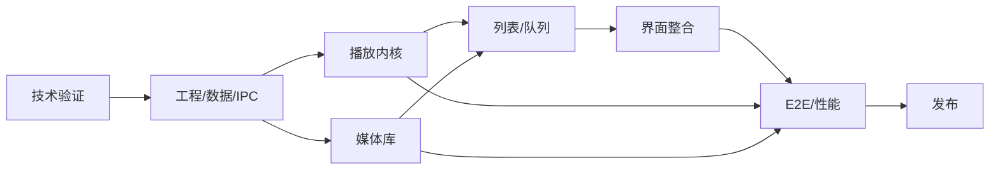

# 博音音乐播放器 BiuPlayer · MVP 开发计划

> 文档版本：v0.1 ｜ 日期：2026-11-24 ｜ 目标版本：`0.1.0`（MVP）
> 依据：[docs/Idea.md](Idea.md)、[docs/FeatureList.md](FeatureList.md)、[docs/Prd.md](Prd.md)、[docs/Arch.md](Arch.md)
> 范围：FeatureList 中 **51 项 P0**；P1/P2 不进入 MVP 验收。
> 读者：产品、开发、测试、发布负责人。

---

## 0. 一页结论

**MVP 要证明一件事**：一个普通用户可以在 Windows / macOS / Linux 上，不联网、不登录，把本地音乐目录交给 BiuPlayer，完成“扫描 → 浏览 → 播放 → 列表管理 → 看歌词”的日常闭环，并且安装包可下载、崩溃可诊断、数据不丢。

| 项目 | 结论 |
|---|---|
| 功能范围 | 51 项 P0，覆盖播放、列表、媒体库、标签读取、歌词、基础界面、系统集成、数据、设置、三语、隐私、打包、质量 |
| 支持格式 | MP3、FLAC、WAV、AAC/M4A、ALAC、OGG Vorbis、AIFF |
| 平台 | Windows 10 1809+ x64；macOS 11+ Intel / Apple Silicon；Ubuntu 22.04/24.04 x64 |
| 安装包 | Windows 绿色版 zip + NSIS；macOS 双架构 dmg（未签名）；Linux AppImage + deb + rpm |
| 规模 | 约 **116 人日**净开发（含 M0）；2 人并行约 **12–13 周**（含 15% 缓冲）；单人约 23–26 周 |
| 发布门禁 | 51/51 P0 验收通过；S1/S2 缺陷为 0；三平台安装包冒烟通过；默认零出站请求 |
| 明确不做 | Gapless、CUE、标签写入、换肤引擎、插件系统、桌面歌词、EQ、Winamp2、文件关联、系统媒体控制、全局快捷键、睡眠定时、自动更新 |

**三条硬约束**

1. **音频链路在 Rust 侧**：前端不通过 `<audio>` 播放；播放状态由 Rust 事件驱动。
2. **MVP 不引入 P1 依赖**：标签只读、封面只做最小读取、歌词只做同名 `.lrc`（内嵌只读回退）；需要写入/管理的全部留到 M2。
3. **每个任务必须可验收**：有命令、有测试、有截图/日志/基准数据之一；不接受“功能已写，待联调”作为完成。

---

## 1. MVP 目标与非目标

### 1.1 目标用户与核心场景

| 用户 | MVP 场景 | 必须顺畅的路径 |
|---|---|---|
| 本地收藏者 | 把多年积累的 MP3/FLAC 目录交给播放器 | 添加目录 → 扫描 → 按专辑/艺术家浏览 → 播放 |
| 日常使用者 | 开机听歌、切歌、调音量、看歌词 | 托盘/窗口控制 → 队列 → 歌词滚动 |
| 列表型用户 | 为不同场景维护多个播放列表 | 新建列表 → 拖入文件 → 排序 → 下次打开还在 |

### 1.2 成功标准

| 维度 | 标准 | 验证方式 |
|---|---|---|
| 功能 | 51 项 P0 全部通过验收用例 | §5 验收清单 + 追溯表 |
| 播放 | 7 种核心格式可播放；连续切歌 1000 次不崩溃 | 格式夹具 + 自动化/手工 |
| 媒体库 | 1 万文件扫描 ≤ 60s；10 万曲目搜索 ≤ 100ms | 基准脚本 |
| 性能 | 空库冷启动 ≤ 2s；播放 CPU ≤ 3%；播放内存 ≤ 300MB | 三平台采样 |
| 稳定 | 8h 连续播放 + 1000 次切歌无泄漏/崩溃；异常退出可恢复 | 长稳脚本 + 手工 |
| 数据 | 配置/数据库异常后可启动；卸载不删除用户音乐 | 故障注入 |
| 隐私 | 默认零出站；无遥测、无账号 | 抓包 24h + 代码审计 |
| 分发 | 四类安装包在干净环境可安装/启动/卸载 | 发布检查表 |
| 质量 | 无 S1/S2 缺陷；CI 全绿；文档可让新人独立构建 | 发布门禁 |

### 1.3 非目标（MVP 明确不做）

- 不做在线曲库、账号、云同步、社交、遥测。
- 不做音频标签写入、批量改名、封面管理、CUE、Gapless、位完美、DSD、EQ/音效、变速变调。
- 不做换肤引擎、插件系统、Winamp2 兼容、桌面歌词、歌词编辑、在线歌词/封面。
- 不做文件关联、系统媒体控制、全局快捷键、睡眠定时、开机自启、自动更新。
- 不做移动端、Web 版、多窗口歌词、可视化。

> 这些能力已在 FeatureList/PRD 中定义为 P1/P2，不影响 MVP 的“日常可听”闭环。

---

## 2. MVP 范围与裁剪

### 2.1 范围计数

| 模块 | 代号 | P0 数量 | MVP 交付 |
|---|---|---|---|
| 播放内核 | AUD | 6 | 解码、探测、输出设备、控制、模式、错误跳过 |
| 播放列表 | PL | 7 | 多列表、添加入口、编辑排序、过滤、队列、大列表 |
| 媒体库 | LIB | 5 | 目录、扫描/增量、视图、搜索、SQLite |
| 元数据 | TAG | 1 | 只读标签 |
| 歌词 | LRC | 3 | 解析、同名歌词、同步显示 |
| 界面 | UI | 6 | 布局、深浅色、窗口、托盘、拖放、性能 |
| 系统集成 | SYS | 2 | 单实例、便携模式 |
| 数据 | DATA | 3 | 目录、配置、迁移 |
| 设置 | SET | 3 | 设置中心、即时生效、关于 |
| 国际化 | I18N | 1 | 简中/繁中/英文 |
| 网络 | NET | 1 | 隐私保证（零出站） |
| 构建分发 | REL | 9 | CI、四类包、命名、校验、发布、质量门 |
| 质量工程 | QA | 4 | 日志、崩溃、单测、文档 |
| **合计** | — | **51** | — |

### 2.2 裁剪原则

1. **只做 P0**：P1 功能即使“只差一点”也不进 MVP；避免用 P1 的复杂度拖垮 P0 的稳定性。
2. **只读优先**：标签、封面、歌词都先只读；任何写文件能力留到 M2，降低数据损坏风险。
3. **够用即可**：列表撤销只保留最近一次；搜索只覆盖标题/艺术家/专辑/文件名；歌词只支持 LRC。
4. **先可恢复**：配置损坏回退、数据库迁移备份、崩溃提示、诊断包，优先于“更多功能”。
5. **平台差异显式化**：托盘、窗口、打包在三个平台分别验收；不假设“Windows 通过 = 全通过”。

### 2.3 MVP 使能项（不新增功能编号）

以下工作不是新的 P0 功能，但没有它们，P0 验收无法成立：

| 使能项 | 内容 | 归属任务 | 说明 |
|---|---|---|---|
| 基础封面读取 | 内嵌封面 + `cover/folder/front/album` 图片，128px 缩略图 | L1-06 | 只读；不做封面管理/批量导入（P1） |
| 内嵌歌词只读 | ID3 USLT、FLAC LYRICS、MP4 `©lyr` 作为同名 `.lrc` 的回退 | Y1-02 | 只读；不做编辑/嵌入写入（P1） |
| 拼音索引 | 标题/艺术家/专辑的全拼与首字母 | L1-04 | 支撑 F-PL-06 / F-LIB-06 |
| 断点续播 | 当前曲目、进度、队列持久化，启动恢复 | A1-05 | 不做“最近播放”列表与统计（P2） |
| 最小诊断包 | 日志 + 配置 + 数据库 schema 版本 + 系统信息 | E1-03 | 不含用户音乐文件；路径可脱敏 |

### 2.4 明确不做（与 P1/P2 的边界）

| 能力 | 优先级 | 留给 |
|---|---|---|
| CUE 分轨、Gapless、位完美、DSD、独占输出 | P1/P2 | M2 |
| 标签写入、批量编辑、文件名模板、封面管理 | P1 | M2 |
| 10 段 EQ、DSP 链、ReplayGain、淡入淡出 | P1/P2 | M2 |
| 换肤引擎、皮肤包、迷你模式、全局快捷键 | P1 | M2 |
| 插件 API、插件市场、Winamp2 兼容 | P1/P2 | M2/M3 |
| 桌面歌词、歌词编辑、双语、在线歌词 | P1/P2 | M2/M3 |
| m3u/pls 导入导出、智能列表、收藏评分 | P1/P2 | M2 |
| 文件关联、系统媒体控制、睡眠定时、自启、更新检查 | P1/P2 | M2 |
| 多语言扩展包、高对比、屏幕阅读器 | P1/P2 | M2/M3 |

---

## 3. MVP 功能清单与验收口径

> 编号与 [docs/FeatureList.md](FeatureList.md) 一致；每条都必须能在 §5 的验收场景或自动化测试中找到对应证据。

| 模块 | 编号 | MVP 功能 | 可执行验收口径 | 主任务 |
|---|---|---|---|---|
| 播放 | F-AUD-01 | 核心格式解码：MP3、FLAC、WAV、AAC/M4A、ALAC、OGG Vorbis、AIFF | 7 类夹具各 1 个可播放，时长/进度正确；`cargo test -p biu-audio --test formats` 通过 | A1-01 |
| 播放 | F-AUD-02 | 文件头探测、损坏/截断容错 | 扩展名与内容不符仍按内容识别；截断文件自动下一首并写日志 | A1-02 |
| 播放 | F-AUD-04 | 输出设备枚举、切换、热插拔回退 | 双设备切换即时生效；拔 USB 声卡 2s 内回退默认并提示 | A1-03/A1-06 |
| 播放 | F-AUD-11 | 播放/暂停/停止/上一首/下一首/seek/音量/静音 | 操作 ≤100ms；UI 与状态一致；seek 后从目标位置继续 | A1-04/A1-07 |
| 播放 | F-AUD-16 | 顺序、列表循环、单曲循环、随机 | 4 种模式行为正确；重启后模式保持 | A1-05 |
| 播放 | F-AUD-20 | 解码失败自动跳过并记录 | 连续 3 个坏文件不卡死；日志含路径与原因 | A1-06 |
| 列表 | F-PL-01 | 多列表新建/重命名/复制/删除/排序/持久化 | 建 3 个列表并排序，重启后名称与顺序完整恢复 | P1-01 |
| 列表 | F-PL-02 | 文件/文件夹/拖放/右键/命令行添加 | 各入口行为一致；重复项提示且不重复插入 | P1-02 |
| 列表 | F-PL-03 | 拖拽排序、多选、删除、批量删除、撤销 | 1 万条拖拽 ≥55fps；删除可撤销 | P1-03 |
| 列表 | F-PL-05 | 标题/艺术家/专辑/时长/添加时间/路径/手动排序 | 各列排序稳定；可恢复手动顺序 | P1-03 |
| 列表 | F-PL-06 | 即时过滤；拼音全拼与首字母 | 1 万条输入 `zd`，1s 内过滤出“周杰伦”等匹配项 | P1-04 |
| 列表 | F-PL-08 | 队列：下一首播放、插播、查看/调整/清空 | 队列优先于列表；清空后回列表顺序；重启恢复 | P1-05 |
| 列表 | F-PL-11 | 10 万条虚拟滚动 | 连续滚动 10s 平均 ≥55fps，无 >200ms 卡顿 | P1-06 |
| 库 | F-LIB-01 | 多目录、递归、排除目录、排除隐藏文件、增删触发重扫 | 1 万文件目录添加即扫描；删除目录不删本地文件 | L1-01 |
| 库 | F-LIB-02 | 首次全量、后续增量；进度、暂停/取消/继续 | 取消后再扫从断点继续且不重复入库；1 万 ≤60s | L1-02/L1-03 |
| 库 | F-LIB-04 | 歌曲/专辑/艺术家/专辑艺术家/流派/年代/文件夹视图 | 各视图分页或虚拟滚动；专辑聚合正确；无封面显示占位 | L1-05 |
| 库 | F-LIB-06 | 搜索标题/艺术家/专辑/文件名；拼音全拼/首字母 | 10 万曲目搜索 ≤100ms；结果高亮 | L1-04 |
| 库 | F-LIB-11 | SQLite WAL、版本化迁移、索引 | `kill -9` 后重启库可打开；迁移幂等 | D1-01/D1-02 |
| 标签 | F-TAG-01 | 读取 ID3v1/v2.2–2.4、APEv2、Vorbis Comment、MP4 atoms、WAV ID3 | 各格式中文不乱码；无标签回退文件名 | L1-02 |
| 歌词 | F-LRC-01 | 标准/增强 LRC、多时间标签、元信息、offset | 当前行误差 <200ms；offset 生效 | Y1-01 |
| 歌词 | F-LRC-03 | 同名 `.lrc` 自动加载、编码检测 | GBK/UTF-8 歌词均正确；无歌词显示占位不阻塞播放 | Y1-02 |
| 歌词 | F-LRC-05 | 逐行滚动、当前行高亮、点击行跳转 | 点击第 5 行跳到对应时间；播放不中断 | Y1-03 |
| 界面 | F-UI-01 | 侧栏 + 主内容 + 播放栏；面板折叠/调宽/持久化 | 重启恢复布局；800×600 窗口不破版 | U1-01 |
| 界面 | F-UI-03 | 浅色/深色两套内置皮肤，跟随系统 | 系统切换深色 500ms 内完成且无白闪 | U1-03 |
| 界面 | F-UI-08 | 无边框、拖拽、置顶、透明度、尺寸位置记忆 | 双屏 150% 缩放拖拽不跳位；重启恢复位置 | U1-04 |
| 界面 | F-UI-09 | 托盘图标与菜单、关闭到托盘、状态同步 | 关闭后播放继续；托盘可恢复窗口；菜单状态一致 | U1-04 |
| 界面 | F-UI-12 | 文件/文件夹拖放 | 拖入有高亮反馈；释放后按约定播放或加入列表 | P1-02 |
| 界面 | F-UI-15 | 动画 60fps、播放时低 CPU | 列表滚动 ≥55fps；播放 CPU ≤3% | Q1-03 |
| 系统 | F-SYS-02 | 单实例；第二实例参数转交 | 二次启动不出现双窗口；文件参数在原窗口播放 | S1-01 |
| 系统 | F-SYS-10 | 便携模式：配置/数据库随程序目录 | 目录拷贝到新机器，列表/设置/队列完整 | E1-02 |
| 数据 | F-DATA-01 | 三平台标准数据目录；便携模式覆盖 | 目录符合平台规范；卸载不误删用户音乐 | E1-02 |
| 数据 | F-DATA-02 | 配置 JSON 原子写入；损坏回退并备份 | 手工破坏配置后仍能启动，坏文件保留为 `.bak` | D1-03 |
| 数据 | F-DATA-03 | 数据库版本化迁移；失败回滚；迁移前备份 | v1→v2 数据完整；失败可回滚并启动 | D1-01/D1-04 |
| 设置 | F-SET-01 | 设置中心分类：常规/播放/音频/歌词/媒体库/高级；仅显示已实现分类 | 分类清晰；改动即时生效；需重启项明确标注 | S1-02 |
| 设置 | F-SET-02 | 即时生效策略 | 主题/音量/输出设备修改立即生效 | S1-02 |
| 设置 | F-SET-06 | 关于页：版本、构建信息、开源许可、致谢；检查更新打开 Releases 页面 | 许可完整；版本一致；点击检查更新在外部浏览器打开 Releases，应用内不请求网络 | S1-03 |
| 国际化 | F-I18N-01 | 简中/繁中/英文；运行时切换 | 全部页面无硬编码中文残留、无截断 | E1-06 |
| 网络 | F-NET-04 | 无遥测、无账号、默认零出站 | 抓包 24h 仅用户触发请求；启动阶段零请求 | Q1-03 |
| 分发 | F-REL-01 | GitHub Actions：Win x64、macOS x64/arm64、Linux x64 | 推送 `v*` tag 产出全平台构建 | R1-01 |
| 分发 | F-REL-02 | Windows 绿色版 zip（解压即用，配置随目录） | 不写注册表/系统目录；拷贝目录到新机器可用 | R1-02 |
| 分发 | F-REL-03 | Windows NSIS 安装版 | 干净虚拟机安装/升级/卸载无残留；卸载不删音乐 | R1-02 |
| 分发 | F-REL-04 | macOS dmg（Intel / Apple Silicon，未签名） | 两种机型右键打开可播放；文档说明去隔离 | R1-03 |
| 分发 | F-REL-05 | Linux AppImage + deb + rpm | Ubuntu 22.04/24.04、X11/Wayland 可启动 | R1-04 |
| 分发 | F-REL-06 | 产物命名含版本/平台/架构 | 文件名符合 `BiuPlayer_<version>_<os>_<arch>` | R1-02..R1-04 |
| 分发 | F-REL-07 | SHA256SUMS + 构建来源证明 | Release 附校验文件；Actions run 可追溯 | R1-05 |
| 分发 | F-REL-08 | tag → draft → 人工确认 → 发布；附 CHANGELOG | 发布可回滚；CHANGELOG 与 tag 一致 | R1-05 |
| 分发 | F-REL-10 | CI 质量门：fmt/clippy/test/lint/typecheck/build | PR 全绿才可合并 | R1-01 |
| 质量 | F-QA-01 | 分级滚动日志；一键导出诊断包 | 诊断包 zip 可导出；路径可脱敏 | E1-03 |
| 质量 | F-QA-02 | panic 捕获、本地转储、下次启动提示 | 模拟 panic 后重启提示；队列与配置不丢 | E1-03 |
| 质量 | F-QA-03 | 解码/标签/LRC/数据库/路径单元测试 | 关键模块覆盖率达标；CI 全绿 | Q1-01 |
| 质量 | F-QA-08 | README、构建指南、用户手册；插件/皮肤文档标注 P1 未实现 | 新人按文档可独立构建；链接有效 | Q1-04 |

## 4. 开发计划与任务分解

### 4.1 计划假设

| 项目 | 假设 |
|---|---|
| 人力 | 2 名全职：A（Rust/音频/数据/打包）、B（React/交互/测试自动化）；设计/QA 各 0.2 FTE |
| 周期 | 12–13 周（含 M0 与 15% 缓冲）；单人顺序执行约 23–26 周 |
| 估算口径 | 人日为净开发，含编码、单测、自测、PR 修改；不含等待、评审排队、发布窗口 |
| 工作制 | 5 天/周，按 6 小时有效产出计；每个任务 ≤3 人日，超过则拆分 |
| 范围冻结 | Sprint 2 结束后冻结 P0；新增需求进入 M2 backlog，不插队 |
| 环境 | Win10 22H2 / Win11、macOS 11+（Intel/ARM）、Ubuntu 22.04/24.04；4 核 8GB 低配机 |

**开工前 1 天（可执行清单）**

- [ ] 创建 `docs/reports/`、`fixtures/`、`scripts/`；把 56 个任务导入看板，字段含 ID、依赖、人日、验收证据。
- [ ] 准备三平台干净 VM 快照、USB 声卡、7 格式夹具与 10k 媒体库。
- [ ] 开启 `main` 保护、PR 模板、CI 必需检查；建 `M2` 标签承接 P1/P2。
- [ ] 确认 GitHub Release draft 权限与未签名分发说明模板。
- [ ] 约定每周五演示、验收记录归档位置与缺陷分级口径。

### 4.2 周计划与并行轨道

> 以 2026-11-30 为第 1 周；实际启动日顺延，周次不变。轨道 A 为 Rust 侧，轨道 B 为前端/发布侧；每周五演示可运行版本。

| 周 | 轨道 A（Rust/音频/数据） | 轨道 B（前端/交互/发布） | 周末出口 |
|---|---|---|---|
| W1 | M0-01 解码、M0-02 输出、M0-04 扫描原型 | M0-03 壳/IPC、M0-05 打包、M0-06 Linux 报告 | M0 完成约 60%；风险清单定稿 |
| W2 | M0 收口、E1-01 workspace、E1-02 路径、D1-01/02 schema | E1-04 IPC、E1-05 布局、E1-06 i18n | M0 评审通过；空壳可启动；DB 可迁移 |
| W3 | A1-01 解码、D1-03/04 配置/迁移、E1-03 日志 | U1-01 布局、E1-07 组件、i18n 填充 | 7 格式解码通过；主界面骨架 |
| W4 | A1-02 探针、A1-03 输出、A1-04 状态机 | P1-01 列表 CRUD、U1-03 主题 | 能播放/暂停/seek；列表可建 |
| W5 | A1-05 队列/模式、A1-06 错误、A1-07 事件 | P1-03 编辑排序、P1-06 虚拟列表 | 队列与模式可用；1 万条不卡 |
| W6 | L1-01 目录、L1-02 扫描、L1-03 增量 | P1-02 添加入口、P1-05 队列、U1-02 播放栏 | 1 万文件扫描 ≤60s；播放栏可用 |
| W7 | L1-04 搜索、L1-05 视图、L1-06 封面 | P1-04 过滤、Y1-01/02 歌词 | 搜索/视图/歌词首版 |
| W8 | L1-07 基准、S1-01 单实例 | Y1-03 同步、U1-04 托盘/窗口 | 10 万库报告；托盘可用 |
| W9 | R1-01 CI、S1-02 设置、S1-03 关于 | Q1-01 单测、U1 收尾 | CI 矩阵与质量门可用；设置/关于完成 |
| W10 | R1-02 Win 包、R1-03 mac、R1-04 Linux | Q1-02 E2E、发布文档 | 安装包冒烟通过；E2E 主链路绿 |
| W11 | R1-05 校验、Q1-03 性能/长稳、缺陷修复 | Q1-04 文档、发布检查、缺陷修复 | RC1；S1/S2 清零 |
| W12 | 10 万库复测、8h 长稳、缺陷修复 | 发布说明、校验、回滚演练 | v0.1.0 可发布 |
| W13 | 缓冲 | 缓冲 | 仅修 S1/S2；不再加功能 |

> 容量口径：2 人 × 5 天 = 10 人日/周。M0 共 17 人日，会占用 W1–W2；周计划允许 ±2 天滑动，以“周末出口”是否达成为准。关键路径累计延后 >2 天时，立即按 §4.4 处理。

### 4.3 任务分解

> 任务编号用于 PR、提交信息、看板与验收记录；`依赖` 为空表示可立即开始。每个任务的“验收证据”必须附在 PR 或发布检查表中。

#### M0 · 技术验证（17 人日）

| ID | 任务 | 产出/实现要点 | 依赖 | 人日 | 验收证据 |
|---|---|---|---|---|---|
| M0-01 | 解码与探针 spike | symphonia 解 7 格式样本；输出 f32 交错；记录 AIFF/ALAC/AAC 缺口与替代方案 | — | 3 | `docs/reports/m0-audio.md`：7/7 通过或明确替代 |
| M0-02 | 输出与设备 spike | cpal 枚举/默认设备/切换；44.1k/48k 正弦波出声；三平台记录 | — | 3 | 三平台录音/波形截图；设备列表日志 |
| M0-03 | Tauri 壳、IPC、日志 spike | command/event 双向；specta 绑定；tracing 落盘；React 调用 | — | 3 | `docs/reports/m0-shell.md`；1000 事件无丢失 |
| M0-04 | SQLite 与扫描原型 | 建 MVP 表；扫描 1 万文件入库；FTS5 查询 | — | 3 | 扫描耗时/行数报告；查询 <100ms |
| M0-05 | 三平台打包冒烟 | GitHub Actions 出 zip/NSIS/dmg/AppImage；记录体积与失败点 | M0-03 | 3 | Actions run 链接；包体积表 |
| M0-06 | Linux 兼容性报告 | Ubuntu 22.04/24.04 的 WebKitGTK 4.1、X11/Wayland；20.04 探测结论 | M0-05 | 2 | `docs/reports/m0-linux.md` |

**M0 出口**：7 格式至少 6 个可播；三平台至少各 1 个包能启动；10 万库方案可行；未决风险有明确结论。未通过则先修 spike，不进入 W2。

#### E1 · 工程基建（13.5 人日）

| ID | 任务 | 产出/实现要点 | 依赖 | 人日 | 验收证据 |
|---|---|---|---|---|---|
| E1-01 | Workspace 与 CI 骨架 | `src-tauri/crates/*`、feature flags、fmt/clippy/test job、缓存 | M0-03 | 2 | `cargo check --workspace`；CI 绿 |
| E1-02 | 配置、路径、便携模式 | 平台数据目录、`portable.flag` 覆盖、路径校验 `ensure_within` | M0-03 | 2 | 路径单测；三平台目录截图 |
| E1-03 | 日志、panic、诊断包 | tracing 分级/滚动；panic hook；导出 zip（配置+日志+schema 版本） | E1-01 | 2 | 模拟 panic 后提示；诊断包可打开 |
| E1-04 | IPC 契约与错误码 | 命令/事件命名、错误 envelope、超时/取消、TS 绑定生成 | E1-01 | 2 | 契约测试；前端类型编译通过 |
| E1-05 | 路由、布局、主题令牌 | 14 条 Hash 路由占位；三栏布局；CSS 变量浅/深色 | E1-01 | 2 | 页面可导航；主题切换无闪烁 |
| E1-06 | i18n 三语 | 简中/繁中/英文资源；运行时切换；缺失 key lint | E1-05 | 2 | 切换后无硬编码中文；无截断 |
| E1-07 | 基础组件与状态页 | 按钮/输入/列表/对话框；空/加载/错误/离线态 | E1-05 | 1.5 | Storybook 或截图清单 |

**E1 出口**：空壳应用在三平台可启动；IPC 有类型；配置/日志/诊断可用；i18n 可切换。

#### D1 · 数据层（5 人日）

| ID | 任务 | 产出/实现要点 | 依赖 | 人日 | 验收证据 |
|---|---|---|---|---|---|
| D1-01 | MVP schema 与迁移 | `schema_migrations`、folders/artists/albums/tracks/playlists/playlist_items/lyrics/play_history、`folders.scan_state` 断点字段、FTS5 | E1-01 | 2 | 迁移从 0 到 1；表/索引清单 |
| D1-02 | DB 打开、PRAGMA、备份 | WAL、busy_timeout、foreign_keys、迁移前备份、损坏检测 | D1-01 | 1 | `kill -9` 后重开；备份文件存在 |
| D1-03 | 配置原子写与恢复 | 临时文件 + rename；JSON 校验；坏文件转 `.bak` | E1-02 | 1 | 破坏配置后启动成功 |
| D1-04 | 迁移与回滚测试 | 0→1 夹具；失败注入；幂等；为后续迁移预留 | D1-01 | 1 | `cargo test -p biu-core --test migrations` |

**D1 出口**：数据库可创建/迁移/恢复；配置损坏不阻塞启动；迁移有自动化测试。

#### A1 · 播放内核（17 人日）

| ID | 任务 | 产出/实现要点 | 依赖 | 人日 | 验收证据 |
|---|---|---|---|---|---|
| A1-01 | 7 格式解码 | symphonia 解码；统一 f32；时长/采样率/声道；错误分类 | M0-01 | 4 | `cargo test -p biu-audio --test formats` 7/7 |
| A1-02 | 探测与容错 | 文件头优先；扩展名不符；截断/空文件；快速失败 | A1-01 | 2 | 坏文件夹具 5 类；日志含原因 |
| A1-03 | 输出与设备 | cpal 流；设备枚举/切换；默认设备回退；采样率适配 | M0-02 | 3 | 双设备切换；拔卡 2s 回退 |
| A1-04 | 播放状态机 | Idle/Loading/Playing/Paused/Stopped/Error；seek/音量/静音 | A1-01/A1-03 | 3 | 状态迁移测试；seek 误差 <50ms |
| A1-05 | 队列、模式、断点续播 | 下一首/插播/清空；4 模式；当前曲/进度/队列持久化 | A1-04 | 2 | 队列单测；重启恢复截图 |
| A1-06 | 错误跳过与热插拔 | 连续失败上限；自动下一首；设备丢失暂停/回退 | A1-04 | 1.5 | 3 个坏文件不卡死；拔卡提示 |
| A1-07 | player:state 事件 | 4Hz 状态 + 即时事件；seq 防乱序；前端同步 | A1-04/E1-04 | 1.5 | 1000 次切歌 UI 无漂移 |

**A1 出口**：7 格式可播；控制/队列/模式可用；设备切换与错误恢复可用；播放 CPU ≤3%。

#### L1 · 媒体库（18 人日）

| ID | 任务 | 产出/实现要点 | 依赖 | 人日 | 验收证据 |
|---|---|---|---|---|---|
| L1-01 | 目录管理 | 添加/移除/排除/隐藏文件；增删触发重扫；不删除源文件 | D1-01 | 2 | 目录增删测试；源文件仍在 |
| L1-02 | 扫描、标签读取、入库 | walkdir + rayon；lofty 读标签；批量事务；封面路径 | L1-01/A1-02 | 4 | 1 万文件 ≤60s；中文标签正确 |
| L1-03 | 增量、暂停/取消、断点 | mtime+size 快判；暂停/取消令牌；`folders.scan_state` 断点；重复入库防护 | L1-02 | 3 | 暂停/取消/继续不重复；二次扫描 <5s |
| L1-04 | 搜索与拼音 | FTS5 外部内容；jieba 分词；全拼/首字母列；bm25 排序 | L1-02/D1-01 | 3 | 10 万库 ≤100ms；`zd` 命中 |
| L1-05 | 视图查询与分页 | 歌曲/专辑/艺术家/流派/年代/文件夹；分页/虚拟列表接口 | L1-04 | 3 | 各视图数据正确；分页无重复 |
| L1-06 | 基础封面读取 | 内嵌 + folder/cover/front；128px webp；LRU 上限 | L1-02 | 1.5 | 专辑视图有图/占位；内存不超预算 |
| L1-07 | 10 万库基准 | 生成器；扫描/搜索/滚动/内存报告 | L1-05 | 1.5 | `docs/reports/bench-library.md` |

**L1 出口**：10 万曲目可扫描/浏览/搜索；增量与断点可靠；封面不导致内存膨胀。

#### P1 · 播放列表（11 人日）

| ID | 任务 | 产出/实现要点 | 依赖 | 人日 | 验收证据 |
|---|---|---|---|---|---|
| P1-01 | 列表 CRUD 与持久化 | 新建/重命名/复制/删除/排序；SQLite 顺序 | D1-01 | 2 | 3 列表重启恢复 |
| P1-02 | 添加入口 | 文件/文件夹/拖放/右键/命令行；去重提示 | P1-01/L1-02 | 2 | 5 种入口行为一致 |
| P1-03 | 编辑、排序、撤销 | 多选/拖拽/删除/批量删除；7 种排序；一次撤销 | P1-01 | 2 | 1 万条拖拽 ≥55fps；撤销有效 |
| P1-04 | 过滤搜索 | 标题/艺术家/专辑/文件名；拼音；300ms 防抖 | P1-01/L1-04 | 1.5 | 1 万条 1s 内出结果 |
| P1-05 | 队列 | 下一首/插播/调整/清空；与列表优先级 | A1-05/P1-01 | 1.5 | 队列优先；清空回列表 |
| P1-06 | 虚拟列表 | TanStack Virtual；行高固定；滚动到当前曲 | P1-01 | 2 | 10 万条 ≥55fps；无白屏 |

**P1 出口**：多列表日常可用；1 万条操作流畅；10 万条可滚动。

#### Y1 · 歌词（5 人日）

| ID | 任务 | 产出/实现要点 | 依赖 | 人日 | 验收证据 |
|---|---|---|---|---|---|
| Y1-01 | LRC 解析 | 标准/增强/多时间/元信息/offset；容错 | L1-02 | 2 | 夹具 20 个；当前行误差 <200ms |
| Y1-02 | 同名歌词与内嵌回退 | 同名 `.lrc`；GBK/UTF-8 检测；USLT/FLAC/MP4 只读 | Y1-01/L1-02 | 1.5 | 编码夹具正确；无歌词占位 |
| Y1-03 | 同步显示 | rAF 滚动、高亮、点击行 seek；窗口隐藏降频 | Y1-02/A1-07 | 1.5 | 点击第 5 行跳转；播放不断 |

**Y1 出口**：同名歌词优先，内嵌回退可用；滚动与点击跳转准确。

#### U1 · 界面整合（8 人日）

| ID | 任务 | 产出/实现要点 | 依赖 | 人日 | 验收证据 |
|---|---|---|---|---|---|
| U1-01 | 主布局 | 侧栏/主内容/播放栏；折叠/调宽；持久化 | E1-05 | 2 | 800×600 不破版；重启恢复 |
| U1-02 | 播放栏与正在播放 | 封面/标题/进度/控制/音量/模式/队列入口 | A1-07 | 2 | 与状态一致；操作 ≤100ms |
| U1-03 | 主题 | 浅/深/跟随系统；令牌；无白闪 | E1-05 | 1.5 | 系统切换 500ms 内完成 |
| U1-04 | 窗口与托盘 | 无边框/拖拽/置顶/透明度/位置记忆；托盘菜单/关闭到托盘 | U1-01 | 2.5 | 双屏 150% 不跳位；托盘状态同步 |

**U1 出口**：日常操作路径可在主界面完成；托盘/窗口行为符合平台习惯。

#### S1 · 系统与设置（5 人日）

| ID | 任务 | 产出/实现要点 | 依赖 | 人日 | 验收证据 |
|---|---|---|---|---|---|
| S1-01 | 单实例与参数转交 | 锁/端口；第二实例转发文件/目录；聚焦原窗口 | E1-04 | 2 | 二次启动不双开；参数生效 |
| S1-02 | 设置中心 | 分类：常规/播放/音频/歌词/媒体库/高级；即时生效；重启标注 | E1-02 | 2 | 改动生效；重启项标注 |
| S1-03 | 关于与许可 | 版本/构建/许可/致谢；检查更新跳转 Releases；链接可打开 | E1-06 | 1 | 版本与包一致；许可完整；应用内无更新请求 |

**S1 出口**：单实例/便携/设置/关于可用；设置改动有明确生效策略。

#### R1 · 构建与分发（9 人日）

| ID | 任务 | 产出/实现要点 | 依赖 | 人日 | 验收证据 |
|---|---|---|---|---|---|
| R1-01 | CI 矩阵与质量门 | Win/mac x64/arm/Linux；fmt/clippy/test/lint/typecheck/build | E1-01 | 2.5 | PR 全绿；tag 触发矩阵 |
| R1-02 | Windows 包 | zip 便携 + NSIS currentUser；图标/协议/卸载 | U1-04 | 2 | 干净 VM 安装/升级/卸载 |
| R1-03 | macOS 包 | dmg x64/arm64；ad-hoc/未签名；去隔离说明 | U1-04 | 1.5 | 两机型右键打开可播 |
| R1-04 | Linux 包 | AppImage + deb + rpm；依赖声明；桌面文件 | U1-04 | 2 | 22.04/24.04、X11/Wayland |
| R1-05 | 校验与发布 | SHA256SUMS、产物命名、draft release、CHANGELOG、回滚 | R1-02..R1-04 | 1 | Release 附件齐全；校验通过 |

**R1 出口**：四类包可下载/安装/启动；发布流程可回滚。

#### Q1 · 质量与发布（7 人日）

| ID | 任务 | 产出/实现要点 | 依赖 | 人日 | 验收证据 |
|---|---|---|---|---|---|
| Q1-01 | 单测与集成测试 | 解码/标签/LRC/DB/路径/IPC；覆盖率门槛 | A1/L1/D1 | 2 | CI 覆盖率报告；关键模块达标 |
| Q1-02 | E2E 冒烟 | 启动→加目录→扫描→播放→列表→歌词→重启 | Q1-01/U1-02 | 2.5 | tauri-driver（Win/Linux）+ macOS 手工冒烟报告 |
| Q1-03 | 性能与长稳 | 启动/内存/CPU/10 万库/8h+1000 切歌/24h 抓包 | Q1-02 | 1.5 | `docs/reports/bench-mvp.md` |
| Q1-04 | 文档与发布检查 | README、构建、用户手册、已知问题、检查表；插件/皮肤章节标注 P1 | R1-05 | 1 | 新人按文档构建成功 |

**Q1 出口**：RC 通过全部门禁；已知问题清单明确；发布检查表签字。

### 4.4 关键路径与压缩策略



**关键路径**：`M0-01 → A1-01 → A1-04 → A1-07 → P1-05 → U1-02 → Q1-02 → R1-05`。
**次关键路径**：`M0-04 → D1-01 → L1-02 → L1-03 → L1-04 → L1-05`。

| 场景 | 策略 |
|---|---|
| 进度落后 1 周 | 砍非验收项（L1-07 报告美化、P1-06 额外调优）；Q1-03 的 24h 抓包改为 8h+代码审计需产品签字；不砍解码/DB/打包 |
| 进度落后 2 周 | 增加 1 名前端/测试，范围不变；不能增人则整体延期 1 周，仍不砍 P0 验收 |
| 只想要 10 周 | 需 2.5–3 FTE；若只有 2 人，必须把 F-PL-11、F-LIB-02 降级到 M2，这会破坏 51 项 P0，不建议作为 MVP |
| 单人开发 | 按 W1–W12 顺序执行，去掉并行演示；23–26 周，每 2 周一个可运行版本 |

### 4.5 任务完成定义（DoD）

一个任务只有同时满足以下条件才算完成：

1. 代码合并到 `main`，PR ≤400 行（超则拆分），至少 1 人 review。
2. 新增/修改逻辑有单测或集成测试；修 bug 先补失败用例。
3. `cargo fmt --check`、`cargo clippy -D warnings`、`cargo test`、`pnpm lint`、`pnpm typecheck`、`pnpm build` 全绿。
4. 覆盖空/加载/错误/离线态；文案进 i18n，无硬编码。
5. 涉及用户可见行为时附截图/录屏；涉及性能时附基准数据；涉及数据时附迁移/回滚证据。
6. 更新 CHANGELOG 或任务卡；不引入新的 S1/S2 缺陷。
7. 验收证据链接写入任务卡，验收人按“验收证据”列复核。

## 5. 验收方案

### 5.1 验收环境

| 维度 | 要求 |
|---|---|
| Windows | Windows 10 22H2 x64、Windows 11 x64；干净虚拟机 + 实体机各 1 |
| macOS | macOS 11/14，Intel 与 Apple Silicon 各 1；未签名打开流程按文档执行 |
| Linux | Ubuntu 22.04 LTS、24.04 LTS；X11 与 Wayland 各测一次 |
| 硬件 | 4 核 8GB、SSD；板载声卡 + 1 个 USB 声卡（热插拔） |
| 显示 | 1920×1080 100%；2560×1440 150% 双屏（窗口/托盘） |
| 网络 | 验收机默认断网；隐私测试单独抓包 |
| 测试数据 | 7 格式音频夹具、10k 媒体库、100k 生成库、坏文件 5 类、LRC 编码夹具 |

**夹具目录**（实施时创建）：

```text
fixtures/
  audio/        # 7 格式，各 10s 正弦波 + 中文标签
  corrupt/      # 截断、空文件、错扩展名、超大标签、非法采样率
  lyrics/       # utf8、gbk、多时间、增强 LRC、无歌词
  library-10k/  # 10k 文件，嵌套目录，中文/空格/长路径
  library-100k/ # 生成器产出，CI 不跑全量
```

### 5.2 验收命令

> 以下为目标命令，随 E1-01/R1-01 落地；任何一项失败即视为门禁不通过。

```bash
# 前端
pnpm install --frozen-lockfile
pnpm typecheck
pnpm lint
pnpm test
pnpm build

# Rust
cargo fmt --all --check
cargo clippy --workspace --all-targets -- -D warnings
cargo test --workspace

# 专项
cargo test -p biu-audio --test formats
cargo test -p biu-core --test migrations
cargo run -p biu-library --example gen_library -- --count 100000 --out /tmp/biu-bench
pnpm test:e2e
bash scripts/smoke-package.sh <artifact>
```

### 5.3 端到端验收场景

| ID | 场景 | 步骤 | 通过标准 |
|---|---|---|---|
| AC-01 | 首次启动与播放闭环 | 干净安装 → 启动 → 添加 1 万文件目录 → 扫描 → 播放第一首 → 暂停/继续 → 关闭重开 | 空库启动 ≤2s；扫描 ≤60s；重开恢复列表/队列/进度；无崩溃 |
| AC-02 | 7 格式播放 | 依次播放 MP3/FLAC/WAV/M4A/ALAC/OGG/AIFF，各 10s，seek 到 50% | 7/7 出声；时长/进度正确；seek 误差 <50ms；无爆音/卡死 |
| AC-03 | 控制、模式、队列 | 连续 100 次播放/暂停/上下曲；切换 4 模式；下一首/插播/清空 | 操作 ≤100ms；模式行为正确；队列优先；UI 与声音一致 |
| AC-04 | 设备切换与热插拔 | 播放中切到 USB 声卡；拔掉；再插回；切回板载 | 切换 ≤2s；拔出自动暂停/回退并提示；插回可重新选择 |
| AC-05 | 扫描、取消、增量 | 1 万文件扫描到 50% 取消 → 继续 → 再添加 100 文件重扫 | 断点继续不重复；增量 ≤5s；数据库计数正确；源文件不变 |
| AC-06 | 10 万库搜索与滚动 | 导入 10 万库；搜索标题/艺术家/拼音；连续滚动 10s | 搜索 ≤100ms；滚动 ≥55fps；内存 ≤500MB；无白屏 |
| AC-07 | 列表管理 | 建 3 列表；拖入 100 首；多选删除；撤销；排序；重启 | 顺序/名称/内容完整恢复；1 万条拖拽 ≥55fps；撤销正确 |
| AC-08 | 歌词 | 加载 UTF-8/GBK/增强 LRC；播放；点击第 5 行；删歌词文件重开 | 编码正确；当前行误差 <200ms；点击跳转；无歌词显示占位 |
| AC-09 | 界面与托盘 | 折叠/调宽侧栏；切深浅色；双屏 150% 拖动；关闭到托盘；托盘恢复 | 布局持久化；主题 500ms 内完成；窗口不跳位；播放不断 |
| AC-10 | 单实例与便携 | 二次启动带文件参数；复制便携目录到另一台机器启动 | 不双开；参数在原窗口播放；列表/设置/队列完整 |
| AC-11 | 安装包 | 每个包在干净 VM 安装 → 启动 → 播放 → 卸载/删除 | 安装/升级/卸载无残留；未签名提示有文档；卸载不删音乐 |
| AC-12 | 隐私与离线 | 断网启动；抓包 24h；检查日志/配置 | 启动零请求；无遥测/账号；仅用户触发外链 |
| AC-13 | 故障恢复 | `kill -9`；破坏配置；破坏 DB；注入 panic；重启 | 均可启动；配置转 `.bak`；DB 备份可回滚；崩溃提示与诊断包可用 |
| AC-14 | 性能与长稳 | 8h 连续播放 + 1000 次切歌；10 万库冷启动/搜索 | 无崩溃/泄漏；CPU ≤3%（播放）；内存 ≤300MB；无句柄暴涨 |

### 5.4 缺陷分级与发布门禁

| 级别 | 定义 | 处理时限 | MVP 发布要求 |
|---|---|---|---|
| S1 | 崩溃、数据丢失、无法启动、无法播放 | 24h 内修复 | 必须为 0 |
| S2 | 核心路径不可用、明显错误、性能严重超标 | 3 天内修复 | 必须为 0 |
| S3 | 非核心功能异常、有规避方案 | 下个迭代 | 可带已知问题发布 |
| S4 | 文案/样式/建议 | 排期 | 不阻塞 |

| 门禁 | 时点 | 检查内容 | 不通过处理 |
|---|---|---|---|
| G0 | 每个 PR | fmt/clippy/test/lint/typecheck/build | 禁止合并 |
| G1 | 每周五 | 演示主链路；新增 S1/S2 清零 | 下周优先修复 |
| G2 | W8 末 | P0 功能完成度 ≥90%；三平台包可启动 | 冻结范围，砍非 P0 |
| G3 | W12 中 | 51/51 验收；S1/S2=0；性能达标 | 延期发布，不降标准 |
| G4 | 发布前 | 校验/文档/回滚/已知问题 | 阻断发布 |

### 5.5 发布检查表

- [ ] 版本号、tag、CHANGELOG 一致（`v0.1.0`）。
- [ ] CI 全绿；构建产物来自同一 commit。
- [ ] Windows zip/NSIS、macOS dmg ×2、Linux AppImage/deb/rpm 齐全。
- [ ] `SHA256SUMS` 已生成并在 Release 中。
- [ ] 每个包在干净环境完成安装/启动/播放/卸载冒烟。
- [ ] 51 项 P0 验收记录归档；S1/S2 为 0。
- [ ] 隐私抓包报告、性能报告、10 万库报告归档。
- [ ] README/构建/用户手册/已知问题已更新。
- [ ] 回滚演练：撤回 Release、恢复上一版下载链接。
- [ ] 发布公告明确“未签名、无自动更新、无遥测”。

---

## 6. 风险与应对

| ID | 风险 | 概率 | 影响 | 触发信号 | 应对 | 负责人 |
|---|---|---|---|---|---|---|
| R-01 | 某格式解码支持不足（AIFF/ALAC/AAC） | 中 | 高 | M0-01 夹具失败 | 换解码库/专用 crate；仍失败则阻塞发布，由产品决定是否降级并公告 | A |
| R-02 | Linux WebKitGTK/托盘兼容 | 中 | 高 | 22.04 启动白屏；GNOME 无托盘 | 固定 4.1 依赖；GNOME 装扩展；托盘不可用时以窗口菜单补充，F-UI-09 仍需在支持 AppIndicator 的桌面通过 | A |
| R-03 | 10 万库扫描/搜索不达标 | 中 | 高 | 基准超预算 2× | 批量事务、索引、FTS 预计算；仍不达标则阻塞发布，不降低 P0 标准 | A |
| R-04 | 未签名安装被拦截 | 高 | 中 | 用户无法打开 | 文档步骤/校验和/社区说明；不承诺绕过 | B |
| R-05 | 播放状态与 UI 漂移 | 中 | 中 | 切歌后进度错位 | 单一状态源 + seq；事件回放测试 | A/B |
| R-06 | 封面缓存导致内存膨胀 | 中 | 中 | 10 万库内存 >500MB | 128px、LRU 64MB、按需加载 | A |
| R-07 | 单实例/托盘平台差异 | 中 | 中 | 二次启动双开；托盘不显示 | 平台适配层；每周三平台冒烟 | A |
| R-08 | CI 慢/ flaky 阻塞 | 中 | 中 | PR 等待 >30min | 缓存、分 job、只跑受影响测试 | B |
| R-09 | 范围蔓延（P1 插队） | 高 | 高 | 周计划出现非 P0 | 范围冻结；变更单；M2 backlog | 产品 |
| R-10 | 迁移/配置损坏丢数据 | 低 | 高 | 升级后库打不开 | 迁移前备份、失败回滚、故障注入 | A |

**Top 3 提前动作**：W1 完成 R-01/R-02 验证；W8 完成 R-03 基准；W10 完成 R-04 文档与 R-10 故障演练。

---

## 7. 执行治理

### 7.1 节奏

| 活动 | 频率 | 参与 | 产出 |
|---|---|---|---|
| 周计划 | 周一 30min | 全员 | 本周任务/依赖/风险 |
| 每日同步 | 每日 15min | 开发 | 阻塞项，不汇报进度细节 |
| 周五演示 | 每周 30min | 全员 | 可运行版本 + 验收证据 |
| 迭代评审 | 每 2 周 | 产品/开发/测试 | 范围/质量/下一步 |
| 发布评审 | W11/W12 | 全员 | 发布/延期决定 |

### 7.2 范围与变更

1. **W6 结束冻结 P0**；此前新增 P0 必须删掉等量工作或延期。
2. 变更单必须写：用户价值、影响任务、人日、风险、是否阻塞发布。
3. 任何 P1 需求进入 `M2` 标签，不在 MVP 分支实现。
4. 缺陷优先于新功能；S1 立即停下手头工作。

### 7.3 分支与提交

- 主干开发，短分支（≤3 天）；PR 标题 `feat(<area>): <task-id> <summary>`。
- 提交信息引用任务 ID，例如 `feat(audio): A1-04 add seek state machine`。
- 每个 PR 附：变更说明、测试命令、截图/基准、风险。
- 禁止直接 push `main`；禁止跳过 CI；禁止提交密钥/用户路径。

### 7.4 交付物

| 交付物 | 位置 | 验收人 |
|---|---|---|
| 源码与 tag `v0.1.0` | 仓库 main | 技术负责人 |
| 四类安装包 + 校验 | GitHub Release（draft 确认后发布） | 发布负责人 |
| 测试报告/基准/抓包 | `docs/reports/` | QA |
| 用户手册/构建指南 | `docs/`、README | 产品 |
| 已知问题清单 | Release notes | 产品/QA |
| 演示录屏 | 任务卡/Release | 全员 |

### 7.5 MVP 完成定义（发布前逐项勾选）

- [ ] 51/51 P0 有验收记录，且证据可追溯。
- [ ] 7 格式播放通过；10 万库基准达标；8h 长稳通过。
- [ ] 三平台安装包可安装/启动/卸载；校验和正确。
- [ ] 默认零出站；无遥测/账号；隐私说明上线。
- [ ] S1/S2 缺陷为 0；S3 有清单与规避方案。
- [ ] 文档可让新人独立构建；发布/回滚流程演练通过。

---

## 8. 附录

### 8.1 P0 计数核对

| 模块 | P0 | 本文档覆盖 |
|---|---:|---:|
| AUD | 6 | 6 |
| PL | 7 | 7 |
| LIB | 5 | 5 |
| TAG | 1 | 1 |
| LRC | 3 | 3 |
| UI | 6 | 6 |
| SYS | 2 | 2 |
| DATA | 3 | 3 |
| SET | 3 | 3 |
| I18N | 1 | 1 |
| NET | 1 | 1 |
| REL | 9 | 9 |
| QA | 4 | 4 |
| **合计** | **51** | **51** |

### 8.2 工作量汇总

| 阶段 | 任务 | 人日 |
|---|---|---:|
| M0 技术验证 | M0-01..06 | 17 |
| E1 工程基建 | E1-01..07 | 13.5 |
| D1 数据层 | D1-01..04 | 5 |
| A1 播放内核 | A1-01..07 | 17 |
| L1 媒体库 | L1-01..07 | 18 |
| P1 列表 | P1-01..06 | 11 |
| Y1 歌词 | Y1-01..03 | 5 |
| U1 界面 | U1-01..04 | 8 |
| S1 系统/设置 | S1-01..03 | 5 |
| R1 构建分发 | R1-01..05 | 9 |
| Q1 质量发布 | Q1-01..04 | 7 |
| **合计** | — | **115.5 ≈ 116** |

> 116 人日为净开发；按 15% 缓冲约 133 人日。2 人并行约 13 周；若按 12 周排期，需用 W13 缓冲吸收，或提前砍 §4.4 中的可选项。

### 8.3 待验证假设

| ID | 假设 | 默认决策 | 验证时点 | 失败回退 |
|---|---|---|---|---|
| A-01 | symphonia 可覆盖 7 格式 | 不引入 ffmpeg | W1 M0-01 | 单格式专用解码器；仍失败则阻塞发布并评估降级（产品签字） |
| A-02 | FTS5 + jieba 预分词可满足中文搜索 | 预计算 `search_text` 列 | W7 L1-04 | 改用 trigram/内存索引；仍须满足 10 万库目标 |
| A-03 | 拼音库体积/准确率可接受 | 预计算全拼/首字母列 | W7 L1-04 | 只做首字母，全拼留 M2 |
| A-04 | Linux 托盘在主流桌面可见 | AppIndicator；GNOME 需扩展 | W8 U1-04 | 托盘降级为窗口菜单，文档说明 |
| A-05 | 未签名包用户可按文档打开 | 文档 + 校验和 | W10 R1-03 | 不改变发布策略，只加强说明 |
| A-06 | 10 万库内存 ≤500MB | 封面 128px + LRU 64MB | W8 L1-07 | 降到 64px/按需；仍超则继续优化到预算内，不降范围 |

### 8.4 相关文档

- [docs/Idea.md](Idea.md)：产品初衷与约束。
- [docs/FeatureList.md](FeatureList.md)：168 项功能与优先级。
- [docs/Prd.md](Prd.md)：需求、流程、NFR、验收。
- [docs/Arch.md](Arch.md)：技术架构、schema、IPC、打包。
- `docs/reports/`：M0 报告、基准、抓包、发布检查（实施时创建）。

---

**变更记录**

| 版本 | 日期 | 变更 |
|---|---|---|
| v0.1 | 2026-11-24 | 首版：51 项 P0、12–13 周计划、任务分解与验收方案 |
