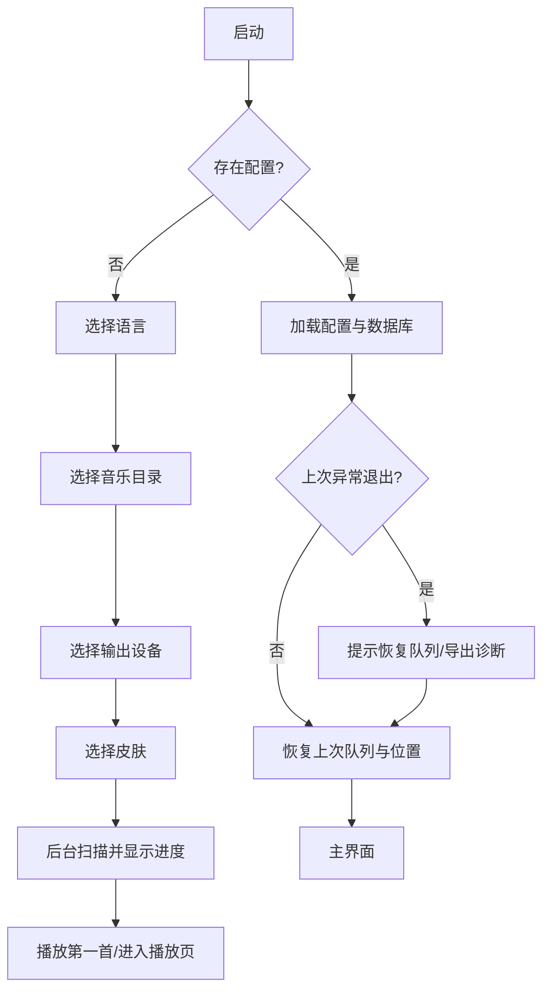

# 博音音乐播放器 BiuPlayer · 产品需求文档（PRD）

| 项目 | 内容 |
|---|---|
| 文档版本 | v0.1（评审稿） |
| 更新日期 | 2026-11-23 |
| 产品名称 | 博音音乐播放器 / BiuPlayer |
| 文档状态 | 待评审 |
| 关联文档 | [Idea.md](Idea.md)、[FeatureList.md](FeatureList.md)、[Arch.md](Arch.md) |
| 技术基线 | Tauri 2 + Rust + React 19 + TypeScript + shadcn/ui + Tailwind CSS |
| 目标平台 | Windows 10+、macOS 11+（Intel / Apple Silicon）、Linux（Ubuntu 22.04+ 基线） |

**修订记录**

| 版本 | 日期 | 作者 | 说明 |
|---|---|---|---|
| v0.1 | 2026-11-23 | 产品/架构 | 首版：背景、用户、范围、信息架构、功能需求、流程、NFR、发布与验收 |

**术语表**

| 术语 | 含义 |
|---|---|
| 媒体库 | 由用户添加的音乐目录扫描得到的曲目、专辑、艺术家集合，存于本地 SQLite |
| 播放列表 | 用户手动维护的曲目集合；另有“最近播放”“收藏”等系统列表 |
| 播放队列 | 独立于列表的临时播放下一个/插播队列 |
| 皮肤包 | 以 `.biuskin`（zip）分发的主题资源包，声明设计令牌与资源 |
| 插件 | 扩展解码、输出、DSP、可视化、歌词源等能力的包，分 WASM 安全插件与原生插件 |
| 位完美 | 音频数据不经重采样与软件音量处理，原样送至输出设备 |
| Gapless | 相邻曲目无缝衔接，无静音间隙 |
| CUE 分轨 | 由 CUE 文件描述的单文件专辑，按曲目切分播放 |
| 便携模式 | 配置、数据库、皮肤、插件存放在程序目录，便于绿色版随身携带 |

---

## 1. 背景与目标

### 1.1 背景

- 千千静听（TTPlayer）已停止维护多年，但其“本地曲库 + 播放列表 + 歌词 + 均衡器 + 换肤 + 插件”的桌面体验仍被大量用户怀念；现代播放器要么偏流媒体，要么界面简陋、缺少无损与桌面级细节。
- 本地无损收藏（FLAC/APE/WAV/DSD）与“离线优先”需求回潮：用户希望音乐资产留在本机、不依赖账号与网络、不被打扰。
- Tauri 2 使“Rust 原生音频 + Web 技术界面”的跨平台桌面应用成为可能，包体与内存显著优于 Electron。
- 项目为开源项目，无法承担代码签名与公证费用，需要以透明构建、校验和与清晰文档替代。

### 1.2 产品定位

**博音音乐播放器（BiuPlayer）**：一款本地优先、离线优先、支持无损的跨平台桌面音乐播放器，以现代交互复刻千千静听的经典能力，并具备可换肤、可插件扩展的开放生态。

一句话价值主张：**把本地音乐库变成一座好看、好用、可定制的私人音乐厅。**

### 1.3 产品目标

| 编号 | 目标 | 说明 |
|---|---|---|
| G1 | 开箱即用的本地播放 | 安装后 3 步内完成“选目录 → 扫描 → 播放”；核心格式开箱即用，APE/TTA/TAK/DSD 等在 1.0 完整支持 |
| G2 | 千千静听核心体验现代化 | 播放列表、歌词、均衡器、标签、换肤、插件、快捷键、托盘、定时关机完整对齐 |
| G3 | 可扩展的皮肤与插件生态 | 第三方可独立产出皮肤包与插件，官方提供模板、文档与示例 |
| G4 | 三平台可靠交付 | GitHub Actions 产出 Windows 绿色版/NSIS、macOS 双架构 dmg、Linux AppImage/deb/rpm |
| G5 | 值得信赖的离线与隐私 | 除用户显式开启的在线功能外零联网、零遥测、零账号 |

### 1.4 成功指标（发布后 90 天）

> 产品不采集遥测，以下指标来自 Release 下载、GitHub 社区数据、CI 基准与可用性测试。

| 指标 | 目标 | 测量方式 |
|---|---|---|
| 首次可用率 | ≥ 90% 受试者在 60s 内完成首次播放 | 5–8 人可用性测试 |
| P0 验收用例通过率 | 100% | QA 用例库 |
| 性能预算达标率 | 100%（启动/内存/搜索/滚动/扫描） | 基准脚本，见第 8 节 |
| 未处理崩溃 | 0（发布前）；用户诊断包中崩溃会话 < 0.5% | 崩溃转储 + 主动导出诊断包 |
| Release 下载 | 4 周 ≥ 3,000 次 | GitHub Release 统计 |
| 社区响应 | Issue 首次响应 < 48h，30 天关闭率 ≥ 70% | GitHub |
| 生态样例 | 官方示例插件 ≥ 3 个、皮肤 ≥ 2 套 | 仓库与文档 |
| 安装包体积 | Windows 安装包 ≤ 25MB（不含 WebView2） | CI 产物 |

---

## 2. 用户与场景

### 2.1 目标用户

| 画像 | 特征 | 核心诉求 | 关键功能 |
|---|---|---|---|
| 老张 · 资深收藏者（40+） | 千千静听老用户，2TB 本地音乐，大量 APE/FLAC 整轨 + CUE，重视音质 | 迁移成本低、整轨分轨、标签整理、歌词、稳定 | 媒体库、CUE、标签编辑、均衡器、Gapless、位完美 |
| 小林 · 桌面效率派（25–35） | 程序员/设计师，边工作边听歌，喜欢深色界面与快捷键 | 轻量、快、不打扰、系统集成好 | 托盘、全局快捷键、迷你模式、系统媒体控制、低占用 |
| 阿凯 · 折腾玩家（18–25） | 学生/开源爱好者，喜欢换肤、写插件、逛社区 | 可定制、开放 API、好看 | 皮肤引擎、插件系统、可视化、皮肤编辑器 |
| 小周 · 普通用户 | 只有几百首 MP3/FLAC，怕复杂 | 简单、不乱装东西、中文界面 | 首次向导、一键扫描、默认皮肤、无广告 |

### 2.2 核心场景（Jobs to be Done）

| 场景 | 触发 | 用户目标 | 涉及模块 |
|---|---|---|---|
| 迁移旧曲库 | 换电脑/整理硬盘 | 一次添加目录，自动识别标签与封面 | 媒体库、元数据 |
| 整轨专辑欣赏 | 播放 APE/FLAC + CUE | 曲目正确切分、无缝衔接、显示封面与歌词 | 播放内核、歌词 |
| 边工作边听 | 开机后常驻 | 托盘/快捷键控制，不占资源，不弹窗 | 系统集成、界面 |
| 整理与补全标签 | 曲库混乱 | 批量改标签、按模板重命名、补封面 | 元数据 |
| 跟唱与桌面歌词 | 听华语/外语歌 | 双语歌词、桌面置顶、可调偏移 | 歌词 |
| 调音 | 耳机/音箱差异 | EQ、重低音、Crossfeed、预设 | 音效 |
| 个性化 | 想与众不同 | 换肤、迷你模式、可视化 | 界面与皮肤 |
| 扩展能力 | 需要特殊格式/玩法 | 安装插件、写插件 | 插件 |
| 睡前听歌 | 夜间 | 定时关闭、淡出 | 系统集成 |

### 2.3 用户旅程

1. **首次使用**：下载 → 安装/解压 → 向导（语言、音乐目录、输出设备、皮肤）→ 扫描 → 播放第一首 → 看到歌词与封面。
2. **日常使用**：开机自启/托盘常驻 → 全局快捷键播放 → 队列与列表切换 → 睡眠定时。
3. **深度使用**：批量整理标签 → 制作/校准歌词 → 换肤 → 安装插件 → 反馈 Issue。

---

## 3. 范围

### 3.1 版本范围

| 版本 | 范围 | 出口标准 |
|---|---|---|
| M0 技术验证 | Rust 解码/输出链路、Tauri 壳、三平台最小播放、Linux 兼容性验证 | 三平台各播放一首无损；性能与体积数据 |
| M1 MVP（P0） | 播放内核基础、播放列表、媒体库、基础歌词、深浅色皮肤、设置、托盘、单实例、便携模式、日志、CI 打包 | 可日常使用；P0 用例全过；四类安装包可下载 |
| M2 1.0（P1） | CUE、Gapless、位完美、EQ、桌面歌词、歌词编辑、标签批量、换肤引擎、插件 API、Winamp2 音效插件兼容（Windows）、文件关联、系统媒体控制、睡眠定时、备份 | FeatureList §3 的 P1 项完成（对照表见 §4） |
| M3 生态（P2） | 插件市场、皮肤编辑器、可视化、DSD、Crossfeed、智能列表、格式转换、CD 抓轨、在线歌词/封面 | 第三方可产出并安装插件/皮肤 |

### 3.2 范围外

1. 在线版权曲库、付费音乐分发、内置盗版音源或搜索下载。
2. DRM 解密、破解、去广告等灰色能力。
3. 账号体系、云同步、社交、评论、榜单运营。
4. 移动端与 Web 版。
5. 代码签名与 Apple 公证（成本原因明确不做，改为校验和、构建溯源与文档指引）。
6. 自建在线歌词/封面服务器（仅支持可配置第三方源，由用户显式开启）。
7. 遥测、埋点、自动崩溃上报（仅本地日志，用户主动导出）。

### 3.3 假设与依赖

- 用户自备合法音乐文件；产品不提供内容。
- Windows 10 1809+ 自带 WebView2；更老系统需用户安装 WebView2 Runtime。
- macOS 未签名，首次打开需右键“打开”或移除隔离属性；文档提供指引。
- Linux 官方支持基线为 Ubuntu 22.04+（Tauri 2 依赖 WebKitGTK 4.1）；Ubuntu 20.04 支持存在技术冲突，见 12.2 开放问题 Q1。
- 插件生态依赖社区；1.0 仅保证官方示例与 API 稳定。

---

## 4. 信息架构与页面

### 4.1 全局布局

```
┌──────────────────────────────────────────────────────────────┐
│ 标题栏（可拖拽 / 窗口控制 / 搜索框 / 设置）                    │
├────────────┬─────────────────────────────────────────────────┤
│ 侧边导航    │ 主内容区                                        │
│ · 正在播放  │  ┌───────────────────────────────────────────┐  │
│ · 媒体库    │  │ 歌曲 / 专辑 / 艺术家 / 播放列表 / 设置      │  │
│ · 播放列表  │  │ （虚拟滚动列表 / 网格 / 详情）              │  │
│ · 最近播放  │  └───────────────────────────────────────────┘  │
│ · 收藏      │                                                 │
│ · 皮肤/插件 │                                                 │
├────────────┴─────────────────────────────────────────────────┤
│ 播放栏：封面｜标题/艺术家｜控制｜进度｜音量｜模式｜歌词｜EQ｜队列 │
└──────────────────────────────────────────────────────────────┘
```

- 主窗口最小 960×640；支持 100%–200% 缩放；侧栏可折叠。
- 辅助窗口：桌面歌词、迷你播放器、全屏歌词、独立歌词编辑器（可选）。
- 主窗口关闭默认“最小化到托盘”，可在设置中改为退出。

### 4.2 页面清单

| ID | 页面 | 入口 | 主要内容 | 优先级 |
|---|---|---|---|---|
| P-01 | 正在播放 | 侧栏 / 托盘 | 封面、曲目信息、歌词、可视化、队列 | P0 |
| P-02 | 媒体库 | 侧栏 | 歌曲/专辑/艺术家/流派/年代/文件夹视图、搜索、排序、批量操作 | P0 |
| P-03 | 播放列表 | 侧栏 | 列表管理、曲目编辑、导入导出、智能列表 | P0 |
| P-04 | 设置 | 标题栏齿轮 | 常规/播放/音频/音效/歌词/皮肤/插件/快捷键/媒体库/高级 | P0 |
| P-05 | 首次启动向导 | 首次启动 | 语言、目录、输出设备、皮肤 | P1 |
| P-06 | 桌面歌词（窗口） | 播放栏/快捷键 | 置顶歌词、字体/颜色/锁定/穿透 | P1 |
| P-07 | 迷你播放器（窗口） | 快捷键/托盘 | 紧凑控制、封面、进度 | P1 |
| P-08 | 全屏歌词（窗口） | 播放页按钮 | 沉浸式歌词与封面背景 | P2 |
| P-09 | 皮肤管理 | 设置/侧栏 | 预览、安装、切换、删除、导入导出 | P1 |
| P-10 | 插件管理 | 设置/侧栏 | 列表、启用/禁用、安装、权限查看、卸载 | P1 |
| P-11 | 标签编辑（对话框） | 右键/属性 | 单曲与批量字段编辑、封面、文件名模板 | P1 |
| P-12 | 歌词编辑（对话框） | 歌词区右键 | 打轴、增删行、偏移、保存 | P1 |
| P-13 | 关于/许可 | 设置 | 版本、开源许可、致谢、检查更新 | P0 |
| P-14 | 音频工具 | 设置/工具菜单 | 格式转换、CD 抓轨、文件整理、校验 | P2 |

### 4.3 全局交互约定

| 交互 | 约定 |
|---|---|
| 播放/暂停 | `Space`；媒体键；播放栏按钮 |
| 上一首/下一首 | `Ctrl/Cmd + ←/→`；媒体键 |
| 快进/快退 5s | `←/→`（列表未聚焦时） |
| 音量 ±5% | `↑/↓` 或 `Ctrl/Cmd + ↑/↓` |
| 静音 | `M` |
| 打开文件 | `Ctrl/Cmd + O` |
| 搜索 | `Ctrl/Cmd + F` |
| 新建列表 | `Ctrl/Cmd + N` |
| 迷你模式 | `Ctrl/Cmd + Shift + M` |
| 桌面歌词开关 | `Ctrl/Cmd + Shift + L` |
| 拖放 | 文件/文件夹拖入窗口：默认“加入队列并播放”，按住 `Shift` 加入当前列表 |
| 托盘 | 左键显示/隐藏；右键菜单含播放控制、桌面歌词、睡眠定时、退出 |
| 通知 | 切歌通知默认关闭；错误通知默认开启且可关闭 |
| 多窗口 | 主窗口与辅助窗口状态同步；关闭主窗口时按设置决定是否退出 |

---

## 5. 功能需求

### 5.1 需求编号与优先级

- 需求编号：`FR-<模块>-<序号>`，模块与 [FeatureList.md](FeatureList.md) 一致。
- 优先级：**P0** MVP 必须；**P1** 1.0 必须；**P2** 增强。
- 每条需求给出“验收标准”，采用 Given/When/Then 语义缩写；`关联` 列指向 FeatureList 功能编号。
- 所有 P0/P1 需求必须有对应自动化或手工用例；P2 需求至少有人工验收脚本。

### 5.2 播放内核（AUD）

目标：本地文件“点开即播”，控制跟手，音质链路可控、可解释。

| 编号 | 需求 | 规则 / 说明 | 优先级 | 验收标准 | 关联 |
|---|---|---|---|---|---|
| FR-AUD-01 | 核心格式播放 | MP3、FLAC、WAV、AAC/M4A、ALAC、OGG Vorbis、AIFF；按文件头识别；损坏文件跳过错 | P0 | Given 核心格式样本各 1 个，When 播放，Then 正常出声、时长与进度正确；Given 截断文件，Then 自动下一首并提示 | F-AUD-01/02/20 |
| FR-AUD-02 | 扩展格式播放 | APE、WavPack、TTA、TAK、Opus、WMA、DSD（DSF/DFF，先输出 PCM）；解码组件缺失时给出安装引导 | P1 | Given 扩展格式样本，When 播放，Then 正常出声；Given 组件缺失，Then 弹窗说明并给出安装入口 | F-AUD-22 |
| FR-AUD-03 | 基础控制 | 播放/暂停/停止/上一首/下一首/进度跳转/音量/静音；状态与 UI 双向同步 | P0 | Given 播放中，When 点击暂停，Then 200ms 内停止出声且按钮态同步；When 拖拽进度，Then 从目标位置继续 | F-AUD-11 |
| FR-AUD-04 | 播放模式 | 顺序、列表循环、单曲循环、随机；切换不打断当前曲；状态持久化 | P0 | Given 列表 10 首，When 切到单曲循环，Then 曲末重播同曲；重启后模式保持 | F-AUD-16 |
| FR-AUD-05 | 输出设备 | 枚举系统输出设备；切换即时生效；设备移除自动回退默认并提示 | P0 | Given 两套输出设备，When 切换，Then 声音从新设备输出且不崩溃；When 拔出 USB 声卡，Then 回退并提示 | F-AUD-04 |
| FR-AUD-06 | 播放信息与错误 | 显示编码器、采样率、位深、码率、文件大小、实际输出格式；错误可查看详情 | P1 | Given 24bit/96kHz FLAC，When 查看信息，Then 显示与文件一致；输出格式与实际链路一致 | F-AUD-19 |
| FR-AUD-07 | CUE 分轨 | 外挂/内嵌 CUE；GBK/UTF-8/BIG5；分轨可 seek、可排序、显示曲目名 | P1 | Given 整轨 FLAC + CUE，When 载入，Then 显示 N 首曲目且各自起止正确；When seek 到第 3 首，Then 播放位置正确 | F-AUD-03 |
| FR-AUD-08 | Gapless 与采样率切换 | 整专辑无缝；跟随曲目切换输出采样率，失败时回退重采样并提示 | P1 | Given 现场专辑，When 连续播放，Then 衔接无可闻间隙；Given 44.1k→96k，Then 输出格式随之切换 | F-AUD-08/09 |
| FR-AUD-09 | 位完美与独占 | 可选直通：不重采样、不软件音量；独占被占用时回退共享并提示 | P1 | Given 开启位完美并播放 16/44.1，When 查看链路，Then 输出为 16/44.1；Given 独占失败，Then 正常播放并提示 | F-AUD-05/06 |
| FR-AUD-10 | 断点续播 | 退出恢复队列、当前曲与位置；单曲记忆位置（可设阈值） | P1 | Given 播放到 3:20 退出，When 重启，Then 队列恢复且位置为 3:20 | F-AUD-17 |
| FR-AUD-11 | DSD 输出 | DoP / native；设备不支持回退 PCM；UI 明示当前模式 | P2 | Given DSD64 文件与支持设备，When 开启 DoP，Then 正常出声无爆音；Given 不支持，Then 回退 PCM 并提示 | F-AUD-07 |
| FR-AUD-12 | 变速、变调、淡化、响度 | 0.5–2.0x 变速不变调；±12 半音；淡入淡出；ReplayGain track/album | P2 | Given 1.5x，When 播放，Then 音高不变；Given 启用 ReplayGain，Then 不同专辑响度接近且不削波 | F-AUD-12~15 |
| FR-AUD-13 | 声道处理 | 左右平衡、单声道下混、声道映射 | P2 | Given 立体声文件，When 下混单声道，Then 两声道内容均保留 | F-AUD-18 |
| FR-AUD-14 | 网络流 | http(s) 流、网络电台；失败重试与超时提示 | P2 | Given 有效流地址，When 添加播放，Then 出声；Given 断网，Then 明确报错并可重试 | F-AUD-21 |

### 5.3 播放列表（PL）

| 编号 | 需求 | 规则 / 说明 | 优先级 | 验收标准 | 关联 |
|---|---|---|---|---|---|
| FR-PL-01 | 多列表管理 | 新建/重命名/复制/删除/拖动排序；列表持久化 | P0 | Given 创建 3 个列表并排序，When 重启，Then 名称与顺序完整恢复 | F-PL-01 |
| FR-PL-02 | 添加曲目 | 文件/文件夹/拖放/右键/命令行；重复添加提示；Shift 拖放加入当前列表 | P0 | Given 拖入文件夹，When 释放，Then 递归加入并开始播放；重复项给出提示且不重复插入 | F-PL-02 |
| FR-PL-03 | 列表编辑与查找 | 拖拽排序、多选、删除、撤销；按标题/艺术家/专辑/时长/添加时间排序；即时搜索（拼音/首字母） | P0 | Given 1 万条列表，When 输入“zd”，Then 1s 内过滤出“周杰伦”等匹配项 | F-PL-03/05/06 |
| FR-PL-04 | 播放队列 | “下一首播放”、插播、查看/调整/清空队列；队列优先于列表 | P0 | Given 播放列表中，When 对另一首选“下一首播放”，Then 当前曲结束后播放该曲，之后回到列表顺序 | F-PL-08 |
| FR-PL-05 | 导入导出 | m3u/m3u8/pls/wpl；相对路径；导出编码 UTF-8 | P1 | Given 列表导出 m3u8，When 在另一台机器导入，Then 顺序与相对路径解析正确 | F-PL-04 |
| FR-PL-06 | 去重与统计 | 按路径/大小+时长去重；显示曲目数、总时长、总大小 | P1 | Given 含 5 个重复项的列表，When 去重，Then 保留 1 份并可预览 | F-PL-07/13 |
| FR-PL-07 | 收藏与评分 | 收藏、1–5 星；可在列表与媒体库筛选、批量修改 | P1 | Given 给 3 首歌打 5 星，When 筛选 5 星，Then 仅显示这 3 首；重启后保留 | F-PL-14 |
| FR-PL-08 | 智能列表 | 规则：流派/年份/评分/最近播放/时长/格式；实时更新 | P2 | Given 规则“2010 年后 + 5 星”，When 新歌入库并满足，Then 自动出现在列表 | F-PL-09 |
| FR-PL-09 | 大列表性能 | 10 万条虚拟滚动；操作不冻结 | P0 | Given 10 万条列表，When 连续滚动 10s，Then 平均 ≥ 55fps 且无 > 200ms 卡顿 | F-PL-11 |

### 5.4 媒体库（LIB）

| 编号 | 需求 | 规则 / 说明 | 优先级 | 验收标准 | 关联 |
|---|---|---|---|---|---|
| FR-LIB-01 | 音乐目录管理 | 多目录、递归、排除子目录、排除隐藏文件；增删目录触发重扫 | P0 | Given 添加包含 1 万文件的目录，When 确认，Then 开始扫描并显示进度；删除目录不删除本地文件 | F-LIB-01 |
| FR-LIB-02 | 扫描与增量 | 首次全量、后续按 mtime/size 增量；可暂停/取消/继续；进度含已处理/总数/当前文件 | P0 | Given 扫描中点击取消，When 再次扫描，Then 从断点继续且不重复入库 | F-LIB-02 |
| FR-LIB-03 | 库视图 | 歌曲/专辑/艺术家/专辑艺术家/流派/年代/文件夹；排序、多选、右键菜单 | P0 | Given 库中有 50 张专辑，When 打开专辑视图，Then 按专辑聚合且封面正确 | F-LIB-04 |
| FR-LIB-04 | 搜索 | 标题/艺术家/专辑/文件名；中文、拼音全拼、首字母；结果高亮 | P0 | Given 10 万曲目，When 搜索“晴天”或“qt”，Then 100ms 内返回并高亮 | F-LIB-06 |
| FR-LIB-05 | 封面 | 内嵌优先，回退 cover/folder/front/album；方形裁切；缺图占位 | P1 | Given 无内嵌但有 cover.jpg 的专辑，When 浏览，Then 显示外挂封面 | F-LIB-05 |
| FR-LIB-06 | 文件监控 | 新增/删除/修改 2s 内反映；扫描期间不重复处理 | P1 | Given 在外部删除一首歌，When 2s 后查看，Then 标记缺失或移除 | F-LIB-03 |
| FR-LIB-07 | 缺失与重定位 | 标记失效；按文件名+大小时长批量重定位；批量移除 | P1 | Given 目录改名，When 选择新根目录，Then 批量修复路径且统计保留 | F-LIB-09 |
| FR-LIB-08 | 重复与统计 | 重复分组（路径/大小+时长/可选指纹）；曲目/专辑/艺术家统计 | P2 | Given 两首同内容不同路径，When 检测，Then 分到同组并可选择保留 | F-LIB-08/10 |
| FR-LIB-09 | 大库性能 | 10 万曲目：启动 < 2s、搜索 < 100ms、滚动 ≥ 55fps | P1 | 基准脚本在三平台达标 | F-LIB-12 |
| FR-LIB-10 | 重建与可移动磁盘 | 一键重建保留评分/统计；相对路径或卷标重定位 | P1 | Given 移动硬盘盘符变化，When 重新扫描，Then 曲目恢复且播放正常 | F-LIB-11/13/14 |

### 5.5 元数据（TAG）

| 编号 | 需求 | 规则 / 说明 | 优先级 | 验收标准 | 关联 |
|---|---|---|---|---|---|
| FR-TAG-01 | 标签读取 | ID3v1/v2.2–2.4、APEv2、Vorbis Comment、MP4 atoms、WAV ID3；中文不乱码 | P0 | Given GBK 编码 ID3 老文件，When 入库，Then 标题/艺术家正确显示 | F-TAG-01/07 |
| FR-TAG-02 | 安全写入 | 临时文件 + 原子替换；写入失败不损坏原文件；写入前校验格式支持 | P1 | Given 只读文件，When 保存，Then 报错且原文件可正常播放 | F-TAG-02 |
| FR-TAG-03 | 字段编辑 | 标题/艺术家/专辑艺术家/专辑/曲号/碟号/年份/流派/作曲/作词/编曲/评论/歌词/封面/评分/BPM/语言/版权/ISRC；多值 | P1 | Given 修改 10 个字段，When 保存，Then 第三方工具读取一致；多艺术家以分隔符正确展示 | F-TAG-03/04 |
| FR-TAG-04 | 批量编辑 | 统一改/追加/替换；支持选中多首与整个专辑；执行前预览 | P1 | Given 100 首，When 批量设置“专辑=精选集”，Then 全部更新且可撤销 | F-TAG-05 |
| FR-TAG-05 | 文件名模板 | `%artist% - %title%` 等变量；预览、冲突策略（跳过/覆盖/自动编号） | P1 | Given 模板与 20 首，When 预览，Then 显示新旧文件名；执行后文件与标签一致 | F-TAG-06 |
| FR-TAG-06 | 封面管理 | 内嵌增删改、外挂 cover.jpg、批量导入、选主封面 | P1 | Given 多图，When 设为主封面，Then 列表与播放页显示该图 | F-TAG-08 |
| FR-TAG-07 | 在线补全 | MusicBrainz/AcoustID，默认关闭；逐条确认，不覆盖已有值 | P2 | Given 未开启，When 编辑标签，Then 无任何网络请求 | F-TAG-09 |
| FR-TAG-08 | 撤销 | 最近一次批量标签/重命名可撤销 | P2 | Given 批量改名，When 撤销，Then 文件名与标签恢复 | F-TAG-10 |

### 5.6 歌词（LRC）

| 编号 | 需求 | 规则 / 说明 | 优先级 | 验收标准 | 关联 |
|---|---|---|---|---|---|
| FR-LRC-01 | 解析与同步 | 标准/增强 LRC、多时间标签、元信息、offset；逐行滚动高亮；点击跳转 | P0 | Given 标准 LRC，When 播放，Then 当前行误差 < 200ms；点击第 5 行，Then 跳到对应时间 | F-LRC-01/05 |
| FR-LRC-02 | 歌词来源 | 同名 `.lrc` 自动加载（编码检测）；内嵌 USLT/SYLT/FLAC LYRICS/MP4 ©lyr；优先级可配置 | P0 | Given 同名 GBK 歌词，When 播放，Then 正确显示不乱码；Given 内嵌歌词，Then 自动使用 | F-LRC-02/03 |
| FR-LRC-03 | 双语歌词 | 翻译/罗马音双行；同时间轴对齐；可单/双行切换 | P1 | Given 双语 LRC，When 开启双行，Then 两行同步滚动且对齐 | F-LRC-04 |
| FR-LRC-04 | 偏移调整 | ±ms 微调，按歌曲保存；提供“提前/延后”快捷按钮 | P1 | Given 歌词整体慢 300ms，When +300ms，Then 对齐；重启后保留 | F-LRC-06 |
| FR-LRC-05 | 歌词编辑 | 边播边打轴、增删行、时间微调、保存/另存、撤销 | P1 | Given 无歌词，When 打轴 10 行并保存，Then 生成合法 LRC 并可回放 | F-LRC-07 |
| FR-LRC-06 | 桌面歌词 | 独立置顶窗口；字体/字号/颜色/描边/双行/锁定/鼠标穿透；位置记忆 | P1 | Given 开启桌面歌词并锁定，When 切换到全屏应用，Then 歌词仍显示且不可误拖 | F-LRC-08 |
| FR-LRC-07 | 全屏歌词 | 封面背景、沉浸式排版、退出回到播放页 | P2 | Given 点击全屏，When Esc，Then 退出且播放不中断 | F-LRC-09 |
| FR-LRC-08 | 在线歌词 | 可配置源、默认关闭、明确联网提示、失败回退 | P2 | Given 未开启，Then 零请求；Given 开启并搜索，Then 可预览并保存 | F-LRC-10 |
| FR-LRC-09 | 歌词样式 | 字体、字号、行距、动画；可保存预设 | P2 | Given 自定义样式，When 重启，Then 样式保留 | F-LRC-12 |

### 5.7 音效与 DSP（DSP）

| 编号 | 需求 | 规则 / 说明 | 优先级 | 验收标准 | 关联 |
|---|---|---|---|---|---|
| FR-DSP-01 | 均衡器 | 10 段 31Hz–16kHz、±12dB、前级增益；实时生效；可开关 | P1 | Given 提升 1kHz +6dB，When 播放粉噪，Then 频响变化符合预期且无爆音 | F-DSP-01 |
| FR-DSP-02 | EQ 预设 | 内置流行/摇滚/古典/爵士/人声/低音增强；自定义保存/导入导出 | P1 | Given 切换预设，When 播放，Then 曲线与听感同步变化；自定义重启后保留 | F-DSP-02 |
| FR-DSP-03 | 空间与动态 | 环绕/立体声扩展、重低音、Crossfeed、限幅/防削波 | P2 | 各开关独立生效，默认关闭，参数可复位 | F-DSP-03~06 |
| FR-DSP-04 | 电平表 | 峰值/RMS、削波指示 | P2 | Given 0dBFS 信号，When 播放，Then 削波指示亮起 | F-DSP-08 |
| FR-DSP-05 | DSP 链与重采样 | 插件参与链路、顺序调整、旁路、A/B；重采样质量可选 | P2 | Given 安装 DSP 插件，When 调整顺序，Then 听感/电平按顺序变化且稳定 | F-DSP-07/09/10 |

### 5.8 界面与皮肤（UI）

| 编号 | 需求 | 规则 / 说明 | 优先级 | 验收标准 | 关联 |
|---|---|---|---|---|---|
| FR-UI-01 | 主界面布局 | 侧栏 + 主内容 + 播放栏；面板可折叠、宽度可调；布局持久化 | P0 | Given 折叠侧栏并调整播放栏高度，When 重启，Then 布局恢复 | F-UI-01 |
| FR-UI-02 | 内置皮肤 | 浅色/深色两套，随系统切换；切换无闪烁 | P0 | Given 系统切换深色，When 应用跟随，Then 500ms 内完成且无白闪 | F-UI-03/14 |
| FR-UI-03 | 皮肤引擎 | `.biuskin` 包：manifest + 设计令牌 + 九宫格资源 + 布局；换肤不重启；异常包回退默认 | P1 | Given 安装第三方皮肤，When 启用，Then 全局生效；Given 损坏包，Then 拒绝并提示 | F-UI-02/04 |
| FR-UI-04 | 窗口与托盘 | 无边框/置顶/透明度/尺寸记忆；托盘菜单与播放状态同步；关闭到托盘可配置 | P0 | Given 关闭主窗口，When 设置为“到托盘”，Then 播放继续且托盘可恢复窗口 | F-UI-08/09 |
| FR-UI-05 | 全局快捷键 | 媒体键 + 自定义组合；冲突检测；可整体关闭 | P1 | Given 设置 `Ctrl+Alt+P` 为播放/暂停，When 应用在后台，Then 快捷键生效 | F-UI-10 |
| FR-UI-06 | 可视化 | 频谱/波形/封面旋转；可关闭；低功耗模式 | P2 | Given 开启频谱，When 播放，Then 与音频同步且 CPU 增幅 ≤ 5% | F-UI-11 |
| FR-UI-07 | 拖放与高 DPI | 文件/文件夹拖放；100%–200% 缩放正确；多屏拖动 | P0 | Given 150% 缩放双屏，When 跨屏拖动，Then 不模糊、不跳位 | F-UI-12/13 |
| FR-UI-08 | 皮肤编辑器 | 可视化编辑令牌/资源、实时预览、打包导出 | P2 | Given 修改主色与背景图，When 导出，Then 生成可安装 `.biuskin` | F-UI-05 |

### 5.9 插件系统（PLG）

| 编号 | 需求 | 规则 / 说明 | 优先级 | 验收标准 | 关联 |
|---|---|---|---|---|---|
| FR-PLG-01 | 插件模型 | manifest（id/版本/API 版本/类型/权限/入口）；API 版本化；不兼容拒绝加载 | P1 | Given API v2 插件在 v1 应用，When 安装，Then 提示不兼容且不启用 | F-PLG-01 |
| FR-PLG-02 | 插件类型 | 解码、输出、DSP、可视化、界面、歌词源、元数据源；每类有官方示例 | P1 | Given 官方示例各 1 个，When 安装启用，Then 功能可见可用 | F-PLG-02 |
| FR-PLG-03 | 安装与管理 | zip 导入、启用/禁用/卸载/更新/回滚；权限与作者信息可见 | P1 | Given 安装插件，When 查看详情，Then 展示权限清单；卸载后无残留文件 | F-PLG-03/04/05 |
| FR-PLG-04 | 隔离与安全 | 插件崩溃不影响主程序；WASM 插件沙箱化；原生插件需显式授权；资源限额 | P1 | Given 插件 panic，When 触发，Then 主程序存活、插件被禁用并记录 | F-PLG-03/08 |
| FR-PLG-05 | 市场与开发者套件 | 可自托管索引；模板、文档、调试日志；评分/下载量（可选） | P2 | Given 官方模板，When 按文档构建，Then 30 分钟内跑通示例 | F-PLG-06/07 |
| FR-PLG-06 | Winamp2 音效插件兼容 | 加载用户提供的 32 位 Winamp2 DSP DLL（`winampDSPGetHeader2`）；可同时启用多个、调整链式顺序、逐个旁路/配置；独立 32 位宿主进程，崩溃不影响播放；仅 Windows x64；链路强制 16bit/立体声，启用时位完美不可用 | P1 | Given 两个 DSP DLL，When 同时启用并调整顺序，Then 处理顺序与听感一致且可逐个旁路；Given 宿主崩溃，Then 播放继续、问题插件被禁用并提示 | F-PLG-10 |

### 5.10 系统集成（SYS）

| 编号 | 需求 | 规则 / 说明 | 优先级 | 验收标准 | 关联 |
|---|---|---|---|---|---|
| FR-SYS-01 | 文件关联 | 常见格式；安装版注册、绿色版可选；双击/多选打开 | P1 | Given 关联 mp3，When 双击文件，Then 打开播放器并播放 | F-SYS-01 |
| FR-SYS-02 | 单实例与命令行 | 第二实例转交参数；`--play/--enqueue/--next/--toggle` | P0 | Given 已运行，When 再次双击文件，Then 在原窗口加入并播放，无第二窗口 | F-SYS-02/03 |
| FR-SYS-03 | 系统媒体控制 | Windows SMTC、macOS Now Playing、Linux MPRIS；媒体键 | P1 | Given 播放中，When 按键盘媒体键，Then 播放/暂停且系统面板状态同步 | F-SYS-04/05 |
| FR-SYS-04 | 睡眠定时 | 倒计时、播完当前曲、播完列表后关机/休眠；到点前可取消 | P1 | Given 设定 30 分钟，When 到点，Then 执行所选动作；提前取消则不执行 | F-SYS-06 |
| FR-SYS-05 | 防休眠与通知 | 播放时阻止睡眠（可关）；切歌通知默认关闭 | P1 | Given 播放中，When 系统空闲，Then 不进入睡眠；暂停后恢复正常策略 | F-SYS-07/08 |
| FR-SYS-06 | 便携模式 | 配置/数据库/皮肤/插件随程序目录；启动时检测 `portable.flag` | P0 | Given 绿色版目录拷贝到新机器，When 启动，Then 列表/设置/统计完整 | F-SYS-10 |
| FR-SYS-07 | 任务栏 / Dock / 自启 | 任务栏进度与缩略图按钮；可选开机自启 | P1 | Given 播放中，When 查看任务栏，Then 显示进度；关闭自启后登录项被清理 | F-SYS-09/11 |

### 5.11 数据（DATA）

| 编号 | 需求 | 规则 / 说明 | 优先级 | 验收标准 | 关联 |
|---|---|---|---|---|---|
| FR-DATA-01 | 数据目录与配置 | 各平台标准目录；便携模式覆盖；配置原子写入，损坏回退并备份 | P0 | Given 手工破坏配置文件，When 启动，Then 使用默认配置并保留坏文件副本 | F-DATA-01/02 |
| FR-DATA-02 | 数据库迁移 | 版本化迁移；失败回滚；迁移前自动备份 | P0 | Given v1 数据库升级到 v2，When 启动，Then 数据完整、迁移日志可查 | F-DATA-03 |
| FR-DATA-03 | 备份与恢复 | 导出配置+库+列表+统计；定时备份；恢复前确认 | P1 | Given 备份文件，When 在新机恢复，Then 列表/评分/统计一致 | F-DATA-04 |
| FR-DATA-04 | 统计与导出 | 播放次数/时长/最近/年度报告；CSV/JSON 导出；可关闭统计 | P2 | Given 播放 10 次，When 查看统计，Then 次数/时长准确；关闭后不再记录 | F-DATA-05/06 |
| FR-DATA-05 | 分类重置 | 设置/媒体库/皮肤/插件/统计分别重置；二次确认 | P1 | Given 重置媒体库，When 确认，Then 仅库数据清空，设置与插件保留 | F-DATA-07 |

### 5.12 设置（SET）

| 编号 | 需求 | 规则 / 说明 | 优先级 | 验收标准 | 关联 |
|---|---|---|---|---|---|
| FR-SET-01 | 设置中心 | 常规/播放/音频/音效/歌词/皮肤/插件/快捷键/媒体库/高级；搜索设置项 | P0 | Given 搜索“淡入”，When 输入，Then 定位到对应项并高亮 | F-SET-01/03 |
| FR-SET-02 | 即时生效 | 绝大多数设置即时生效；需重启项明确标注 | P0 | Given 修改主题/音量/输出设备，Then 立即生效 | F-SET-02 |
| FR-SET-03 | 设置迁移 | 导入/导出设置文件，含版本校验与未知项忽略 | P1 | Given 旧版本设置文件，When 导入，Then 兼容项生效、未知项提示 | F-SET-04 |
| FR-SET-04 | 首次向导 | 语言、音乐目录、输出设备、皮肤；可跳过、可再次进入 | P1 | Given 首次启动，When 完成向导，Then 自动扫描并进入播放页 | F-SET-05 |
| FR-SET-05 | 关于与许可 | 版本、构建信息、开源许可、致谢、检查更新 | P0 | Given 打开关于，Then 显示完整第三方许可列表 | F-SET-06 |

### 5.13 国际化与无障碍（I18N）

| 编号 | 需求 | 规则 / 说明 | 优先级 | 验收标准 | 关联 |
|---|---|---|---|---|---|
| FR-I18N-01 | 多语言 | 简中/繁中/英文；运行时切换；无硬编码文案 | P0 | Given 切换英文，When 浏览全部页面，Then 无中文残留、无截断 | F-I18N-01 |
| FR-I18N-02 | 语言包扩展 | 外部 JSON；缺键回退英文并记录 | P1 | Given 第三方语言包缺 3 个键，When 加载，Then 回退且日志可见 | F-I18N-02 |
| FR-I18N-03 | 无障碍 | 键盘全操作、焦点可见、ARIA 标签、高对比、减少动画 | P1/P2 | Given 仅键盘，When 完成播放与搜索，Then 全流程可达 | F-I18N-03~06 |

### 5.14 网络增强（NET）

| 编号 | 需求 | 规则 / 说明 | 优先级 | 验收标准 | 关联 |
|---|---|---|---|---|---|
| FR-NET-01 | 更新检查 | GitHub Releases API；仅提示；可关闭；不静默下载安装 | P1 | Given 关闭检查，When 启动，Then 无网络请求；Given 有新版本，Then 提示并打开下载页 | F-NET-02 |
| FR-NET-02 | 在线歌词/封面 | 默认关闭；开启时说明来源与隐私；失败回退本地 | P2 | Given 未开启，When 播放无歌词歌曲，Then 显示占位且零请求 | F-NET-01 |
| FR-NET-03 | 隐私保证 | 无遥测、无账号、无后台请求；出站请求可审计 | P0 | 抓包 24h：除用户触发外无请求 | F-NET-04 |

### 5.15 构建与分发（REL）

| 编号 | 需求 | 规则 / 说明 | 优先级 | 验收标准 | 关联 |
|---|---|---|---|---|---|
| FR-REL-01 | CI 矩阵 | GitHub Actions：Windows x64、macOS x64/arm64、Linux x64；tag 触发 | P0 | Given 推送 `v*` tag，When CI 完成，Then 产出全部安装包 | F-REL-01 |
| FR-REL-02 | Windows 产物 | 绿色版 zip + NSIS 安装版；安装版可选路径/关联/自启；卸载清理 | P0 | 干净虚拟机安装/卸载/升级均通过 | F-REL-02/03 |
| FR-REL-03 | macOS 产物 | Intel 与 Apple Silicon 分别 dmg（可加 universal）；未签名说明 | P0 | 两种机型均可打开并播放 | F-REL-04 |
| FR-REL-04 | Linux 产物 | AppImage + deb + rpm；Ubuntu 22.04/24.04 验证 | P0 | 三种包可安装启动；Wayland/X11 均可 | F-REL-05 |
| FR-REL-05 | 校验与发布 | SHA256SUMS、构建溯源、draft release、CHANGELOG | P0 | Release 附校验文件；校验通过 | F-REL-06/07/08 |
| FR-REL-06 | 质量门 | fmt/clippy/test/lint/typecheck/build 必须通过 | P0 | PR 红灯不可合并 | F-REL-10 |
| FR-REL-07 | 自动更新 | 可选；受不签名限制，以提示下载为主 | P2 | 关闭后无请求；开启仅提示 | F-REL-09 |

### 5.16 质量与工程（QA）

| 编号 | 需求 | 规则 / 说明 | 优先级 | 验收标准 | 关联 |
|---|---|---|---|---|---|
| FR-QA-01 | 日志与崩溃 | 分级滚动日志；一键导出诊断包；panic 捕获与下次启动提示 | P0 | Given 模拟崩溃，When 重启，Then 提示并可导出诊断包 | F-QA-01/02 |
| FR-QA-02 | 测试体系 | 单元/集成/E2E；关键模块覆盖率门槛；测试数据含多格式样本 | P0 | CI 全绿；覆盖率达标 | F-QA-03/04 |
| FR-QA-03 | 性能与长稳 | 基准脚本；24h 长稳；内存/CPU 回归检测 | P1 | 基准与 24h 结果达标 | F-QA-05/06 |
| FR-QA-04 | 文档 | README、构建、用户手册、插件/皮肤开发文档、贡献规范 | P0 | 新人按文档可独立构建 | F-QA-08/09 |

### 5.17 音频工具（TOOL）

| 编号 | 需求 | 规则 / 说明 | 优先级 | 验收标准 | 关联 |
|---|---|---|---|---|---|
| FR-TOOL-01 | 格式转换 | 批量转 MP3/FLAC/WAV/OGG；码率/质量/采样率；保留标签与封面 | P2 | 转换后标签/封面完整，可播放 | F-TOOL-01 |
| FR-TOOL-02 | CD 抓轨 | 读取 CD、元数据源可选、抓轨 FLAC/WAV、生成 CUE、校验日志 | P2 | 抓轨结果可播放且校验通过 | F-TOOL-02 |
| FR-TOOL-03 | 文件整理 | 按模板移动/重命名；冲突策略；预览后执行、可撤销 | P1 | 1000 文件整理后路径与标签一致 | F-TOOL-04 |
| FR-TOOL-04 | 文件校验 | 检测损坏/异常采样率/位深并导出报告 | P2 | 损坏样本被准确标记 | F-TOOL-05 |

---

## 6. 关键流程

### 6.1 首次启动



- 跳过向导：使用默认目录（空库）与默认设备，仍可在设置中重新进入。
- 扫描失败：提示目录权限/磁盘错误，保留已入库数据，可重试。

### 6.2 播放与队列

1. 用户双击曲目 → 前端将 `track_id` 与上下文（列表/专辑）交给播放内核。
2. 内核解析音源（本地文件/流/CUE 虚拟轨）→ 预加载下一首 → 输出。
3. 播放结束：按模式选择下一首（队列优先 → 列表 → 随机池）→ Gapless 衔接。
4. 解码失败：记录错误 → 标记不可播 → 自动跳下一首（连续失败 3 次暂停并提示）。
5. 用户切歌：淡出（若启用）→ 释放旧解码器 → 加载新曲 → 淡入。

### 6.3 媒体库扫描

1. 添加目录 → 校验可读 → 写入 `folders`。
2. 扫描器遍历（跳过隐藏/排除项）→ 读取标签与音频属性 → 批量事务入库（每 200 条或 500ms）。
3. 进度事件节流（≤ 10Hz）→ 前端显示“已处理/总数/当前文件”。
4. 取消：设置取消标记，已入库数据保留，记录断点。
5. 完成：更新增量游标（mtime/size），刷新封面缓存，触发 `library:changed`。

### 6.4 歌词制作

1. 播放歌曲 → 打开歌词编辑器 → 载入现有 LRC（若有）。
2. 播放中按“打轴”记录当前行时间 → 自动跳到下一行。
3. 可拖动微调、插入/删除行、设置 offset → 试听校验。
4. 保存：写入同名 `.lrc`（UTF-8），或按用户选择内嵌（需要标签写入支持）。
5. 冲突：已有文件时提示覆盖/另存/取消。

### 6.5 换肤

1. 用户导入 `.biuskin` → 校验 manifest 与版本 → 解压到 `skins/<id>/<version>`（原子替换）。
2. 应用读取令牌 → 注入 CSS 变量 → 加载布局与资源 → 通知所有窗口。
3. 失败（缺资源/非法 CSS）→ 回退上一套皮肤并提示。
4. 删除皮肤：若为当前皮肤，先切回内置皮肤再删除。

### 6.6 插件安装

1. 导入插件包 → 校验 manifest、API 版本、签名（可选）→ 展示权限清单。
2. 用户确认 → 安装到 `plugins/<id>/` → 注册到插件表（默认禁用）。
3. 启用 → 宿主创建实例（WASM 沙箱/原生加载）→ 健康检查 → 注入对应扩展点。
4. 运行异常 → 捕获 → 禁用插件 → 提示并保留日志。
5. 卸载 → 停用 → 删除目录 → 清理配置（可选保留）。

### 6.7 睡眠定时

1. 选择方式（倒计时/播完当前/播完列表）与动作（关机/休眠/仅停止）。
2. 显示剩余时间；到点前 60s 可收到提示（可选）。
3. 到点执行：先淡出停止 → 执行系统动作；关机前保存队列与位置。

### 6.8 异常恢复

- 启动检测 `running.lock` 与上次退出标记；异常退出时提供“恢复播放队列”“导出诊断包”“安全模式启动（禁用插件/皮肤）”。
- 数据库损坏：自动备份损坏文件 → 尝试修复 → 失败则新建空库并保留原文件。
- 配置损坏：回退默认并保留 `.bak`。

---

## 7. 交互与视觉规范

### 7.1 布局与尺寸

| 项 | 规范 |
|---|---|
| 间距 | 4 的倍数（4/8/12/16/24/32） |
| 圆角 | 组件 8px，卡片 12px，弹窗 16px（可由皮肤覆盖） |
| 字号 | 12/13/14/16/20/24；正文 14 |
| 播放栏高度 | 72px（紧凑 56px） |
| 侧栏宽度 | 默认 220px，范围 180–320px |
| 列表行高 | 舒适 40px / 紧凑 32px |
| 动效 | 120–200ms ease-out；支持“减少动画” |

### 7.2 组件映射（shadcn/ui）

| 场景 | 组件 |
|---|---|
| 按钮/图标按钮 | `Button`、`Toggle` |
| 列表/表格 | `Table` + TanStack Virtual；行内 hover 操作 |
| 菜单/右键 | `DropdownMenu`、`ContextMenu` |
| 对话框/抽屉 | `Dialog`、`Sheet`、`AlertDialog` |
| 表单 | `Input`、`Select`、`Switch`、`Slider`、`Tabs`、`Form`（react-hook-form + zod） |
| 反馈 | `Toast`（sonner）、`Progress`、`Skeleton`、`Tooltip` |
| 导航 | 侧栏自绘 + `ScrollArea`；设置页 `Tabs` |
| 封面 | `AspectRatio` + 懒加载 + 占位渐变 |

### 7.3 页面状态

| 状态 | 规范 |
|---|---|
| 空 | 插画/图标 + 一句说明 + 主操作按钮（如“添加音乐文件夹”） |
| 加载 | 骨架屏（列表/封面），超过 300ms 才显示，避免闪烁 |
| 错误 | 说明“发生了什么 + 下一步”，提供重试/查看日志；不暴露堆栈 |
| 离线 | 在线功能入口置灰并提示“该功能需要联网”；本地功能不受影响 |
| 无权限/文件缺失 | 行内标记 + 批量修复入口 |
| 长任务 | 进度 + 取消；完成后 Toast 汇总 |

### 7.4 文案与国际化

- 全部文案走 i18n key；按钮用动词，错误说清“原因 + 动作”。
- 中文标点全角，英文与数字前后留空格；不出现“请稍候……”式无信息文案。
- 歌词、标签等用户内容不翻译。

### 7.5 无障碍

- 所有可点击元素可 Tab 到达，焦点环可见；列表支持方向键与 Home/End。
- 图标按钮必须有 `aria-label`；进度条/滑块有 `aria-valuenow`。
- 颜色对比 ≥ 4.5:1（正文）；不仅靠颜色传达状态。
- 支持系统“减少动态效果”与高对比主题。

---

## 8. 非功能需求

| 类别 | 指标 | 验收方式 |
|---|---|---|
| 启动 | 冷启动 ≤ 2s；10 万曲库 ≤ 3s | 三平台基准脚本，10 次中位数 |
| 内存 | 空闲 ≤ 200MB；播放 ≤ 300MB；10 万库 ≤ 500MB | 系统监视器采样 |
| CPU | 播放 ≤ 3%（单核折算）；可视化开启 ≤ 10% | 采样 60s 平均 |
| 交互 | 播放控制响应 ≤ 100ms；IPC p95 ≤ 50ms | 自动化埋点（本地） |
| 列表 | 10 万条滚动 ≥ 55fps | 帧率采样 |
| 搜索 | 10 万曲目 ≤ 100ms | 基准脚本 |
| 扫描 | 1 万文件 ≤ 60s（SSD） | 基准脚本 |
| 包体 | Windows 安装包 ≤ 25MB（不含 WebView2） | CI 产物 |
| 稳定性 | 24h 播放无泄漏/崩溃；连续切歌 1000 次无崩溃 | 长稳任务 |
| Winamp2 DSP | 链路附加延迟 ≤ 30ms（1024 帧块）；宿主崩溃恢复 ≤ 2s；仅 Windows x64 | 测试插件基准 + 故障注入 |
| 兼容 | Win10 1809+、macOS 11+、Ubuntu 22.04+；Wayland/X11 | 虚拟机/真机矩阵 |
| 可访问 | 键盘全流程；对比度达标 | 手工 + axe |
| 隐私 | 无遥测；默认零出站 | 抓包 + 代码审计 |

---

## 9. 数据与隐私

- **数据位置**：Windows `%APPDATA%/BiuPlayer`、macOS `~/Library/Application Support/BiuPlayer`、Linux `~/.local/share/biuplayer`；便携模式为程序目录 `./data`。
- **数据内容**：设置、SQLite 库（曲目/标签缓存/列表/统计）、歌词缓存、封面缓存、皮肤、插件、日志。
- **数据主权**：用户可导出库与统计、备份/恢复、分类重置；卸载不删除音乐文件。
- **隐私**：默认无网络请求；在线歌词/封面/更新检查需用户开启；不上传任何曲目、路径、播放记录；诊断包由用户主动导出，导出前提示内容。
- **安全**：插件权限清单可见；原生插件需显式授权；皮肤包禁止远程资源；所有外部路径做规范化校验。
- **Winamp2 DSP**：仅加载用户显式添加的 32 位 Windows DLL；记录路径与 SHA256，不自动扫描加载；本质是原生代码，不构成安全沙箱，仅做进程隔离与崩溃恢复。

---

## 10. 发布计划

| 阶段 | 周期 | 交付 | 出口标准 |
|---|---|---|---|
| M0 技术验证 | 1–2 周 | 解码/输出 Demo、Tauri 壳、三平台冒烟、Linux 兼容结论 | 三平台播放无损；性能/体积数据 |
| M1 MVP | 6–8 周 | P0 功能 + CI 四类安装包 | P0 用例 100%；可日常使用 |
| M2 1.0 | 8–12 周 | P1 功能（CUE/Gapless/EQ/桌面歌词/换肤/插件/系统集成） | P1 用例 100%；1.0 发布 |
| M3 生态 | 持续 | P2 功能、插件市场、皮肤编辑器、工具 | 第三方插件/皮肤可产出 |

**发布节奏**：M1 前每两周一个内测包；1.0 前一个月进入冻结，仅修缺陷；正式版遵循 SemVer，`CHANGELOG` 自动生成。

---

## 11. 验收与测试

### 11.1 测试层级

| 层级 | 范围 | 工具 |
|---|---|---|
| 单元 | Rust 解码/标签/LRC/数据库/路径；TS 工具与 store | cargo test、vitest |
| 集成 | IPC 命令、扫描→入库→查询、插件加载 | cargo test + 临时库 |
| 组件 | 列表、播放栏、设置表单 | Testing Library + mocked IPC |
| E2E | 首次启动、播放、换肤、安装插件 | tauri-driver（Linux/Windows）+ 手工 macOS |
| 兼容 | 三平台 × 架构 × DPI × Wayland/X11 | 虚拟机/真机矩阵 |
| 长稳/性能 | 24h、10 万库、连续切歌 | 脚本 + 监控 |

### 11.2 缺陷等级

| 等级 | 定义 | 处理 |
|---|---|---|
| S1 阻断 | 无法启动/无法播放/数据丢失/安全漏洞 | 立即修复，阻断发布 |
| S2 严重 | 核心功能不可用、崩溃、性能严重超标 | 发布前必须修复 |
| S3 一般 | 次要功能异常、UI 错位、文案错误 | 排期修复 |
| S4 建议 | 体验优化、边缘场景 | 进入 Backlog |

### 11.3 完成定义（DoD）

代码评审通过；单测/集成测试通过；i18n 三语齐备；错误与空状态处理；文档/CHANGELOG 更新；性能无回归；无 S1/S2 缺陷。

---

## 12. 风险与开放问题

### 12.1 风险

| 风险 | 影响 | 缓解 |
|---|---|---|
| 不签名/不公证 | macOS 拦截、Windows SmartScreen 警告 | 文档指引、SHA256、构建溯源、社区信任 |
| 扩展格式解码依赖 | 包体增大或格式支持不全 | 原生优先；可选解码组件；清晰引导 |
| 插件安全 | 恶意插件破坏数据/外联 | WASM 沙箱、权限、原生插件显式授权、审计 |
| 大库性能 | 启动慢/卡顿 | 增量扫描、索引、虚拟滚动、基准先行 |
| 皮肤兼容 `.ski` | 格式/授权风险 | 自研格式，兼容性另立项评估 |
| 无遥测导致问题发现慢 | 缺陷定位难 | 本地诊断包、Issue 模板、可选反馈 |
| Winamp2 32 位插件兼容性 | 插件质量参差、崩溃/卡死、变速类插件改变长度 | 独立宿主 + 超时重启；等长插件为完全支持，变长插件标记实验性；Windows x64 外不承诺 |

### 12.2 开放问题

| ID | 问题 | 建议 | 截止 |
|---|---|---|---|
| Q1 | Ubuntu 20.04 与 Tauri 2（WebKitGTK 4.1）冲突，是否坚持支持？ | 默认基线 22.04；20.04 做专项验证，若不可行则明确公告并评估 Tauri 1 分支 | M0 结束 |
| Q2 | 是否兼容千千 `.ski` 皮肤？ | 先自研 `.biuskin`；兼容性单独立项，避免拖慢 1.0 | M2 前 |
| Q3 | 扩展格式采用原生库还是随包 ffmpeg？ | 原生优先；ffmpeg 作为可选组件，注意 LGPL 合规与包体 | M1 前 |
| Q4 | 插件市场是否自建？ | 先支持可自托管索引 + 本地安装；官方市场 M3 评估 | M3 |
| Q5 | DSD 是否支持 DoP/native？ | 先 PCM 输出，DoP 作为 P2；以设备兼容性测试为准 | M3 |
| Q6 | 是否提供自动更新？ | 仅提示 + 手动下载；不静默安装 | 1.0 前 |
| Q7 | Winamp2 DSP 是否支持 Windows ARM64？ | x64 正式支持；ARM64 依赖 x86 仿真，标实验性，不承诺音质/稳定性 | M2 |

---

## 13. 附录

### 13.1 与 FeatureList 的追溯

| FeatureList 模块 | PRD 章节 | 功能数 | P0 |
|---|---|---|---|
| A 播放内核 | 5.2 | 22 | 6 |
| B 播放列表 | 5.3 | 14 | 7 |
| C 媒体库 | 5.4 | 14 | 5 |
| D 元数据 | 5.5 | 10 | 1 |
| E 歌词 | 5.6 | 12 | 3 |
| F 音效 DSP | 5.7 | 10 | 0 |
| G 界面与皮肤 | 5.8 | 16 | 6 |
| H 插件系统 | 5.9 | 10 | 0 |
| I 系统集成 | 5.10 | 11 | 2 |
| J 数据 | 5.11 | 7 | 3 |
| K 设置 | 5.12 | 6 | 3 |
| L 国际化与无障碍 | 5.13 | 6 | 1 |
| M 网络增强 | 5.14 | 4 | 1 |
| N 构建与分发 | 5.15 | 12 | 9 |
| O 质量与工程 | 5.16 | 9 | 4 |
| P 音频工具 | 5.17 | 5 | 0 |
| **合计** | — | **168** | **51** |

> 覆盖说明：FeatureList 的 168 项功能全部在 PRD 中按模块归并（映射见 13.2）；PRD 将其归并为 107 条可验收需求，避免逐条重复。

### 13.2 功能编号 → 需求映射

FeatureList 的功能在模块内连续编号（01..N），PRD 需求对同模块功能做归并。逐条验收细节以 FeatureList 的“验收要点”和本文件 §5 的 Given/When/Then 为准。

| 模块 | FeatureList 编号 | PRD 需求 |
|---|---|---|
| A 播放内核 | F-AUD-01..22 | FR-AUD-01..14 |
| B 播放列表 | F-PL-01..14 | FR-PL-01..09 |
| C 媒体库 | F-LIB-01..14 | FR-LIB-01..10 |
| D 元数据 | F-TAG-01..10 | FR-TAG-01..08 |
| E 歌词 | F-LRC-01..12 | FR-LRC-01..09 |
| F 音效 DSP | F-DSP-01..10 | FR-DSP-01..05 |
| G 界面与皮肤 | F-UI-01..16 | FR-UI-01..08 |
| H 插件系统 | F-PLG-01..10 | FR-PLG-01..06 |
| I 系统集成 | F-SYS-01..11 | FR-SYS-01..07 |
| J 数据 | F-DATA-01..07 | FR-DATA-01..05 |
| K 设置 | F-SET-01..06 | FR-SET-01..05 |
| L 国际化与无障碍 | F-I18N-01..06 | FR-I18N-01..03 |
| M 网络增强 | F-NET-01..04 | FR-NET-01..03 |
| N 构建与分发 | F-REL-01..12 | FR-REL-01..07 |
| O 质量与工程 | F-QA-01..09 | FR-QA-01..04 |
| P 音频工具 | F-TOOL-01..05 | FR-TOOL-01..04 |

> 一个 FR 通常覆盖同模块多个 F-ID（例如 FR-AUD-01 覆盖 F-AUD-01/02/04）；也有多个 FR 细化同一 F-ID 的情况。每行 FR 的“关联”列给出主要来源，区间映射用于保证无遗漏。

### 13.3 参考

- 千千静听经典功能列表与交互习惯（社区资料）。
- Tauri 2 官方文档：窗口、能力、打包、Linux 依赖。
- shadcn/ui、Tailwind CSS、Radix UI 官方文档。
- 竞品观察：Foobar2000（音质/插件）、MusicBee（库管理）、AIMP（皮肤）、Apple Music（视觉）。

<!-- END -->


